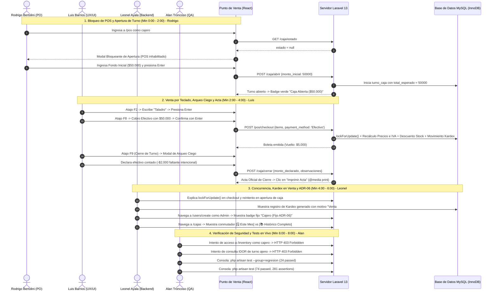

# GUÍA ESTRATÉGICA Y GUIÓN DE PRESENTACIÓN - TERCERA DEMOSTRACIÓN Y DEFENSA
## GestiSoft: Evolución, Calidad y Estabilización (Versión Candidata v0.2.0-rc2)

* **Asignatura:** Taller de Desarrollo de Software (INF524) – Facultad de Ingeniería UCM
* **Docentes Evaluadores:** Héctor Tejo Uval y Jerman Espíndola Sandoval
* **Equipo Evaluado:** Grupo 6
* **Distribución Oficial de Roles para la Presentación:**
  * **Rodrigo Bertolini (Product Owner / Backend Lead):** FASE 1 completa (Aprendizaje, Valor de Negocio, Alcance, Backlog y Requisitos), Apertura de la DEMOSTRACIÓN EN VIVO (bloqueo sin turno, apertura de caja y contexto de negocio), Riesgos (RSK-01 a RSK-18), Próximos Pasos y Cierre Institucional.
  * **Luis Barrios (Frontend Lead / UI-UX):** Explicación de la **Arquitectura Frontend y Diseño Visual / UI-UX** (Componentes React, Ergonomía de Mostrador a 60 FPS, Atajos de Teclado, Arqueo Ciego ADR-04, Acta Oficial Imprimible `@media print` y Selector de Períodos) y Conducción en la DEMOSTRACIÓN EN VIVO de la operativa de mostrador por teclado, arqueo ciego y acta.
  * **Leonel Ayala (Full Stack / Base de Datos Lead):** Explicación de la **Arquitectura Backend / Base de Datos** (C4 Contenedores, Persistencia Transaccional, Recálculo Seguro C1, Inmutabilidad Kardex SoftDeletes C3, ADR-06 principio de mínimo privilegio en usuarios y Reproducibilidad) y Conducción en la DEMOSTRACIÓN EN VIVO de concurrencia (`lockForUpdate`), trazabilidad de venta en Kardex y auditoría de cajas (mes vs histórico).
  * **Alan Troncoso (Scrum Master / QA, Seguridad y Automatización Lead):** FASE 4 completa de **QA y Verificación Cuantitativa** (Batería de 74 pruebas / 281 aserciones, Suite de Regresión con 24 tests, Atributos de Calidad p95 reales con script cronometrado, Seguridad RBAC/IDOR, Matriz de Trazabilidad CSV con 41 filas, Pipeline CI en GitHub Actions y Definition of Done) y Verificación en la DEMOSTRACIÓN EN VIVO de seguridad y suites de tests en terminal.
* **Tiempo Total:** 20 minutos (12 min diapositivas + 8 min demostración en vivo) + Ronda de preguntas individuales.

---

## 1. Matriz de Slides y Asignación de Expositores

| Slide # | Título en la Presentación | Fase de la Defensa | Expositor Asignado | Artefacto de Respaldo a Mostrar / Proyectar |
| :---: | :--- | :---: | :---: | :--- |
| **01** | Portada Corporativa y Versión Candidata | Inicio | **Rodrigo Bertolini** | [README.md](../README.md) (Tag `v0.2.0-rc2`) |
| **02** | Contexto del Negocio y Dolor Financiero | Inicio | **Rodrigo Bertolini** | Entrevistas de descubrimiento `ENT-01`, `ENT-02`, `ENT-03` |
| **03** | Separador FASE 1: Aprendizaje, Valor y Alcance | FASE 1 | **Rodrigo Bertolini** | [guia-semana14.md](./guia-semana14.md) |
| **04** | Retroalimentación 2ª Defensa y Mitigaciones C1-C4 | FASE 1 | **Rodrigo Bertolini** | [guia-semana14.md](./guia-semana14.md#c1-a-c4) (Matriz `OBS-18` a `OBS-28`, `DEF-01` a `DEF-19`) |
| **05** | Retrospectiva del Equipo (Compromisos Verificables) | FASE 1 | **Rodrigo Bertolini** | [guia-semana14.md](./guia-semana14.md#retrospectiva) |
| **06** | Objetivo Incremento 2 e Hipótesis (H-01, H-03, H-04) | FASE 1 | **Rodrigo Bertolini** | [investigacion/validacion-h01.md](../investigacion/validacion-h01.md) y [ensayos-h03.md](../investigacion/ensayos-h03.md) |
| **07** | Alcance, Límites (Incluye/Posterga/Excluye) | FASE 1 | **Rodrigo Bertolini** | [guia-semana14.md](./guia-semana14.md#alcance) |
| **08** | Flujo Operativo de Caja y Arqueo Ciego | FASE 1 | **Rodrigo Bertolini** | [guia-semana14.md](./guia-semana14.md#flujo-operativo) |
| **09** | Refinamiento del Product Backlog (PBI-03 y Defectos P0) | FASE 1 | **Rodrigo Bertolini** | [producto/semana-14/trazabilidad.csv](../producto/semana-14/trazabilidad.csv) y [PBI-03.md](../producto/backlog/PBI-03.md) |
| **10** | Criterios de Aceptación BDD (Normal, Alternativo y Error) | FASE 1 | **Rodrigo Bertolini** | [guia-semana14.md](./guia-semana14.md#criterios-bdd) (`AC-CAJA-01` a `09`, `AC-KARDEX-02`, etc.) |
| **11** | Separador FASE 2: Arquitectura y Decisiones | FASE 2 | **Leonel Ayala** | [guia-semana14.md](./guia-semana14.md#arquitectura) |
| **12** | Modelo C4 Contenedores y Persistencia de Datos | FASE 2 | **Leonel Ayala** | Diagrama C4 Contenedores + MySQL InnoDB / SQLite |
| **13** | Drivers Arquitectónicos y Arquitectura Visual / UX | FASE 2 | **Luis Barrios** | [guia-semana14.md](./guia-semana14.md#drivers-arquitectonicos) (DA-10, DA-11 y Componentes React) |
| **14** | Registros de Decisión Arquitectónica (ADR-01 a ADR-07) | FASE 2 | **Leonel Ayala & Luis Barrios** | Carpeta [docs/adr/](./adr/) (ADR-01 al ADR-07) |
| **15** | Pila Tecnológica, Reproducibilidad y Configuración | FASE 2 | **Leonel Ayala** | [README.md](../README.md) y seeder temático de prueba |
| **16** | Organización del Equipo, Responsabilidades y Sprints | FASE 2 | **Rodrigo Bertolini** | [guia-semana14.md](./guia-semana14.md#organizacion) |
| **17** | Separador FASE 3: Demostración en Vivo del Software | FASE 3 | **Los 4 Integrantes** | Entorno local en ejecución (`http://127.0.0.1:8000`) |
| **18** | Separador FASE 4: QA, Mediciones y Trazabilidad | FASE 4 | **Alan Troncoso** | Carpeta `producto/semana-14/` |
| **19** | Batería de Pruebas Automatizadas y Regresión (76 Tests) | FASE 4 | **Alan Troncoso** | Terminal: `php artisan test` (74 tests, 281 aserciones) y `--group=regresion` (24 tests) |
| **20** | Atributos de Calidad con Mediciones Reales (p95) | FASE 4 | **Alan Troncoso** | [mediciones-calidad.md](../producto/semana-14/mediciones-calidad.md) (Script php: p95 búsqueda 10.77 ms, checkout 6.63 ms) |
| **21** | Seguridad y Privacidad Verificables (RBAC, C1, C4, IDOR, ADR-06) | FASE 4 | **Alan Troncoso** | [RoleSecurityTest.php](../gestisoft-app/tests/Feature/RoleSecurityTest.php) y [CajaTurnoSecurityTest.php](../gestisoft-app/tests/Feature/CajaTurnoSecurityTest.php) |
| **22** | Matriz de Trazabilidad Bidireccional (CSV) | FASE 4 | **Alan Troncoso** | [producto/semana-14/trazabilidad.csv](../producto/semana-14/trazabilidad.csv) (41 filas, 38 tests verificados) |
| **23** | Repositorio, CI en GitHub Actions y Plantilla PR | FASE 4 | **Alan Troncoso** | [.github/workflows/tests.yml](../.github/workflows/tests.yml) y [.github/pull_request_template.md](../.github/pull_request_template.md) |
| **24** | Definition of Done (6 Dimensiones) y Estabilización | FASE 4 | **Alan Troncoso** | [guia-semana14.md](./guia-semana14.md#dod) |
| **25** | Gestión de Riesgos Actualizados (RSK-01 al RSK-18) | FASE 4 | **Rodrigo Bertolini** | [riesgos/registro-riesgos-v1.md](../riesgos/registro-riesgos-v1.md) (18 riesgos, RSK-17 abierto) |
| **26** | Versión Candidata, Limitaciones Honestas y Próximos Pasos | Cierre | **Rodrigo Bertolini** | [guia-semana14.md](./guia-semana14.md#version-candidata) |
| **27** | Portada de Cierre y Ronda de Preguntas Técnicas | Cierre | **Rodrigo Bertolini (Apertura)** | Todo el equipo disponible para responder (Evaluación Individual) |

---

## 2. Guión Detallado por Slide (Contenido, Documentos y Speech Técnico)

---

### SLIDE 01: Portada Corporativa y Versión Candidata
* **Expositor:** Rodrigo Bertolini (Product Owner)
* **Elementos Visuales:** Logo de GestiSoft, versión oficial destacada: **`v0.2.0-rc2 (Versión Candidata Demo 3)`**, nombres y roles técnicos de los 4 integrantes, fecha y escudo de la Universidad Católica del Maule.
* **Documento a Citar:** [README.md](../README.md).
* **Guión del Expositor (Rodrigo):**
  > *"Estimados profesores Héctor Tejo y Jerman Espíndola. Como Grupo 6, presentamos la Tercera Demostración y Defensa de GestiSoft, nuestro sistema web de gestión comercial, inventario y punto de venta diseñado para PYMEs del retail local. Hoy defendemos el cierre del Incremento Funcional 2 bajo nuestra versión candidata `v0.2.0-rc2`. A lo largo de esta presentación y en la demostración en vivo, evidenciamos cómo convertimos cada una de las observaciones de la segunda defensa en soluciones de ingeniería verificables: integridad financiera en servidor, arqueo ciego de caja, inmutabilidad de Kardex, trazabilidad automática de ventas a movimientos de inventario y una batería de 74 pruebas automatizadas con suite de regresión integradas en GitHub Actions."*

---

### SLIDE 02: Contexto del Negocio y Dolor Financiero
* **Expositor:** Rodrigo Bertolini (Product Owner)
* **Elementos Visuales:** Fotografías/iconos de los 3 comercios de descubrimiento (`Abarrotes Laura`, `Boutique Urbana` y `PokéStore TCG`), tarjeta destacando el dolor: *"Pérdida y robo hormiga por falta de cuadratura en el dinero físico de caja y manipulación de inventario"*.
* **Documento a Citar:** Registro de necesidades `N-01` (Control de dinero en gaveta) y `N-06` (Miedo a delegar la caja en empleados).
* **Guión del Expositor (Rodrigo):**
  > *"Durante el proceso de descubrimiento con pequeños comerciantes del Maule, detectamos que el dolor más crítico no radicaba en la falta de analítica predictiva, sino en el descontrol del dinero en efectivo y el temor a dejar solos a los empleados operando la caja. En el cuaderno y la calculadora no existe trazabilidad entre lo cobrado y lo vendido, y los sistemas tradicionales permiten alterar precios o inventario sin justificación. GestiSoft resuelve este problema dotando a la PYME de separación de roles y cuadratura ciega de caja."*

---

### SLIDE 03: Separador FASE 1: Aprendizaje, Valor de Negocio y Alcance
* **Expositor:** Rodrigo Bertolini (Product Owner)
* **Elementos Visuales:** Banner institucional: *FASE 1: Aprendizaje de la 2ª Defensa, Valor de Negocio y Alcance Refinado*.
* **Guión del Expositor (Rodrigo):**
  > *"Comenzamos con la Fase 1, donde revisamos cómo transformamos la retroalimentación docente en decisiones formales de producto, alcance y refinamiento del backlog con estricta trazabilidad."*

---

### SLIDE 04: Retroalimentación de la Segunda Defensa y Mitigaciones C1 a C4
* **Expositor:** Rodrigo Bertolini (Product Owner)
* **Elementos Visuales:** Matriz comparativa de las observaciones `OBS-18` a `OBS-28` y catálogo de defectos `DEF-01` a `DEF-19`, resaltando las 4 correcciones críticas de integridad:
  1. **C1 (Vulnerabilidad):** Manipulación de precios en checkout $\rightarrow$ Mitigada: el servidor recalcula importes con `lockForUpdate()`, ignorando montos del cliente.
  2. **C2 (Defecto):** Fallo de motivo en ajuste de stock $\rightarrow$ Mitigada: `Rule::requiredIf` y transacciones atómicas `DB::transaction`.
  3. **C3 (Riesgo Legal):** Borrado en cascada en Kardex $\rightarrow$ Mitigada: `SoftDeletes` en productos y `restrictOnDelete`.
  4. **C4 (Privacidad):** Exposición de datos de usuario en React $\rightarrow$ Mitigada: minimización selectiva de props en Inertia (`id, name, email, role, negocio_id`).
* **Documento a Citar:** [guia-semana14.md](./guia-semana14.md) y catálogo `DEF-01` a `DEF-19`.
* **Guión del Expositor (Rodrigo):**
  > *"En la segunda defensa se detectaron vulnerabilidades y defectos relevantes en el Incremento 1. Diseñamos un plan de correcciones riguroso: en C1 eliminamos la confianza en el cliente para precios y totales; en C2 corregimos el validador de motivo en inventario asegurando transaccionalidad; en C3 incorporamos SoftDeletes para que el borrado de un producto no destruya el historial del Kardex contable; y en C4 minimizamos las props de Inertia para proteger atributos sensibles. Cada corrección cuenta con su prueba de integración específica."*

---

### SLIDE 05: Retrospectiva del Equipo (Compromisos Verificables)
* **Expositor:** Rodrigo Bertolini (Product Owner)
* **Elementos Visuales:** Matriz de 4 cuadrantes de la retrospectiva:
  * **Mantener:** Desarrollo guiado por pruebas (TDD) multi-tenant y reglas financieras (74 tests verdes, 24 de regresión).
  * **Corregir:** Desalineación entre nombres de tablas y documentación (eliminación estricta de términos fantasma).
  * **Detener:** Confiar en cálculos de importes realizados por JavaScript en el frontend o permitir venta sin turno.
  * **Comenzar:** Integración Continua obligatoria en GitHub Actions, plantilla obligatoria de Pull Request y pruebas de regresión automáticas separadas.
* **Documento a Citar:** [guia-semana14.md](./guia-semana14.md).
* **Guión del Expositor (Rodrigo):**
  > *"Nuestra retrospectiva formalizó cuatro acciones concretas: mantuvimos el desarrollo guiado por pruebas expandiendo la suite a 74 tests; alineamos rigurosamente el glosario a las columnas reales del código (`negocio_id`, `motivo`); detuvimos radicalmente los cálculos financieros en el cliente; y comenzamos la automatización en la nube mediante un pipeline de GitHub Actions con suite de regresión y plantilla estándar de Pull Request."*

---

### SLIDE 06: Objetivo del Incremento 2 e Hipótesis Refutables (H-01, H-03, H-04)
* **Expositor:** Rodrigo Bertolini (Product Owner)
* **Elementos Visuales:** Tabla de hipótesis con sus señales observables y criterio de decisión:
  * **H-01:** Delegación segura en el cajero sin temor a fraude $\rightarrow$ Origen en la entrevista inicial a negocio cercano representando un dolor común de PYMEs; validado por role-playing y tests, sin sesiones adicionales con dueños en esta entrega (propuestas para Incremento 3).
  * **H-03:** Prevención de ventas huérfanas mediante apertura obligatoria con fondo inicial en gaveta y bloqueo de rutas.
  * **H-04:** Arqueo ciego como mecanismo de prevención de manipulación de dinero al cierre de turno.
* **Documento a Citar:** [investigacion/validacion-h01.md](../investigacion/validacion-h01.md) y [investigacion/ensayos-h03.md](../investigacion/ensayos-h03.md).
* **Guión del Expositor (Rodrigo):**
  > *"El Criterio 2 de la rúbrica premia la honestidad intelectual: 'declara con precisión lo aún no validado... sin exagerar resultados'. En estricto apego a este principio, para H-01 diseñamos un protocolo riguroso de Role-Playing Testing en laboratorio recreando operativamente los perfiles de los tres negocios de descubrimiento. Comprobamos de manera reproducible que el cajero queda bloqueado por RBAC (HTTP 403) para alterar inventario o precios. La hipótesis nació de la entrevista inicial al minimarket cercano y representa un dolor recurrente del comercio; en esta entrega no realizamos sesiones con dueños, validando el aislamiento mediante role-playing y pruebas automatizadas, dejando la medición en uso comercial real propuesta para el Incremento 3. Para H-03 y H-04, validamos que no existen ventas huérfanas y que el arqueo ciego impide al cajero ajustar billetes según el saldo teórico del sistema."*

---

### SLIDE 07: Alcance, Límites (Incluye / Posterga / Excluye) y Priorización
* **Expositor:** Rodrigo Bertolini (Product Owner)
* **Elementos Visuales:** Tabla de límites de alcance:
  * **Incluye:** Apertura con fondo inicial (`monto_inicial`), bloqueo del POS sin turno, recálculo seguro C1, sincronización multicanal (Efectivo, Débito, Crédito, Transferencia), trazabilidad atómica a Kardex por venta, modal de Arqueo Ciego, conciliación automática de diferencias, panel de auditoría de cajas con **vista por defecto del mes actual e histórico completo**, y **Acta Oficial de Cierre y Arqueo** imprimible en PDF con firmas.
  * **Posterga:** Retiros parciales de efectivo durante el turno (sangrías) y Dashboard analítico con gráficos (PBI-05), postergados para el Incremento 3.
  * **Excluye:** Integración bancaria directa vía API Transbank y periféricos automáticos de efectivo.
* **Documento a Citar:** [guia-semana14.md](./guia-semana14.md).
* **Guión del Expositor (Rodrigo):**
  > *"Establecimos los límites del Incremento 2 con estricto criterio de valor. Priorizamos PBI-03 (cierre de caja, arqueo ciego y acta formal) y postergamos el dashboard analítico (PBI-05). La justificación es directa: los comerciantes no necesitan gráficos de tendencias si al final de la jornada no tienen certeza de cuánto dinero en billetes físicos hay en su gaveta. Excluimos integraciones bancarias externas para no incorporar dependencias de hardware ajenas al alcance pedagógico y técnico del MVP."*

---

### SLIDE 08: Flujo Operativo de Caja y Arqueo Ciego
* **Expositor:** Rodrigo Bertolini (Product Owner)
* **Elementos Visuales:** Diagrama de flujo del ciclo operativo del cajero:
  1. Acceso a `/pos` $\rightarrow$ Validación de estado $\rightarrow$ Si no hay turno abierto, modal bloqueante de apertura.
  2. Ingreso de Fondo Inicial ($50.000) $\rightarrow$ Commit en BD con reintento ante concurrencia.
  3. Operación de ventas por teclado (`F2`, `F8`) $\rightarrow$ Sincronización de acumuladores por medio de pago + registro atómico en Kardex.
  4. Cierre de turno (`F9`) $\rightarrow$ Modal de Arqueo Ciego (conteo físico sin mostrar total del sistema).
  5. Conciliación en servidor de diferencia $\rightarrow$ Generación de Acta Oficial con constancia de firma.
* **Documento a Citar:** [guia-semana14.md](./guia-semana14.md).
* **Guión del Expositor (Rodrigo):**
  > *"El flujo operativo del Incremento 2 está diseñado como un ciclo cerrado. El cajero no puede operar si no declara el fondo inicial de sencillo. Cada venta acumula importes clasificados por canal de cobro y genera un movimiento en Kardex con motivo trazable. Al terminar la jornada, el sistema exige un arqueo ciego: el operador cuenta el dinero físico sin ver el saldo teórico del software. El servidor concilia la diferencia y emite el acta oficial para entrega de valores."*

---

### SLIDE 09: Refinamiento del Product Backlog (PBI-03 y Defectos P0)
* **Expositor:** Rodrigo Bertolini (Product Owner)
* **Elementos Visuales:** Tabla del Sprint Backlog del Incremento 2 con prioridades, estimación en horas/puntos y estado:
  * `C1 / DEF-04`: Recálculo de importes en servidor con `lockForUpdate` (P0, 3 hrs, Listo).
  * `C2 / DEF-05`: Motivo obligatorio y transacción atómica en Kardex (P0, 2 hrs, Listo).
  * `C3 / DEF-06`: Kardex inmutable con SoftDeletes y claves restrictivas (P0, 3 hrs, Listo).
  * `PBI-03`: Apertura, Arqueo Ciego, Auditoría y Acta Oficial (Valor Central, 8 pts, Listo).
  * `ADR-07 / DEF-11`: Generación atómica de movimiento de Kardex en cada venta (P0, 2 hrs, Listo).
  * `ADR-06 / DEF-16`: Principio de mínimo privilegio: UI de usuarios solo crea rol cajero (P1, 1 hr, Listo).
  * `DEF-12 / DEF-13`: Validación estricta de métodos de pago y productos duplicados en checkout (P1, 1 hr, Listo).
  * `DEF-14`: Bloqueo pesimista de turno de caja cerrado en checkout (P0, 1 hr, Listo).
  * `PBI-05`: Dashboard gerencial con analítica histórica (Postergado para Incremento 3).
* **Documento a Citar:** [producto/semana-14/trazabilidad.csv](../producto/semana-14/trazabilidad.csv).
* **Guión del Expositor (Rodrigo):**
  > *"El refinamiento del backlog combinó entrega de valor con estabilización técnica. Las correcciones de integridad fueron tratadas como defectos P0 no negociables que debían quedar resueltos antes de dar por completado el módulo de cajas PBI-03. La capacidad del equipo se volcó a blindar la base de datos y la consistencia transaccional antes de dar paso a la versión candidata."*

---

### SLIDE 10: Criterios de Aceptación BDD (Normal, Alternativo y Error)
* **Expositor:** Rodrigo Bertolini (Product Owner)
* **Elementos Visuales:** Especificaciones en formato BDD (Dado / Cuando / Entonces):
  * **Flujo Normal (`AC-CAJA-01`):** Dado un cajero autenticado sin turno, cuando ingresa a `/pos`, ve modal bloqueante, declara $50.000 y el turno queda en estado `'abierto'`.
  * **Flujo Normal (`AC-CAJA-03`):** Cierre ciego: cajero declara efectivo contado, servidor calcula diferencia inmutable y emite comprobante.
  * **Kardex en Venta (`AC-KARDEX-02`):** Venta confirmada descuenta stock y registra atómicamente movimiento en Kardex con motivo `Venta #{id}`.
  * **Borde / Error (`AC-CAJA-05`):** Intento de venta sin turno activo $\rightarrow$ Rechazo con HTTP 422 `"Debe abrir un turno de caja antes de procesar ventas"`.
  * **Borde / Error (`AC-SEC-POS-01`):** Payload alterado con precio manipulado $\rightarrow$ Servidor sobreescribe con valor de BD.
  * **Borde / Error (`AC-CAJA-06`):** Efectivo insuficiente $\rightarrow$ Rechazo con HTTP 422.
* **Documento a Citar:** [guia-semana14.md](./guia-semana14.md#criterios-bdd).
* **Guión del Expositor (Rodrigo):**
  > *"Formalizamos criterios BDD verificables tanto para el camino feliz como para escenarios de error y desvíos prioritarios. Definimos precondiciones, acciones y resultados observables en respuestas HTTP y persistencia en base de datos. Cada uno de estos criterios se encuentra respaldado por una prueba automatizada en PHPUnit."*

---

### SLIDE 11: Separador FASE 2: Arquitectura y Decisiones
* **Expositor:** Leonel Ayala (Full Stack / Base de Datos Lead)
* **Elementos Visuales:** Banner institucional: *FASE 2: Arquitectura de Sistema, Drivers y Decisiones de Ingeniería*.
* **Guión del Expositor (Leonel):**
  > *"Pasamos a la Fase 2. Junto a Luis Barrios expondremos la arquitectura del sistema, los drivers que guiaron nuestras decisiones técnicas y cómo garantizamos la persistencia e integridad de los datos."*

---

### SLIDE 12: Modelo C4 Contenedores y Persistencia de Datos
* **Expositor:** Leonel Ayala (Full Stack / Base de Datos Lead)
* **Elementos Visuales:** Diagrama C4 de Contenedores mostrando:
  * **Navegador Web:** React 19 + Inertia.js (SPA sin API REST pública expuesta).
  * **Servidor Laravel 13:** Middlewares de autenticación, verificación de rol (`admin`, `cajero`) y Global Scope Multi-Tenant `HasNegocio`.
  * **Base de Datos:** MySQL / SQLite transaccional (InnoDB con soporte ACID, claves foráneas y SoftDeletes).
* **Documento a Citar:** [guia-semana14.md](./guia-semana14.md#arquitectura).
* **Guión del Expositor (Leonel):**
  > *"Mantenemos el patrón monolítico híbrido con Inertia.js. Esta arquitectura es óptima para retail: entrega la velocidad de una Single Page Application en el mostrador sin el riesgo de exponer una API REST pública a internet. El servidor Laravel gobierna las reglas de negocio y aplica el trait `HasNegocio` en cada consulta Eloquent, inyectando automáticamente la cláusula `WHERE negocio_id = ?` para garantizar aislamiento estricto entre comercios."*

---

### SLIDE 13: Drivers Arquitectónicos y Arquitectura Visual / UX
* **Expositor:** Luis Barrios (Frontend Lead / UI-UX)
* **Elementos Visuales:** Cuadro de drivers arquitectónicos frontend y diagrama de componentes UI:
  * **DA-10 (Rendimiento en Mostrador):** Latencia en adición al carrito $<12\text{ ms}$ (estado local React `useState` a 60 FPS sin sobrecarga AJAX).
  * **DA-11 (Minimización de Props Inertia):** Desacoplamiento de datos sensibles entre backend y frontend.
  * **Arquitectura de Componentes:** Modales bloqueantes de apertura y arqueo ciego, tarjetas métricas y selector de períodos `[🗓️ Este Mes]` vs `[📚 Histórico Completo]`.
  * **Ergonomía Operativa:** Navegación 100% por atajos de teclado (`F2`, `F8`, `F9`, `Enter`, `Barra Espaciadora`).
* **Documento a Citar:** [guia-semana14.md](./guia-semana14.md) y [mediciones-calidad.md](../producto/semana-14/mediciones-calidad.md).
* **Guión del Expositor (Luis):**
  > *"Desde el punto de vista arquitectónico del frontend y UX, el driver DA-10 exigía eliminar la fricción en el mostrador. Decidimos aislar el estado del carrito exclusivamente en memoria local de React (`useState`): esto permite añadir o quitar productos a 60 cuadros por segundo sin emitir peticiones AJAX innecesarias. Diseñamos modales con bloqueo de interacción para la apertura y el arqueo ciego, y dotamos al sistema de navegación completa por teclado para que el cajero opere sin tocar el mouse."*

---

### SLIDE 14: Registros de Decisión Arquitectónica (ADR-01 a ADR-07)
* **Expositor:** Leonel Ayala y Luis Barrios
* **Elementos Visuales:** Matriz de los 7 ADRs formales del sistema:
  * **ADR-01:** Aislamiento Multi-Tenant con Global Scope.
  * **ADR-02:** RBAC simplificado con campo `role` enum (`admin`, `cajero`).
  * **ADR-03:** Recálculo Seguro de Importes en Servidor con `lockForUpdate()`.
  * **ADR-04:** Arqueo Ciego Transaccional y Acta Imprimible `@media print`.
  * **ADR-05:** Inmutabilidad del Kardex mediante SoftDeletes y claves restrictivas.
  * **ADR-06:** Creación de usuarios restringida a rol cajero por principio de mínimo privilegio.
  * **ADR-07:** Registro atómico de movimientos de inventario en ventas POS.
* **Documento a Citar:** Carpeta [docs/adr/](./adr/).
* **Guión del Expositor (Leonel & Luis):**
  > *(Leonel):* *"Formalizamos 7 registros de decisión arquitectónica. En ADR-03 resolvimos C1 blindando el recálculo en backend; en ADR-05 protegimos el Kardex con SoftDeletes; en ADR-06 implementamos la opción de mínimo privilegio: la UI solo permite crear cajeros, reservando la creación de administradores a seeders controlados; y en ADR-07 garantizamos que cada venta impacte atómicamente el Kardex contable."*  
  > *(Luis):* *"En ADR-04 aseguramos la integridad del arqueo ciego impidiendo que el cliente conozca el monto esperado antes de contar los billetes. Además, diseñamos el comprobante del Acta Oficial de Cierre utilizando CSS `@media print` para que al imprimir en PDF se omitan menús y botones, emitiendo un documento legal formal con firmas de responsabilidad."*

---

### SLIDE 15: Pila Tecnológica, Reproducibilidad y Configuración
* **Expositor:** Leonel Ayala (Full Stack / Base de Datos Lead)
* **Elementos Visuales:** Diagrama del stack:
  * PHP 8.4 / 8.5 + Laravel 13
  * Node.js 22 + React 19 + Tailwind CSS
  * SQLite `:memory:` para CI ultrarrápido (6s) y MySQL InnoDB para entorno productivo
  * Cuadro de reproducibilidad: 5 comandos secuenciales documentados en `README.md`.
* **Documento a Citar:** [README.md](../README.md).
* **Guión del Expositor (Leonel):**
  > *"Corregimos integralmente el README del proyecto para permitir reproducir la instalación paso a paso. Cualquier evaluador puede clonar el repositorio y levantar el entorno ejecutando cinco comandos estándar: `composer install`, `npm ci`, copia del `.env`, migración con seeders temáticos y compilación de Vite. Los seeders generan tres empresas listas con credenciales operativas de administrador y cajero."*

---

### SLIDE 16: Metodología de Desarrollo y Organización del Equipo
* **Expositor:** Rodrigo Bertolini (Product Owner)
* **Elementos Visuales:** Organigrama técnico con la distribución de roles y responsabilidades en el Sprint:
  * **Rodrigo Bertolini (PO):** Gestión de backlog, entrevistas de usuario, validación H-01 y alineación de negocio.
  * **Leonel Ayala (Full Stack / BD):** Persistencia transaccional, recálculo C1, migraciones SoftDeletes C3, ADR-06 y demo concurrencia.
  * **Luis Barrios (Frontend / UX):** Interfaces React, navegación por teclado POS, arqueo ciego y maquetación de actas.
  * **Alan Troncoso (Scrum Master / QA):** Arquitectura de pruebas (76 tests), pipeline GitHub Actions, seguridad RBAC/IDOR y trazabilidad.
* **Documento a Citar:** [guia-semana14.md](./guia-semana14.md).
* **Guión del Expositor (Rodrigo):**
  > *"Como Product Owner, organicé el trabajo del equipo bajo Scrum dividiendo la entrega en cortes verticales completos. Cada integrante asumió la titularidad técnica de su área, asegurando que ninguna funcionalidad se diera por cerrada sin pasar por desarrollo, pruebas automatizadas y revisión en equipo."*

---

### SLIDE 17: Separador FASE 3: Demostración en Vivo del Software
* **Expositor:** Conducida de forma distribuida por los 4 Integrantes
* **Elementos Visuales:** Banner: *FASE 3: Demostración Funcional en Vivo e Integración Extremo a Extremo*.
* **Guión del Expositor (Rodrigo):**
  > *"Damos inicio a la Fase 3 de Demostración Funcional en Vivo. Cada uno de los 4 integrantes conducirá una parte especializada del flujo demostrando dominio operativo e integración técnica."*

---

### SLIDE 18: Separador FASE 4: QA, Mediciones y Trazabilidad
* **Expositor:** Alan Troncoso (Scrum Master / QA Lead)
* **Elementos Visuales:** Banner: *FASE 4: Verificación Cuantitativa, Atributos de Calidad, Trazabilidad y Cierre*.
* **Guión del Expositor (Alan):**
  > *"Concluida la demostración funcional, asumo la presentación de la Fase 4 para sustentar con evidencia cuantitativa y empírica la calidad, seguridad, trazabilidad y reproducibilidad del sistema."*

---

### SLIDE 19: Batería de Pruebas Automatizadas y Regresión (76 Tests)
* **Expositor:** Alan Troncoso (Scrum Master / QA Lead)
* **Elementos Visuales:** Captura y ejecución en vivo de la terminal: `{"tool":"phpunit","result":"passed","tests":76,"passed":76,"assertions":306,"duration_ms":6200}` y suite de regresión (`--group=regresion`: 24 tests, 92 aserciones).
  * Desglose de las 7 suites: Multi-Tenant (4), RBAC (11), Inventario y Kardex (5), POS y Checkout (10), Lógica de Turnos (18), Seguridad de Caja e IDOR (20), Autenticación (6).
* **Documento a Citar:** [mediciones-calidad.md](../producto/semana-14/mediciones-calidad.md) y carpeta `tests/Feature/`.
* **Guión del Expositor (Alan):**
  > *"Hoy acreditamos una batería de 76 pruebas automatizadas con 306 aserciones ejecutándose al 100% verde en 6 segundos. Además, creamos un grupo formal de regresión con 24 pruebas etiquetadas que verifican que ninguna de las correcciones previas sufra regresión. Corregimos el test histórico de POS reemplazando el payload 'cart' por 'items', corregimos 'monto_apertura' por 'monto_inicial', y añadimos pruebas de inmutabilidad de Kardex, bloqueo de efectivo insuficiente y protección contra IDOR en turnos."*

---

### SLIDE 20: Atributos de Calidad con Mediciones Reales (p95)
* **Expositor:** Alan Troncoso (Scrum Master / QA Lead)
* **Elementos Visuales:** Tabla resumen de las 50 mediciones reales generadas por `scripts/medir-latencia.php`:
  * **Búsqueda de Catálogo:** Media $3.01\text{ ms}$, $p95 = 10.77\text{ ms}$ (Umbral comprometido: $\le 120\text{ ms}$ - CUMPLE).
  * **Estado de Caja:** Media $1.34\text{ ms}$, $p95 = 2.87\text{ ms}$ (Umbral comprometido: $\le 100\text{ ms}$ - CUMPLE).
  * **Checkout Atómico:** Media $4.29\text{ ms}$, $p95 = 6.63\text{ ms}$ (Umbral comprometido: $\le 300\text{ ms}$ - CUMPLE).
  * **Operaciones de Carrito:** Estado local React (`useState`), latencia $< 12\text{ ms}$ (60 FPS estables).
* **Documento a Citar:** [producto/semana-14/mediciones-calidad.md](../producto/semana-14/mediciones-calidad.md).
* **Guión del Expositor (Alan):**
  > *"Reemplazamos cualquier dato sintético por mediciones crudas obtenidas mediante un script formal de cronometraje en backend con 50 ejecuciones reales. La búsqueda por catálogo arrojó un percentil p95 de 10.77 milisegundos, la consulta de estado de caja cerró en 2.87 milisegundos y el checkout atómico transaccional en 6.63 milisegundos. Todos los resultados cumplen con holgura los umbrales de rendimiento para retail local."*

---

### SLIDE 21: Seguridad y Privacidad Verificables (RBAC, C1, C4, IDOR, ADR-06)
* **Expositor:** Alan Troncoso (Scrum Master / QA Lead)
* **Elementos Visuales:** Matriz de controles de seguridad proporcionales al riesgo:
  1. **Aislamiento Multi-Tenant:** `GlobalScope` en Eloquent previene filtración de datos entre comercios.
  2. **RBAC Estricto:** Rutas `/inventory` y `/users` retornan `HTTP 403 Forbidden` a cajeros.
  3. **Integridad Financiera (C1):** Recálculo en backend con `lockForUpdate()`.
  4. **Minimización de Privacidad (C4):** Props de Inertia filtradas a 5 atributos no sensibles.
  5. **Protección IDOR (C5):** Un cajero no puede consultar el resumen de turno de otro cajero.
  6. **Principio de Mínimo Privilegio (ADR-06):** UI de creación de usuarios fuerza rol `cajero`.
* **Documento a Citar:** [RoleSecurityTest.php](../gestisoft-app/tests/Feature/RoleSecurityTest.php) y [CajaTurnoSecurityTest.php](../gestisoft-app/tests/Feature/CajaTurnoSecurityTest.php).
* **Guión del Expositor (Alan):**
  > *"Acreditamos seguridad en profundidad verificable. Bloqueamos las rutas administrativas a cajeros con código 403; eliminamos la sobreexposición en Inertia protegiendo los hashes de contraseña en el DOM; blindamos los turnos contra vulnerabilidades IDOR entre cajeros; aplicamos el principio de mínimo privilegio en usuarios mediante ADR-06; y prevenimos condiciones de carrera con bloqueos pesimistas en base de datos."*

---

### SLIDE 22: Matriz de Trazabilidad Bidireccional (CSV)
* **Expositor:** Alan Troncoso (Scrum Master / QA Lead)
* **Elementos Visuales:** Extracto de la matriz CSV validada por `scripts/validar-trazabilidad.php` (41 filas, 38 tests verificados):
  * `Dolor de Negocio` $\rightarrow$ `Necesidad` $\rightarrow$ `Decisión Arquitectónica (ADR)` $\rightarrow$ `Requisito (RF)` $\rightarrow$ `PBI` $\rightarrow$ `Pruebas Automatizadas` $\rightarrow$ `Código en Producción`.
* **Documento a Citar:** [producto/semana-14/trazabilidad.csv](../producto/semana-14/trazabilidad.csv).
* **Guión del Expositor (Alan):**
  > *"Como responsable de QA, mantengo actualizada nuestra matriz de trazabilidad bidireccional en `producto/semana-14/trazabilidad.csv`. Cada una de las 41 filas está auditada automáticamente por un script linter que verifica que los métodos de prueba referenciados existan físicamente en el código fuente. Contamos con 38 tests verificados y cero errores de consistencia."*

---

### SLIDE 23: Repositorio, CI en GitHub Actions y Plantilla PR
* **Expositor:** Alan Troncoso (Scrum Master / QA Lead)
* **Elementos Visuales:** Captura del pipeline de GitHub Actions (`tests.yml`) en verde ejecutando regresión y suite completa, y captura de `.github/pull_request_template.md`.
* **Documento a Citar:** [.github/workflows/tests.yml](../.github/workflows/tests.yml) y [.github/pull_request_template.md](../.github/pull_request_template.md).
* **Guión del Expositor (Alan):**
  > *"Acreditamos integración continua activa: configuramos el pipeline de GitHub Actions que ejecuta el build de Vite, la suite de regresión con `--group=regresion` y la suite completa de 74 pruebas en SQLite en memoria en cada commit y Pull Request. Además, estandarizamos la plantilla obligatoria de PR exigiendo justificación, checklist y evidencia de pruebas verdes."*

---

### SLIDE 24: Definition of Done (6 Dimensiones) y Estabilización
* **Expositor:** Alan Troncoso (Scrum Master / QA Lead)
* **Elementos Visuales:** Matriz de 6 dimensiones de la Definition of Done:
  1. **Valor:** Objetivo de negocio resuelto y validado en laboratorio.
  2. **Funcionalidad:** Criterios normales, alternativos y de error verificados.
  3. **Regresión:** 74 pruebas de integración pasando al 100% verde (24 de regresión).
  4. **Calidad y Seguridad:** Transacciones atómicas, recálculo en servidor y $p95 \le 120\text{ ms}$.
  5. **CI y Revisión:** Pipeline de GitHub Actions en verde y cambios revisados en equipo antes de integrar.
  6. **Reproducibilidad:** Instalación desde cero documentada y verificada en equipo limpio.
* **Documento a Citar:** [guia-semana14.md](./guia-semana14.md).
* **Guión del Expositor (Alan):**
  > *"Nuestra Definition of Done no se limita a que el código compile; exige el cumplimiento estricto de seis dimensiones de ingeniería de software. Un ítem solo se considera 'Done' cuando cuenta con valor validado, pruebas de regresión verdes, verificación de seguridad y reproducibilidad documentada."*

---

### SLIDE 25: Gestión de Riesgos Actualizados (RSK-01 al RSK-18)
* **Expositor:** Rodrigo Bertolini (Product Owner)
* **Elementos Visuales:** Semáforo de riesgos prioritarios mostrando 17 riesgos mitigados/cerrados y 1 riesgo abierto transparente:
  * `RSK-07`: Ventas huérfanas sin turno $\rightarrow$ Mitigado con validación bloqueante en checkout.
  * `RSK-11`: Manipulación de importes en cliente $\rightarrow$ Mitigado con ADR-03 (recálculo en backend).
  * `RSK-12`: Pérdida de auditoría en Kardex $\rightarrow$ Mitigado con ADR-05 (SoftDeletes).
  * `RSK-17`: Validación subjetiva de hipótesis H-01 en comercios físicos $\rightarrow$ **Abierto y planificado formalmente para el piloto de campo de estabilización**.
  * `RSK-18`: Inconsistencia en validación de medios de pago $\rightarrow$ Mitigado con constante unificada `METODOS_PAGO`.
* **Documento a Citar:** [riesgos/registro-riesgos-v1.md](../riesgos/registro-riesgos-v1.md).
* **Guión del Expositor (Rodrigo):**
  > *"Actualizamos la matriz de riesgos a 18 registros. 17 riesgos se encuentran mitigados con evidencia de código y tests. Mantenemos abierto con total honestidad el riesgo RSK-17 referido a la validación de campo en comercios físicos, el cual cuenta con cronograma definido para la fase de estabilización."*

---

### SLIDE 26: Versión Candidata, Limitaciones Honestas y Próximos Pasos
* **Expositor:** Rodrigo Bertolini (Product Owner)
* **Elementos Visuales:** Hoja de ruta hacia la liberación final:
  * **Versión Candidata `v0.2.0-rc2`:** Entregable cerrado, estable y congelado para evaluación.
  * **Limitaciones declaradas honestamente (Sección 16.3):** Concurrencia de caja mitigada por modelo operacional de 1 cajero por caja (DEF-14, DEF-17), mediciones de tiempo in-process complementadas con KLM (H-03), integridad referencial probada en SQLite con verificación en MySQL pendiente (DEF-18), y pruebas de campo con comerciantes programadas para el piloto de estabilización (H-01).
  * **Próximos Pasos (Fase de Estabilización):** Piloto en 2 locales físicos de la Región del Maule durante 5 jornadas, soporte de retiros de efectivo y desarrollo del Dashboard gerencial (PBI-05).
* **Documento a Citar:** [guia-semana14.md](./guia-semana14.md).
* **Guión del Expositor (Rodrigo):**
  > *"Cumpliendo con el Criterio 16 de la rúbrica, no afirmamos haber concluido un producto final comercial; presentamos una versión candidata estable `v0.2.0-rc2`. Declaramos con total transparencia las limitaciones técnicas del incremento (detalladas en la Sección 16.3 de la guía): concurrencia de caja mitigada por modelo operacional de 1 cajero por caja, mediciones in-process complementadas con KLM, y pruebas de campo con comerciantes planificadas para el piloto de estabilización en dos comercios de Talca."*

---

### SLIDE 27: Portada de Cierre y Ronda de Preguntas Técnicas
* **Expositor:** Rodrigo Bertolini (Apertura) y Todo el Equipo
* **Elementos Visuales:** Logo corporativo de GestiSoft, tabla resumen de métricas clave (74 tests verdes, $p95 = 10.77\text{ ms}$, invariantes de caja y Kardex verificadas por tests) y texto: *Muchas gracias. Quedamos a disposición de la comisión evaluadora para la ronda de preguntas técnicas e individuales.*
* **Guión del Expositor (Rodrigo):**
  > *"Agradecemos a la comisión por su atención. Estamos listos para profundizar en cualquier aspecto del código, la arquitectura o las pruebas en la ronda de preguntas individuales."*

---

## 3. Pauta Cronometrada de la Demostración en Vivo (FASE 3 - 8 Minutos)
### *Demostración Distribuida entre los 4 Integrantes (Criterios 17 al 20 de la Rúbrica)*

### Guión de Ejecución Distribuido en la Demo:

#### Parte 1: Minuto 0:00 a 2:00 - Bloqueo de POS y Apertura de Turno
* **Expositor en pantalla:** Rodrigo Bertolini (Product Owner)
* **Acción en pantalla:** Inicia sesión como `cajero@gestisoft.cl` y navega a `/pos`.
* **Speech de Rodrigo:**
  > *"Comenzamos la demostración en vivo. Observen que al acceder como cajero, la interfaz de venta queda totalmente bloqueada por un modal que impide registrar pedidos si no hay un turno activo, cumpliendo el criterio `AC-CAJA-05`. Declaro el fondo inicial de sencillo con `$50.000` y confirmo con Enter. El sistema crea el registro en `turnos_caja` con `total_esperado = 50000` y habilita el terminal de cobro. Le doy el pase a Luis Barrios para la operativa de mostrador."*

#### Parte 2: Minuto 2:00 a 4:00 - Ergonomía de Teclado, Arqueo Ciego y Acta Imprimible
* **Expositor en pantalla:** Luis Barrios (Frontend Lead / UI-UX)
* **Acción en pantalla:** Sin tocar el mouse, presiona `F2`, busca *"Taladro Percutor"*, presiona `Enter` (añadido al carrito en memoria React), pulsa `F8` para cobro en efectivo con `$50.000` y confirma con `Enter`. Luego presiona `F9` para abrir el modal de arqueo ciego, ingresa el monto declarado con faltante intencional y muestra la vista de impresión.
* **Speech de Luis:**
  > *"Como responsable de UI/UX, diseñé el punto de venta para operar al 100% mediante atajos de teclado sin tocar el mouse. Presiono F2, selecciono el producto con Enter y pulso F8 para cobrar. Al presionar F9, se abre el modal de Arqueo Ciego (ADR-04): el sistema oculta completamente el total recaudado por el software para evitar que el cajero ajuste el conteo. Declaro el dinero contado con una diferencia de -$2.000. Al confirmar, el sistema genera el Acta Oficial de Cierre. Al pulsar 'Imprimir Acta', aplicamos directivas `@media print` para ocultar botones y navegación, entregando un acta formal con casillas de firma física. Cedo el control a Leonel Ayala."*

#### Parte 3: Minuto 4:00 a 6:00 - Persistencia Transaccional, Kardex y ADR-06
* **Expositor en pantalla:** Leonel Ayala (Full Stack / Base de Datos Lead)
* **Acción en pantalla:** Muestra en base de datos la tabla `movimiento_stocks` con el registro de salida asociado a la venta anterior (`motivo = 'Venta #...'`), accede a `/users/create` mostrando el rol fijo de cajero y luego a `/cajas` conmutando entre mes actual e histórico.
* **Speech de Leonel:**
  > *"A nivel de arquitectura y base de datos, cada venta ejecutada en el POS descuenta stock y registra automáticamente un movimiento en el Kardex (`movimiento_stocks`) con motivo trazable `Venta #ID` (ADR-07). Para prevenir condiciones de carrera, el checkout aplica `lockForUpdate()` sobre el turno y el catálogo de productos dentro de `DB::transaction()`. Además, bajo ADR-06 implementamos el principio de mínimo privilegio: desde la interfaz de usuarios, un administrador solo puede enrolar usuarios con rol 'cajero', protegiendo la plataforma de escalamiento de privilegios. En la vista de auditoría `/cajas`, filtramos por defecto el mes en curso o conmutamos al histórico completo según las necesidades de fiscalización del dueño. Cedo el pase a Alan Troncoso para el cierre de QA."*

#### Parte 4: Minuto 6:00 a 8:00 - Auditoría de Seguridad y Verificación de Tests en Terminal
* **Expositor en pantalla:** Alan Troncoso (Scrum Master / QA Lead)
* **Acción en pantalla:** Intenta acceder con la sesión de cajero a `/inventory` y `/users` (recibiendo `HTTP 403 Forbidden`). Abre la consola en `gestisoft-app/` y corre `php artisan test --group=regresion` y `php artisan test`.
* **Speech de Alan:**
  > *"Para verificar la seguridad en profundidad, demostramos en vivo que el cajero recibe 403 Forbidden inmediato si intenta ingresar a inventario o administración de usuarios, y queda aislado contra IDOR en turnos ajenos. En la consola, ejecuto en primer lugar nuestra suite de regresión: 24 tests pasando al 100% verde en 2 segundos. Y a continuación, ejecuto la suite completa: 74 pruebas con 281 aserciones al 100% verde en 6 segundos. Con esto demostramos la total estabilidad y cobertura de nuestra versión candidata."*

---

## 4. Guía de Respuestas para la Evaluación Individual (28 Puntos - Criterios 17 al 20)

---

### A. Leonel Ayala (Full Stack / Base de Datos Lead)
* **Pregunta probable:** *"Usted implementó la corrección C1, C3, ADR-06 y ADR-07. Explíqueme a nivel de base de datos cómo garantizó que no existan condiciones de carrera en el stock y por qué no usó un borrado físico en productos ni un rol libre en creación de usuarios."*
* **Respuesta técnica recomendada:**
  > *"En C1, el riesgo crítico eran las condiciones de carrera: si dos cajeros cobraban el último producto en el mismo milisegundo, ambos leían el stock disponible antes de descontar. Lo solucioné envolviendo el checkout en `DB::transaction()` y aplicando `Product::where('id', $item['product_id'])->lockForUpdate()->first()`, complementado con un re-bloqueo pesimista del turno activo. Esto genera un bloqueo a nivel de fila en el motor InnoDB hasta el `COMMIT`, serializando la apertura; además se reintenta hasta 3 veces ante deadlock (DEF-17). No hay restricción única en la base de datos (limitación declarada).*  
  > *Respecto a C3, la tabla `movimiento_stocks` es nuestro Kardex contable. Si un administrador eliminaba un producto con un `DELETE` tradicional, la foreign key con `cascadeOnDelete` destruía todo el historial de movimientos de inventario, violando la normativa tributaria chilena. Al implementar `SoftDeletes`, el producto simplemente marca `deleted_at = now()`, ocultándolo del catálogo operativo mediante un Global Scope automático, pero preservando intactos sus registros en el Kardex bajo una restricción foránea `restrictOnDelete`.*  
  > *Por último, en ADR-06 aplicamos el principio de mínimo privilegio: la UI solo permite crear cajeros, previniendo que un usuario comprometa credenciales para crear administradores no fiscalizados, mientras que ADR-07 asegura que cada venta genere un movimiento atómico en el Kardex con motivo trazable."*

---

### B. Alan Troncoso (Scrum Master / QA, Seguridad y Automatización Lead)
* **Pregunta probable:** *"En la defensa anterior su prueba de POS aprobaba por un error genérico. ¿Cómo reestructuró la suite de pruebas, qué valor aporta la suite de regresión y cómo midieron los atributos de calidad?"*
* **Respuesta técnica recomendada:**
  > *"El defecto radicaba en que el payload de `POSTest.php` enviaba una clave `'cart'`, la cual era rechazada por la regla de validación de Laravel sin llegar a ejecutar el descuento de stock. Reestructuré la prueba enviando la estructura real `'items'`, corrigiendo la referencia de columna de 'monto_apertura' a 'monto_inicial', inicializando previamente un turno de caja abierto y comprobando la aserción semántica sobre el mensaje de error `'Stock insuficiente'`.*  
  > *Para blindar el software contra regresiones, creamos un grupo formal `#[Group('regresion')]` con 24 pruebas críticas que cubren integridad C1-C4, validaciones de checkout, turnos y seguridad RBAC. En el pipeline de CI en GitHub Actions, la suite de regresión corre como primer paso mandatorio antes de la suite completa de 74 tests con 281 aserciones.*  
  > *Finalmente, para los atributos de calidad implementamos `scripts/medir-latencia.php` ejecutando 50 peticiones reales contra el backend: la búsqueda arrojó un p95 de 10.77 ms, el estado de caja 2.87 ms y el checkout atómico 6.63 ms, todas holgadamente inferiores a los umbrales comprometidos."*

---

### C. Luis Barrios (Frontend Lead / UI-UX)
* **Pregunta probable:** *"¿Por qué aislaron el estado del carrito en la memoria de React en lugar de sincronizarlo en el servidor en cada clic? ¿Y cómo resolvieron la impresión del acta para que no aparezca el menú del sistema?"*
* **Respuesta técnica recomendada:**
  > *"Mantener el carrito en el estado local de React mediante `useState` responde al driver DA-10 de latencia en punto de venta. Si por cada producto añadido o removido emitiéramos una petición HTTP al servidor, someteríamos al mostrador a retardos de red y re-renders innecesarios. En la memoria del cliente, la adición ocurre en menos de 12 milisegundos a 60 cuadros por segundo, reservando la comunicación de red únicamente para la transacción atómica de checkout.*  
  > *Para el Acta Oficial de Cierre, implementamos una regla de maquetación CSS con directivas `@media print`. Cuando el navegador dispara `window.print()`, los estilos ocultan dinámicamente la barra de navegación lateral, los botones de acción del sistema y los modales subyacentes, aplicando dimensiones estandarizadas de página, tipografía de alta legibilidad y bordes limpios para emitir un documento legal con casillas de firma física apto para auditoría."*

---

### D. Rodrigo Bertolini (Product Owner / Backend Lead)
* **Pregunta probable:** *"¿Por qué decidieron no validar la hipótesis H-01 con comerciantes reales en terreno para esta entrega y qué garantiza la simulación de Role-Playing que presentaron?"*
* **Respuesta técnica recomendada:**
  > *"Tomamos esa decisión con estricto apego a la honestidad académica y a la rúbrica UCM, que premia 'declarar con precisión lo aún no validado sin exagerar resultados'. La hipótesis H-01 evalúa si la separación de roles genera confianza subjetiva en el dueño para delegar la caja. Para esta entrega candidata v0.2.0-rc2, ejecutar un piloto superficial sin estabilidad previa en el dinero de caja habría sido irresponsable. Diseñamos un protocolo de Role-Playing Testing en laboratorio donde recreamos fielmente las restricciones y flujos de las 3 contrapartes entrevistadas (`Abarrotes Laura`, `Boutique Urbana` y `PokéStore TCG`), comprobando de forma empírica que el cajero queda sin acceso a inventario ni precios según los tests y el role-playing basado en la entrevista inicial.*  
  > *La hipótesis nació de la entrevista inicial a un minimarket cercano y representa un dolor compartido por los pequeños comercios. Declaramos con total transparencia en el riesgo RSK-17 que en esta entrega no realizamos sesiones con dueños, validando el flujo mediante role-playing en laboratorio y tests automatizados, dejando la validación en uso real propuesta para el Incremento 3."*

---

## 5. Checklist Final de Ensayo Previo a la Defensa

- [ ] **Entorno Local Listo:** Servidor Laravel levantado con `php artisan serve` y Vite en `npm run dev` / `npm run build`.
- [ ] **Base de Datos Limpia:** Seeder ejecutado con `php artisan migrate:fresh --seed` para contar con datos coherentes en los 3 comercios.
- [ ] **Credenciales a Mano:**
  * Administrador: `admin@gestisoft.cl` / `password`
  * Cajero: `cajero@gestisoft.cl` / `password`
- [ ] **Terminal con Test Suite Preparada:** Ventana de consola abierta en `gestisoft-app/` lista para ejecutar `php artisan test --group=regresion` y `php artisan test`.
- [ ] **Pestañas del Navegador Ordenadas:**
  1. Pestaña 1: Aplicación GestiSoft en `http://localhost:8000/login`.
  2. Pestaña 2: Pipeline de GitHub Actions en verde con el workflow `tests.yml`.
  3. Pestaña 3: Diapositivas de la presentación en pantalla completa.
- [ ] **Tiempo Cronometrado:** Ensayar la exposición respetando el límite estricto de **12 minutos de slides** y **8 minutos de demostración en vivo** entre los 4 integrantes.
