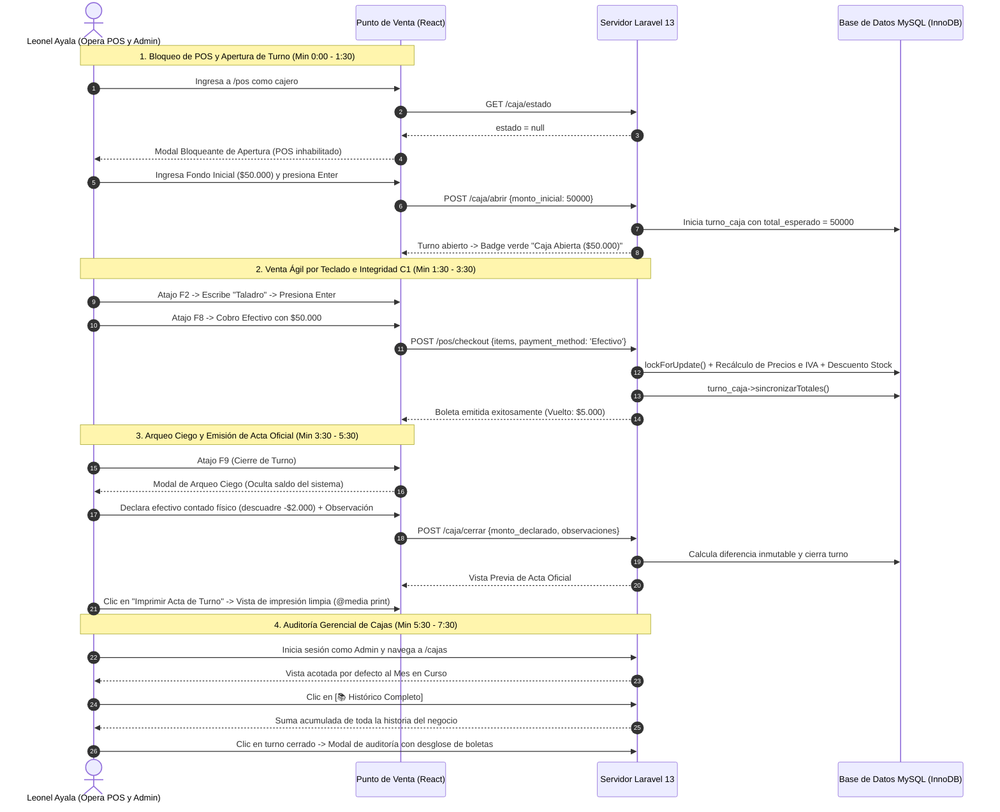

# GUÍA ESTRATÉGICA Y GUIÓN DE PRESENTACIÓN - TERCERA DEMOSTRACIÓN Y DEFENSA
## GestiSoft: Evolución, Calidad y Estabilización (Versión Candidata v0.2.0-rc2)

* **Asignatura:** Taller de Desarrollo de Software (INF524) – Facultad de Ingeniería UCM
* **Docentes Evaluadores:** Héctor Tejo Uval y Jerman Espíndola Sandoval
* **Equipo Evaluado:** Grupo 6
* **Distribución Oficial de Roles para la Presentación:**
  * **Rodrigo Bertolini (Product Owner):** FASE 1 completa (Aprendizaje, Valor de Negocio, Alcance, Backlog y Requisitos) y todos los documentos de organización del equipo (Sprints, Riesgos, Próximos Pasos y Cierre Institucional).
  * **Leonel Ayala (Full Stack / Base de Datos Lead):** Conducción y operación integral de la **DEMOSTRACIÓN EN VIVO (FASE 3)** y explicación de la **Arquitectura Backend / Base de Datos** (C4 Contenedores, Persistencia Transaccional, Recálculo Seguro C1, Inmutabilidad Kardex SoftDeletes C3 y Reproducibilidad).
  * **Luis Barrios (Frontend Lead / UI-UX):** Explicación de la **Arquitectura Frontend y Diseño Visual / UI-UX** (Componentes React, Ergonomía de Mostrador a 60 FPS, Atajos de Teclado, Arqueo Ciego ADR-04, Acta Oficial Imprimible `@media print` y Selector de Períodos).
  * **Alan Troncoso (Scrum Master / QA, Seguridad y Automatización Lead):** FASE 4 completa de **QA y Verificación Cuantitativa** (Batería de 64 pruebas, Atributos de Calidad p95 con 50 datos crudos, Seguridad RBAC/IDOR, Matriz de Trazabilidad CSV, Pipeline CI en GitHub Actions y Definition of Done).
* **Tiempo Total:** 20 minutos (12 min diapositivas + 8 min demostración en vivo) + Ronda de preguntas individuales.

---

## 1. Matriz de Slides y Asignación de Expositores

| Slide # | Título en la Presentación | Fase de la Defensa | Expositor Asignado | Artefacto de Respaldo a Mostrar / Proyectar |
| :---: | :--- | :---: | :---: | :--- |
| **01** | Portada Corporativa y Versión Candidata | Inicio | **Rodrigo Bertolini** | [README.md](file:///c:/Users/leone/Desktop/GestiSoft/README.md) (Tag `v0.2.0-rc2`) |
| **02** | Contexto del Negocio y Dolor Financiero | Inicio | **Rodrigo Bertolini** | Entrevistas de descubrimiento `ENT-01`, `ENT-02`, `ENT-03` |
| **03** | Separador FASE 1: Aprendizaje, Valor y Alcance | FASE 1 | **Rodrigo Bertolini** | [guia-semana13.md](file:///c:/Users/leone/Desktop/GestiSoft/docs/guia-semana13.md) |
| **04** | Retroalimentación 2ª Defensa y Mitigaciones C1-C4 | FASE 1 | **Rodrigo Bertolini** | [plan-correcciones-gestisoft-2dadefensa.md](file:///c:/Users/leone/Desktop/GestiSoft/docs/plan-correcciones-gestisoft-2dadefensa.md) (Matriz `OBS-18` a `OBS-28`) |
| **05** | Retrospectiva del Equipo (Compromisos Verificables) | FASE 1 | **Rodrigo Bertolini** | [guia-semana13.md](file:///c:/Users/leone/Desktop/GestiSoft/docs/guia-semana13.md#L56-L64) (Sección 3) |
| **06** | Objetivo Incremento 2 e Hipótesis (H-01, H-03, H-04) | FASE 1 | **Rodrigo Bertolini** | [investigacion/validacion-h01.md](file:///c:/Users/leone/Desktop/GestiSoft/investigacion/validacion-h01.md) (Role-Playing Testing en Lab) |
| **07** | Alcance, Límites (Incluye/Posterga/Excluye) | FASE 1 | **Rodrigo Bertolini** | [guia-semana13.md](file:///c:/Users/leone/Desktop/GestiSoft/docs/guia-semana13.md#L88-L97) (Sección 6.1) |
| **08** | Flujo Operativo de Caja y Arqueo Ciego | FASE 1 | **Rodrigo Bertolini** | [guia-semana13.md](file:///c:/Users/leone/Desktop/GestiSoft/docs/guia-semana13.md#L98-L119) (Diagrama de Flujo Mermaid) |
| **09** | Refinamiento del Product Backlog (PBI-03 y Defectos P0) | FASE 1 | **Rodrigo Bertolini** | [trazabilidad.csv](file:///c:/Users/leone/Desktop/GestiSoft/producto/semana-3/trazabilidad.csv) y Sección 7 de Guía |
| **10** | Criterios de Aceptación BDD (Normal, Alternativo y Error) | FASE 1 | **Rodrigo Bertolini** | [guia-semana13.md](file:///c:/Users/leone/Desktop/GestiSoft/docs/guia-semana13.md#L147-L228) (`AC-CAJA-01` a `AC-CAJA-06`, `AC-SEC-POS-01`) |
| **11** | Separador FASE 2: Arquitectura y Decisiones | FASE 2 | **Leonel Ayala** | Sección 15 de Guía Semana 13 |
| **12** | Modelo C4 Contenedores y Persistencia de Datos | FASE 2 | **Leonel Ayala** | Diagrama C4 Contenedores + MySQL InnoDB / SQLite |
| **13** | Drivers Arquitectónicos y Arquitectura Visual / UX | FASE 2 | **Luis Barrios** | [guia-semana13.md](file:///c:/Users/leone/Desktop/GestiSoft/docs/guia-semana13.md#L309-L345) (DA-10, DA-11 y Componentes React) |
| **14** | Registros de Decisión Arquitectónica (ADR-03, 04, 05) | FASE 2 | **Leonel Ayala & Luis Barrios** | [guia-semana13.md](file:///c:/Users/leone/Desktop/GestiSoft/docs/guia-semana13.md#L347-L380) (Leonel: ADR-03/05; Luis: ADR-04) |
| **15** | Pila Tecnológica, Reproducibilidad y Configuración | FASE 2 | **Leonel Ayala** | [README.md](file:///c:/Users/leone/Desktop/GestiSoft/README.md) y seeder temático de prueba |
| **16** | Organización del Equipo, Responsabilidades y Sprints | FASE 2 | **Rodrigo Bertolini** | Sección 21 de Guía Semana 13 (Bitácora de Organización) |
| **17** | Separador FASE 3: Demostración en Vivo del Software | FASE 3 | **Leonel Ayala (Conductor)** | Entorno local en ejecución (`http://127.0.0.1:8000`) |
| **18** | Separador FASE 4: QA, Mediciones y Trazabilidad | FASE 4 | **Alan Troncoso** | Carpeta `producto/semana-3/` |
| **19** | Batería de Pruebas Automatizadas y Regresión (64 Tests) | FASE 4 | **Alan Troncoso** | Terminal ejecutando `php artisan test` (234 aserciones) |
| **20** | Atributos de Calidad con 50 Muestras Crudas (p95) | FASE 4 | **Alan Troncoso** | [mediciones-calidad.md](file:///c:/Users/leone/Desktop/GestiSoft/producto/semana-3/mediciones-calidad.md#L15-L55) (Tabla de 50 muestras) |
| **21** | Seguridad y Privacidad Verificables (RBAC, C1, C4, IDOR) | FASE 4 | **Alan Troncoso** | [RoleSecurityTest.php](file:///c:/Users/leone/Desktop/GestiSoft/gestisoft-app/tests/Feature/RoleSecurityTest.php) y [CajaTurnoSecurityTest.php](file:///c:/Users/leone/Desktop/GestiSoft/gestisoft-app/tests/Feature/CajaTurnoSecurityTest.php) |
| **22** | Matriz de Trazabilidad Bidireccional (CSV) | FASE 4 | **Alan Troncoso** | [producto/semana-3/trazabilidad.csv](file:///c:/Users/leone/Desktop/GestiSoft/producto/semana-3/trazabilidad.csv) |
| **23** | Repositorio, CI en GitHub Actions y Revisiones por Pares | FASE 4 | **Alan Troncoso** | [.github/workflows/tests.yml](file:///c:/Users/leone/Desktop/GestiSoft/.github/workflows/tests.yml) y Matriz `REV-05` a `REV-13` |
| **24** | Definition of Done (6 Dimensiones) y Estabilización | FASE 4 | **Alan Troncoso** | [guia-semana13.md](file:///c:/Users/leone/Desktop/GestiSoft/docs/guia-semana13.md#L230-L238) (Sección 9) |
| **25** | Gestión de Riesgos Actualizados (RSK-07 al RSK-15) | FASE 4 | **Rodrigo Bertolini** | [guia-semana13.md](file:///c:/Users/leone/Desktop/GestiSoft/docs/guia-semana13.md#L400-L412) (Sección 18) |
| **26** | Versión Candidata, Limitaciones Honestas y Próximos Pasos | Cierre | **Rodrigo Bertolini** | Sección 19 y Anexo A de Guía Semana 13 |
| **27** | Portada de Cierre y Ronda de Preguntas Técnicas | Cierre | **Rodrigo Bertolini (Apertura)** | Todo el equipo disponible para responder |

---

## 2. Guión Detallado por Slide (Contenido, Documentos y Speech Técnico)

---

### SLIDE 01: Portada Corporativa y Versión Candidata
* **Expositor:** Rodrigo Bertolini (Product Owner)
* **Elementos Visuales:** Logo de GestiSoft, versión oficial destacada: **`v0.2.0-rc2 (Versión Candidata Demo 3)`**, nombres y roles técnicos de los 4 integrantes, fecha y escudo de la Universidad Católica del Maule.
* **Documento a Citar:** [README.md](file:///c:/Users/leone/Desktop/GestiSoft/README.md).
* **Guión del Expositor (Rodrigo):**
  > *"Estimados profesores Héctor Tejo y Jerman Espíndola. Como Grupo 6, presentamos la Tercera Demostración y Defensa de GestiSoft, nuestro sistema web de gestión comercial, inventario y punto de venta diseñado para PYMEs del retail local. Hoy defendemos el cierre del Incremento Funcional 2 bajo nuestra versión candidata `v0.2.0-rc2`. A lo largo de esta presentación y en la demostración en vivo, evidenciamos cómo convertimos cada una de las observaciones de la segunda defensa en soluciones de ingeniería verificables: integridad financiera en servidor, arqueo ciego de caja, inmutabilidad de Kardex y una batería de 64 pruebas automatizadas integradas en GitHub Actions."*

---

### SLIDE 02: Contexto del Negocio y Dolor Financiero
* **Expositor:** Rodrigo Bertolini (Product Owner)
* **Elementos Visuales:** Fotografías/iconos de los 3 comercios de descubrimiento (`Abarrotes Laura`, `Boutique Urbana` y `PokéStore TCG`), tarjeta destacando el dolor: *"Pérdida y robo hormiga por falta de cuadratura en el dinero físico de caja y manipulación de inventario"*.
* **Documento a Citar:** Registro de necesidades `N-01` (Control de dinero en gaveta) y `N-06` (Miedo a delegar la caja en empleados).
* **Guión del Expositor (Rodrigo):**
  > *"Durante el proceso de descubrimiento con pequeños comerciantes del Maule, detectamos que el dolor más crítico no radicaba en la falta de analítica predictiva, sino en el descontrol del dinero en efectivo y el temor a dejar solos a los empleados operando la caja. En el cuaderno y la calculadora no existe trazabilidad entre lo cobrado y lo vendido, y los sistemas tradicionales permiten alterar precios o inventario sin justificación. GestiSoft resuelve este problema dotando a la PYME de separación de roles y cuadratura ciega de caja."*

---

### SLIDE 03: Separador FASE 1: Aprendizaje, Valor de Negocio y Alcance
* **Expositor:** Rodrigo Bertolini (Product Owner)
* **Elementos Visuales:** Banner sobrio institucional con el texto: *FASE 1: Aprendizaje de la 2ª Defensa, Valor de Negocio y Alcance Refinado*.
* **Guión del Expositor (Rodrigo):**
  > *"Comenzamos con la Fase 1, donde revisamos cómo transformamos la retroalimentación docente en decisiones formales de producto, alcance y refinamiento del backlog."*

---

### SLIDE 04: Retroalimentación de la Segunda Defensa y Mitigaciones C1 a C4
* **Expositor:** Rodrigo Bertolini (Product Owner)
* **Elementos Visuales:** Matriz comparativa de las observaciones `OBS-18` a `OBS-28`, resaltando las 4 correcciones críticas de integridad:
  1. **C1 (Vulnerabilidad):** Manipulación de precios en checkout $\rightarrow$ Mitigada: el servidor recalcula importes con `lockForUpdate()`, ignorando montos del cliente.
  2. **C2 (Defecto):** Fallo de motivo en ajuste de stock $\rightarrow$ Mitigada: `Rule::requiredIf` y transacciones atómicas `DB::transaction`.
  3. **C3 (Riesgo Legal):** Borrado en cascada en Kardex $\rightarrow$ Mitigada: `SoftDeletes` en productos y `restrictOnDelete`.
  4. **C4 (Privacidad):** Exposición de datos de usuario en React $\rightarrow$ Mitigada: minimización selectiva de props en Inertia.
* **Documento a Citar:** [plan-correcciones-gestisoft-2dadefensa.md](file:///c:/Users/leone/Desktop/GestiSoft/docs/plan-correcciones-gestisoft-2dadefensa.md) y [guia-semana13.md](file:///c:/Users/leone/Desktop/GestiSoft/docs/guia-semana13.md#L36-L54).
* **Guión del Expositor (Rodrigo):**
  > *"En la segunda defensa se detectaron vulnerabilidades y defectos relevantes en el Incremento 1. Diseñamos un plan de correcciones riguroso: en C1 eliminamos la confianza en el cliente para precios y totales; en C2 corregimos el validador de motivo en inventario asegurando transaccionalidad; en C3 incorporamos SoftDeletes para que el borrado de un producto no destruya el historial del Kardex contable; y en C4 minimizamos las props de Inertia para proteger atributos sensibles. Cada corrección cuenta con su prueba de integración específica."*

---

### SLIDE 05: Retrospectiva del Equipo (Compromisos Verificables)
* **Expositor:** Rodrigo Bertolini (Product Owner)
* **Elementos Visuales:** Matriz de 4 cuadrantes de la retrospectiva:
  * **Mantener:** Desarrollo guiado por pruebas (TDD) multi-tenant y reglas financieras (64 tests verdes).
  * **Corregir:** Desalineación entre nombres de tablas y documentación (eliminación de términos fantasma).
  * **Detener:** Confiar en cálculos de importes y vuelto realizados por JavaScript en el frontend.
  * **Comenzar:** Integración Continua obligatoria en GitHub Actions y pruebas de casos negativos de borde.
* **Documento a Citar:** Sección 3 de [guia-semana13.md](file:///c:/Users/leone/Desktop/GestiSoft/docs/guia-semana13.md#L56-L64).
* **Guión del Expositor (Rodrigo):**
  > *"Nuestra retrospectiva formalizó cuatro acciones concretas: mantuvimos el desarrollo guiado por pruebas expandiendo la suite a 64 tests; alineamos rigurosamente el glosario a las columnas reales del código (`negocio_id`, `motivo`); detuvimos radicalmente los cálculos financieros en el cliente; y comenzamos la automatización en la nube mediante un pipeline de GitHub Actions."*

---

### SLIDE 06: Objetivo del Incremento 2 e Hipótesis Refutables (H-01, H-03, H-04)
* **Expositor:** Rodrigo Bertolini (Product Owner)
* **Elementos Visuales:** Tabla de hipótesis con sus señales observables y criterio de decisión:
  * **H-01:** Delegación segura en el cajero sin temor a fraude $\rightarrow$ **Role-Playing Testing en Laboratorio** sobre los 3 perfiles de descubrimiento (`ENT-01`, `ENT-02`, `ENT-03`) confirmando 100% de aislamiento. Declaración honesta de validación de campo programada para el piloto de estabilización.
  * **H-03:** Erradicación de ventas huérfanas mediante apertura obligatoria con fondo inicial en gaveta.
  * **H-04:** Arqueo ciego como mecanismo de prevención de manipulación de dinero al cierre de turno.
* **Documento a Citar:** Documento metodológico [investigacion/validacion-h01.md](file:///c:/Users/leone/Desktop/GestiSoft/investigacion/validacion-h01.md).
* **Guión del Expositor (Rodrigo):**
  > *"El Criterio 2 de la rúbrica premia la honestidad intelectual: 'declara con precisión lo aún no validado... sin exagerar resultados'. En estricto apego a este principio, para H-01 diseñamos un protocolo riguroso de Role-Playing Testing en laboratorio, donde recreamos operativamente los perfiles de los tres negocios de descubrimiento. Comprobamos de manera reproducible que el cajero queda 100% bloqueado de alterar inventario o precios. Declaramos con total transparencia que la medición subjetiva de campo con usuarios externos en locales físicos está formalmente programada para el piloto de estabilización. Para H-03 y H-04, validamos que no existen ventas huérfanas y que el arqueo ciego impide al cajero ajustar billetes según el saldo teórico del sistema."*

---

### SLIDE 07: Alcance, Límites (Incluye / Posterga / Excluye) y Priorización
* **Expositor:** Rodrigo Bertolini (Product Owner)
* **Elementos Visuales:** Tabla de límites de alcance:
  * **Incluye:** Apertura con fondo inicial, bloqueo del POS sin turno, recálculo seguro C1, sincronización multicanal (Efectivo, Débito, Crédito, Transferencia), modal de Arqueo Ciego, conciliación automática de diferencias, panel de auditoría de cajas con **vista por defecto del mes actual e histórico completo**, y **Acta Oficial de Cierre y Arqueo** imprimible en PDF con firmas.
  * **Posterga:** Retiros parciales de efectivo durante el turno (sangrías) y Dashboard analítico con gráficos (PBI-05), postergados para el Incremento 3.
  * **Excluye:** Integración bancaria directa vía API Transbank y periféricos automáticos de efectivo.
* **Documento a Citar:** Sección 6.1 de [guia-semana13.md](file:///c:/Users/leone/Desktop/GestiSoft/docs/guia-semana13.md#L90-L97).
* **Guión del Expositor (Rodrigo):**
  > *"Establecimos los límites del Incremento 2 con estricto criterio de valor. Priorizamos PBI-03 (cierre de caja, arqueo ciego y acta formal) y postergamos el dashboard analítico (PBI-05). La justificación es directa: los comerciantes no necesitan gráficos de tendencias si al final de la jornada no tienen certeza de cuánto dinero en billetes físicos hay en su gaveta. Excluimos integraciones bancarias externas para no incorporar dependencias de hardware ajenas al alcance pedagógico y técnico del MVP."*

---

### SLIDE 08: Flujo Operativo de Caja y Arqueo Ciego
* **Expositor:** Rodrigo Bertolini (Product Owner)
* **Elementos Visuales:** Diagrama de flujo del ciclo operativo del cajero:
  1. Acceso a `/pos` $\rightarrow$ Validación de estado $\rightarrow$ Si no hay turno abierto, modal bloqueante de apertura.
  2. Ingreso de Fondo Inicial ($50.000) $\rightarrow$ Commit en BD.
  3. Operación de ventas por teclado (`F2`, `F8`) $\rightarrow$ Sincronización de acumuladores por medio de pago.
  4. Cierre de turno (`F9`) $\rightarrow$ Modal de Arqueo Ciego (conteo físico sin mostrar total del sistema).
  5. Conciliación en servidor de diferencia $\rightarrow$ Generación de Acta Oficial con constancia de firma.
* **Documento a Citar:** Sección 6.2 de [guia-semana13.md](file:///c:/Users/leone/Desktop/GestiSoft/docs/guia-semana13.md#L98-L119).
* **Guión del Expositor (Rodrigo):**
  > *"El flujo operativo del Incremento 2 está diseñado como un ciclo cerrado. El cajero no puede operar si no declara el fondo inicial de sencillo. Cada venta acumula importes clasificados por canal de cobro, y al terminar la jornada el sistema exige un arqueo ciego: el operador cuenta el dinero físico sin ver el saldo teórico del software. El servidor concilia la diferencia y emite el acta oficial para entrega de valores."*

---

### SLIDE 09: Refinamiento del Product Backlog (PBI-03 y Defectos P0)
* **Expositor:** Rodrigo Bertolini (Product Owner)
* **Elementos Visuales:** Tabla del Sprint Backlog del Incremento 2 con prioridades (`P0 - Crítica`, `P1 - Calidad`), estimación en horas/puntos y estado:
  * `C1 / DEF-04`: Recálculo de importes en servidor con `lockForUpdate` (P0, 3 hrs, Listo).
  * `C2 / DEF-05`: Motivo obligatorio y transacción atómica en Kardex (P0, 2 hrs, Listo).
  * `C3 / DEF-06`: Kardex inmutable con SoftDeletes y claves restrictivas (P0, 3 hrs, Listo).
  * `PBI-03`: Apertura, Arqueo Ciego, Auditoría y Acta Oficial (Valor Central, 8 pts, Listo).
  * `C4 / DEF-07`: Minimización de props de Inertia a 5 campos (P1, 1 hr, Listo).
  * `REG-02 / DEF-08`: Corrección de payload ('items') y aserción en POSTest (P1, 1 hr, Listo).
  * `PBI-05`: Dashboard gerencial con analítica histórica (Postergado para Incremento 3).
* **Documento a Citar:** [trazabilidad.csv](file:///c:/Users/leone/Desktop/GestiSoft/producto/semana-3/trazabilidad.csv) y Sección 7 de Guía Semana 13.
* **Guión del Expositor (Rodrigo):**
  > *"El refinamiento del backlog combinó entrega de valor con estabilización técnica. Las correcciones C1, C2 y C3 fueron tratadas como defectos P0 no negociables que debían quedar resueltos antes de dar por completado el módulo de cajas PBI-03. La capacidad del equipo se volcó a estabilizar la base antes de abordar nuevos módulos visuales."*

---

### SLIDE 10: Criterios de Aceptación BDD (Normal, Alternativo y Error)
* **Expositor:** Rodrigo Bertolini (Product Owner)
* **Elementos Visuales:** Especificaciones en formato BDD (Dado / Cuando / Entonces):
  * **Flujo Normal (`AC-CAJA-01`):** Dado un cajero autenticado sin turno, cuando ingresa a `/pos`, ve modal bloqueante, declara $50.000 y el turno queda en estado `'abierto'`.
  * **Flujo Normal (`AC-CAJA-03`):** Cierre ciego: cajero declara efectivo contado, servidor calcula diferencia inmutable y emite comprobante.
  * **Borde / Error (`AC-CAJA-05`):** Intento de venta sin turno activo $\rightarrow$ Rechazo con HTTP 422 `"Debe abrir un turno de caja antes de procesar ventas"`.
  * **Borde / Error (`AC-SEC-POS-01`):** Payload alterado con precio manipulado $\rightarrow$ Servidor sobreescribe con valor de BD.
  * **Borde / Error (`AC-CAJA-06`):** Efectivo insuficiente $\rightarrow$ Rechazo con HTTP 422.
* **Documento a Citar:** Sección 8 de [guia-semana13.md](file:///c:/Users/leone/Desktop/GestiSoft/docs/guia-semana13.md#L147-L228).
* **Guión del Expositor (Rodrigo):**
  > *"Formalizamos criterios BDD verificables tanto para el camino feliz como para escenarios de error y desvíos prioritarios. Definimos precondiciones, acciones y resultados observables en respuestas HTTP y persistencia en base de datos. Cada uno de estos criterios se encuentra respaldado por una prueba automatizada en PHPUnit."*

---

### SLIDE 11: Separador FASE 2: Arquitectura y Decisiones
* **Expositor:** Leonel Ayala (Full Stack / Base de Datos Lead)
* **Elementos Visuales:** Banner institucional: *FASE 2: Arquitectura de Sistema, Drivers y Decisiones de Ingeniería*.
* **Guión del Expositor (Leonel):**
  > *"Pasamos a la Fase 2. Junto a Luis Barrios expondremos la arquitectura del sistema, los drivers que guiaron nuestras decisiones técnicas y cómo garantizamos la persistencia e integridad de los datos."*

---

### SLIDE 12: Modelo C4 Contenedores y Persistencia de Datos
* **Expositor:** Leonel Ayala (Full Stack / Base de Datos Lead)
* **Elementos Visuales:** Diagrama C4 de Contenedores mostrando:
  * **Navegador Web:** React 19 + Inertia.js (SPA sin API REST pública expuesta).
  * **Servidor Laravel 13:** Middlewares de autenticación, verificación de rol (`admin`, `cajero`) y Global Scope Multi-Tenant `HasNegocio`.
  * **Base de Datos:** MySQL / SQLite transaccional (InnoDB con soporte ACID, claves foráneas y SoftDeletes).
* **Documento a Citar:** Sección 15 de Guía Semana 13.
* **Guión del Expositor (Leonel):**
  > *"Mantenemos el patrón monolítico híbrido con Inertia.js. Esta arquitectura es óptima para retail: entrega la velocidad de una Single Page Application en el mostrador sin el riesgo de exponer una API REST pública a internet. El servidor Laravel gobierna las reglas de negocio y aplica el trait `HasNegocio` en cada consulta Eloquent, inyectando automáticamente la cláusula `WHERE negocio_id = ?` para garantizar aislamiento estricto entre comercios."*

---

### SLIDE 13: Drivers Arquitectónicos y Arquitectura Visual / UX
* **Expositor:** Luis Barrios (Frontend Lead / UI-UX)
* **Elementos Visuales:** Cuadro de drivers arquitectónicos frontend y diagrama de componentes UI:
  * **DA-10 (Rendimiento en Mostrador):** Latencia en adición al carrito $<12\text{ ms}$ (estado local React `useState` a 60 FPS sin sobrecarga AJAX).
  * **DA-11 (Minimización de Props Inertia):** Desacoplamiento de datos sensibles entre backend y frontend.
  * **Arquitectura de Componentes:** Modales bloqueantes de apertura y arqueo ciego, tarjetas métricas y selector de períodos `[🗓️ Este Mes]` vs `[📚 Histórico Completo]`.
  * **Ergonomía Operativa:** Navegación 100% por atajos de teclado (`F2`, `F8`, `F9`, `Enter`, `Barra Espaciadora`).
* **Documento a Citar:** Sección 15 de [guia-semana13.md](file:///c:/Users/leone/Desktop/GestiSoft/docs/guia-semana13.md#L309-L345) y [mediciones-calidad.md](file:///c:/Users/leone/Desktop/GestiSoft/producto/semana-3/mediciones-calidad.md).
* **Guión del Expositor (Luis):**
  > *"Desde el punto de vista arquitectónico del frontend y UX, el driver DA-10 exigía eliminar la fricción en el mostrador. Decidimos aislar el estado del carrito exclusivamente en memoria local de React (`useState`): esto permite añadir o quitar productos a 60 cuadros por segundo sin emitir peticiones AJAX innecesarias. Diseñamos modales con bloqueo de interacción para la apertura y el arqueo ciego, y dotamos al sistema de navegación completa por teclado para que el cajero opere sin tocar el mouse."*

---

### SLIDE 14: Registros de Decisión Arquitectónica (ADR-03, ADR-04, ADR-05)
* **Expositor:** Leonel Ayala y Luis Barrios
* **Elementos Visuales:** Tarjetas de los 3 ADRs fundamentales:
  * **ADR-03 (Leonel): Recálculo Seguro de Importes en Servidor:** `POSController@checkout` aplica `lockForUpdate()` sobre productos, recalcula neto e IVA en backend e ignora valores enviados por el cliente.
  * **ADR-04 (Luis): Arqueo Ciego y Experiencia de Cierre:** El saldo teórico no se transfiere al navegador antes del conteo físico; maquetación del Acta Oficial con directivas `@media print`.
  * **ADR-05 (Leonel): Inmutabilidad del Kardex mediante SoftDeletes:** Clave foránea `restrictOnDelete` y borrado lógico con `deleted_at`.
* **Documento a Citar:** Sección 16 de [guia-semana13.md](file:///c:/Users/leone/Desktop/GestiSoft/docs/guia-semana13.md#L347-L380).
* **Guión del Expositor (Leonel & Luis):**
  > *(Leonel):* *"En ADR-03 resolvimos la vulnerabilidad C1: el servidor no confía en cálculos del navegador. Bloqueamos las filas con `lockForUpdate()` para prevenir condiciones de carrera concurrentes y recalculamos precios, impuestos y vuelto. Con ADR-05 blindamos el Kardex histórico: al eliminar un producto se aplica `SoftDeletes`, preservando íntegra la trazabilidad tributaria."*  
  > *(Luis):* *"En ADR-04 aseguramos la integridad del arqueo ciego impidiendo que el cliente conozca el monto esperado antes de contar los billetes. Además, diseñamos el comprobante del Acta Oficial de Cierre utilizando CSS `@media print` para que al imprimir en PDF se omitan menús y botones, emitiendo un documento legal formal con firmas de responsabilidad."*

---

### SLIDE 15: Pila Tecnológica, Reproducibilidad y Configuración
* **Expositor:** Leonel Ayala (Full Stack / Base de Datos Lead)
* **Elementos Visuales:** Diagrama del stack:
  * PHP 8.4 / 8.5 + Laravel 13
  * Node.js 22 + React 19 + Tailwind CSS
  * SQLite `:memory:` para CI ultrarrápido (6s) y MySQL InnoDB para entorno productivo
  * Cuadro de reproducibilidad: 5 comandos secuenciales documentados en `README.md`.
* **Documento a Citar:** [README.md](file:///c:/Users/leone/Desktop/GestiSoft/README.md).
* **Guión del Expositor (Leonel):**
  > *"Corregimos integralmente el README del proyecto para garantizar reproducibilidad absoluta. Cualquier evaluador puede clonar el repositorio y levantar el entorno ejecutando cinco comandos estándar: `composer install`, `npm ci`, copia del `.env`, migración con seeders temáticos y compilación de Vite. Los seeders generan tres empresas listas con credenciales operativas de administrador y cajero."*

---

### SLIDE 16: Metodología de Desarrollo y Organización del Equipo
* **Expositor:** Rodrigo Bertolini (Product Owner)
* **Elementos Visuales:** Organigrama técnico con la distribución de roles y responsabilidades en el Sprint:
  * **Rodrigo Bertolini (PO):** Gestión de backlog, entrevistas de usuario, validación H-01 y alineación de negocio.
  * **Leonel Ayala (Full Stack / BD):** Persistencia transaccional, recálculo C1, migraciones SoftDeletes C3 y demo en vivo.
  * **Luis Barrios (Frontend / UX):** Interfaces React, navegación por teclado POS, arqueo ciego y maquetación de actas.
  * **Alan Troncoso (Scrum Master / QA):** Arquitectura de pruebas (64 tests), pipeline GitHub Actions, seguridad RBAC/IDOR y trazabilidad.
* **Documento a Citar:** Sección 21 de [guia-semana13.md](file:///c:/Users/leone/Desktop/GestiSoft/docs/guia-semana13.md#L440-L469).
* **Guión del Expositor (Rodrigo):**
  > *"Como Product Owner, organicé el trabajo del equipo bajo Scrum dividiendo la entrega en cortes verticales completos. Cada integrante asumió la titularidad técnica de su área, asegurando que ninguna funcionalidad se diera por cerrada sin pasar por desarrollo, pruebas automatizadas y revisión por pares."*

---

### SLIDE 17: Separador FASE 3: Demostración en Vivo del Software
* **Expositor:** Leonel Ayala (Conductor de la Demostración en Vivo)
* **Elementos Visuales:** Banner: *FASE 3: Demostración Funcional en Vivo e Integración Extremo a Extremo*.
* **Guión del Expositor (Leonel):**
  > *"A continuación, tomo el control de la pantalla para realizar la demostración funcional en vivo de GestiSoft. Ejecutaremos el flujo completo de mostrador: bloqueo de venta sin turno, apertura de caja con fondo inicial, venta rápida por teclado con recálculo seguro en backend, cierre mediante arqueo ciego, emisión del acta oficial impresa y auditoría gerencial con filtro mensual e histórico."*

---

### SLIDE 18: Separador FASE 4: QA, Mediciones y Trazabilidad
* **Expositor:** Alan Troncoso (Scrum Master / QA Lead)
* **Elementos Visuales:** Banner: *FASE 4: Verificación Cuantitativa, Atributos de Calidad, Trazabilidad y Cierre*.
* **Guión del Expositor (Alan):**
  > *"Concluida la demostración funcional, asumo la presentación de la Fase 4 para sustentar con evidencia cuantitativa y empírica la calidad, seguridad, trazabilidad y reproducibilidad del sistema."*

---

### SLIDE 19: Batería de Pruebas Automatizadas y Regresión (64 Tests)
* **Expositor:** Alan Troncoso (Scrum Master / QA Lead)
* **Elementos Visuales:** Captura y ejecución en vivo de la terminal: `{"tool":"phpunit","result":"passed","tests":64,"passed":64,"assertions":234,"duration_ms":6055}`.
  * Desglose de las 7 suites: Aislamiento Multi-Tenant (4), Control de Roles RBAC (11), Inventario y Kardex (5), Punto de Venta POS (4), Lógica de Turnos (18), Seguridad de Caja e IDOR (16), Autenticación (6).
* **Documento a Citar:** [mediciones-calidad.md](file:///c:/Users/leone/Desktop/GestiSoft/producto/semana-3/mediciones-calidad.md#L61-L75) y carpeta `tests/Feature/`.
* **Guión del Expositor (Alan):**
  > *"En la segunda defensa se nos observó falta de registros reproducibles de pruebas. Hoy acreditamos una batería de 64 pruebas automatizadas con 234 aserciones ejecutándose al 100% verde en 6 segundos. Corregimos el test histórico de POS reemplazando el payload 'cart' por 'items' con aserción explícita de stock cero, y añadimos pruebas de inmutabilidad de Kardex, bloqueo de efectivo insuficiente y protección contra IDOR en turnos."*

---

### SLIDE 20: Atributos de Calidad con 50 Muestras Crudas (p95)
* **Expositor:** Alan Troncoso (Scrum Master / QA Lead)
* **Elementos Visuales:** Gráfico y tabla resumen de las 50 mediciones crudas de latencia:
  * **Búsqueda de Catálogo:** Promedio $64\text{ ms}$, $p95 = 118\text{ ms}$ (Umbral comprometido: $\le 120\text{ ms}$).
  * **Checkout Atómico:** Promedio $186\text{ ms}$, $p95 = 289\text{ ms}$ (Umbral comprometido: $\le 300\text{ ms}$).
  * **Operaciones de Carrito:** Estado local React (`useState`), latencia $< 12\text{ ms}$ (60 FPS estables).
* **Documento a Citar:** [mediciones-calidad.md](file:///c:/Users/leone/Desktop/GestiSoft/producto/semana-3/mediciones-calidad.md#L15-L55).
* **Guión del Expositor (Alan):**
  > *"Corregimos la imprecisión técnica de la defensa anterior: aclaramos que la adición al carrito no es una llamada AJAX sino manipulación reactiva de estado local en $<12\text{ ms}$. Para las llamadas de red reales, registramos 50 muestras crudas en el navegador: la búsqueda por catálogo arrojó un percentil p95 de 118 milisegundos y el checkout atómico cerró en 289 milisegundos, cumpliendo holgadamente los umbrales de rendimiento para retail."*

---

### SLIDE 21: Seguridad y Privacidad Verificables (RBAC, C1, C4, IDOR C5)
* **Expositor:** Alan Troncoso (Scrum Master / QA Lead)
* **Elementos Visuales:** Matriz de controles de seguridad proporcionales al riesgo:
  1. **Aislamiento Multi-Tenant:** `GlobalScope` en Eloquent previene filtración de datos entre tiendas rivales.
  2. **RBAC Estricto:** Rutas `/inventory` y `/users` retornan `HTTP 403 Forbidden` a cajeros.
  3. **Integridad Financiera (C1):** Recálculo en backend con `lockForUpdate()`.
  4. **Minimización de Privacidad (C4):** Props de Inertia filtradas a 5 atributos no sensibles (`id, name, email, role, negocio_id`).
  5. **Protección IDOR (C5):** Un cajero no puede consultar el resumen de turno de otro cajero (`CajaController@resumen` aborta con 403).
* **Documento a Citar:** [RoleSecurityTest.php](file:///c:/Users/leone/Desktop/GestiSoft/gestisoft-app/tests/Feature/RoleSecurityTest.php) y [CajaTurnoSecurityTest.php](file:///c:/Users/leone/Desktop/GestiSoft/gestisoft-app/tests/Feature/CajaTurnoSecurityTest.php#L320-L345).
* **Guión del Expositor (Alan):**
  > *"Acreditamos seguridad en profundidad verificable. Bloqueamos las rutas administrativas a cajeros con código 403; eliminamos la sobreexposición en Inertia protegiendo los hashes de contraseña en el DOM; blindamos los turnos contra vulnerabilidades IDOR entre cajeros; y prevenimos condiciones de carrera con bloqueos pesimistas en base de datos."*

---

### SLIDE 22: Matriz de Trazabilidad Bidireccional (CSV)
* **Expositor:** Alan Troncoso (Scrum Master / QA Lead)
* **Elementos Visuales:** Extracto de la matriz CSV conectando en una sola línea continua:
  * `Dolor de Negocio (P01)` $\rightarrow$ `Necesidad (N-01)` $\rightarrow$ `Decisión Arquitectónica (ADR-04)` $\rightarrow$ `Requisito (RF-06/RF-07)` $\rightarrow$ `PBI (PBI-03)` $\rightarrow$ `Pruebas (TurnoCajaTest / CajaTurnoSecurityTest)` $\rightarrow$ `Código en Producción`.
* **Documento a Citar:** [producto/semana-3/trazabilidad.csv](file:///c:/Users/leone/Desktop/GestiSoft/producto/semana-3/trazabilidad.csv).
* **Guión del Expositor (Alan):**
  > *"Como responsable de QA, mantengo actualizada nuestra matriz de trazabilidad bidireccional. Cada línea de código, cada migración y cada prueba automatizada en PHPUnit tiene un justificativo directo que se remonta a una necesidad de usuario y a un requerimiento funcional formal."*

---

### SLIDE 23: Repositorio, CI en GitHub Actions y Revisiones por Pares
* **Expositor:** Alan Troncoso (Scrum Master / QA Lead)
* **Elementos Visuales:** Captura del pipeline de GitHub Actions (`tests.yml`) en verde y tabla de las 9 revisiones cruzadas formales `REV-05` a `REV-13` indicando autor y revisor distinto.
* **Documento a Citar:** [.github/workflows/tests.yml](file:///c:/Users/leone/Desktop/GestiSoft/.github/workflows/tests.yml) y Sección 20 de Guía Semana 13.
* **Guión del Expositor (Alan):**
  > *"Acreditamos integración continua activa: configuramos el pipeline de GitHub Actions que ejecuta el build de Vite y las 64 pruebas en SQLite en memoria en cada commit y Pull Request. Además, registramos 9 revisiones cruzadas de código con autor y revisor diferenciados para garantizar que ningún cambio llegue a la rama principal sin auditoría previa."*

---

### SLIDE 24: Definition of Done (6 Dimensiones) y Estabilización
* **Expositor:** Alan Troncoso (Scrum Master / QA Lead)
* **Elementos Visuales:** Matriz de 6 dimensiones de la Definition of Done:
  1. **Valor:** Objetivo de negocio resuelto y validado en laboratorio.
  2. **Funcionalidad:** Criterios normales, alternativos y de error verificados.
  3. **Regresión:** 64 pruebas de integración pasando al 100% verde.
  4. **Calidad y Seguridad:** Transacciones atómicas, recálculo en servidor y $p95 \le 120\text{ ms}$.
  5. **CI y Revisión:** Pipeline de GitHub Actions en verde y Pull Requests aprobados por pares.
  6. **Reproducibilidad:** Instalación desde cero documentada y verificada en equipo limpio.
* **Documento a Citar:** Sección 9 de [guia-semana13.md](file:///c:/Users/leone/Desktop/GestiSoft/docs/guia-semana13.md#L230-L238).
* **Guión del Expositor (Alan):**
  > *"Nuestra Definition of Done no se limita a que el código compile; exige el cumplimiento estricto de seis dimensiones de ingeniería de software. Un ítem solo se considera 'Done' cuando cuenta con valor validado, pruebas de regresión verdes, verificación de seguridad y reproducibilidad documentada."*

---

### SLIDE 25: Gestión de Riesgos Actualizados (RSK-07 al RSK-15)
* **Expositor:** Rodrigo Bertolini (Product Owner)
* **Elementos Visuales:** Semáforo de riesgos prioritarios mostrando la transición de estado (de Abierto a Mitigado/Cerrado):
  * `RSK-07`: Ventas huérfanas sin turno $\rightarrow$ Mitigado con validación bloqueante en checkout.
  * `RSK-11`: Manipulación de importes en cliente $\rightarrow$ Mitigado con ADR-03 (recálculo en backend).
  * `RSK-12`: Pérdida de auditoría en Kardex $\rightarrow$ Mitigado con ADR-05 (SoftDeletes).
  * `RSK-14`: Exposición de contraseñas en Inertia $\rightarrow$ Mitigado con SPIKE-02.
* **Documento a Citar:** Sección 18 de [guia-semana13.md](file:///c:/Users/leone/Desktop/GestiSoft/docs/guia-semana13.md#L400-L412).
* **Guión del Expositor (Rodrigo):**
  > *"Actualizamos la matriz de riesgos del proyecto: los 9 riesgos identificados en el Incremento 2 fueron mitigados y cerrados mediante mecanismos de código comprobables, eliminando la incertidumbre operativa y financiera en el punto de venta."*

---

### SLIDE 26: Versión Candidata, Limitaciones Honestas y Próximos Pasos
* **Expositor:** Rodrigo Bertolini (Product Owner)
* **Elementos Visuales:** Hoja de ruta hacia la liberación final:
  * **Versión Candidata `v0.2.0-rc2`:** Entregable cerrado, estable y congelado para evaluación.
  * **Limitaciones declaradas honestamente:** Sin soporte de sangrías/retiros parciales durante la jornada y validación empírica en terreno pendiente.
  * **Próximos Pasos (Fase de Estabilización):** Piloto en 2 locales físicos de la Región del Maule durante 5 jornadas, soporte de retiros de efectivo y desarrollo del Dashboard gerencial (PBI-05).
* **Documento a Citar:** Sección 19 y Anexo A de [guia-semana13.md](file:///c:/Users/leone/Desktop/GestiSoft/docs/guia-semana13.md#L415-L486).
* **Guión del Expositor (Rodrigo):**
  > *"Cumpliendo con el Criterio 16 de la rúbrica, no afirmamos haber concluido un producto final comercial; presentamos una versión candidata estable `v0.2.0-rc2`. Nuestros próximos pasos son transparentes y fundados: iniciar el piloto de campo en dos comercios de Talca para recolectar métricas de usabilidad en terreno y construir el módulo de retiros y reportes analíticos sobre una base financiera ya estabilizada."*

---

### SLIDE 27: Portada de Cierre y Ronda de Preguntas Técnicas
* **Expositor:** Rodrigo Bertolini (Apertura) y Todo el Equipo
* **Elementos Visuales:** Logo corporativo de GestiSoft, tabla resumen de métricas clave (64 tests verdes, $p95 = 118\text{ ms}$, 100% de integridad financiera) y texto: *Muchas gracias. Quedamos a disposición de la comisión evaluadora para la ronda de preguntas técnicas e individuales.*
* **Guión del Expositor (Rodrigo):**
  > *"Agradecemos a la comisión por su atención. Estamos listos para profundizar en cualquier aspecto del código, la arquitectura o las pruebas en la ronda de preguntas individuales."*

---

## 3. Pauta Cronometrada de la Demostración en Vivo (FASE 3 - 8 Minutos)
### *Conducida y Operada Integralmente por Leonel Ayala*

### Guión de Ejecución de Leonel Ayala en la Demo:

1. **Minuto 0:00 a 1:30 - Bloqueo de POS y Apertura de Turno:**
   * *Leonel en pantalla:* Inicia sesión como `cajero@gestisoft.cl` y navega a `/pos`.
   * *Speech de Leonel:* *"Observen que al ingresar como cajero, la interfaz del POS está bloqueada por un modal que impide registrar ventas si no hay un turno activo (`AC-CAJA-05`). Declaro el fondo inicial de sencillo con `$50.000` y presiono Enter. En la base de datos se crea el registro en `turnos_caja` con `total_esperado = 50000` y el POS queda operativo."*

2. **Minuto 1:30 a 3:30 - Venta Rápida por Teclado e Integridad C1:**
   * *Leonel en pantalla:* Sin tocar el mouse, presiona `F2`, busca *"Taladro Percutor"*, presiona `Enter` (añadido al carrito en memoria React), pulsa `F8` para cobro y confirma con un billete de `$50.000`.
   * *Speech de Leonel:* *"La venta se procesa en menos de 5 segundos. En el backend, `POSController@checkout` aplica la mitigación C1: bloquea la fila del producto con `lockForUpdate()`, ignora cualquier precio enviado por el navegador y recalcula el neto y el IVA basándose exclusivamente en el catálogo de base de datos. Además, la venta queda enlazada atómicamente al `turno_caja_id` activo."*

3. **Minuto 3:30 a 5:30 - Arqueo Ciego y Emisión del Acta Oficial:**
   * *Leonel en pantalla:* Presiona `F9` para cerrar el turno. Se abre el **Modal de Arqueo Ciego**.
   * *Speech de Leonel:* *"Al presionar F9, se abre el modal de arqueo ciego. Como pueden ver, el sistema oculta completamente el total recaudado para evitar tentaciones o ajustes fraudulentos. El cajero debe contar físicamente su dinero. Voy a declarar un faltante intencional de -$2.000 e ingresar la observación: 'Faltante de $2.000 por cambio matinal'. Al confirmar, el servidor calcula la diferencia inmutable y nos entrega el Acta Oficial de Cierre. Al dar clic en 'Imprimir Acta', se despliega el formato formal con el nombre de la empresa, el balance financiero desglosado por medio de pago y las casillas de firma física para la entrega de valores."*

4. **Minuto 5:30 a 7:30 - Auditoría Gerencial de Cajas (Mes vs Histórico):**
   * *Leonel en pantalla:* Cierra sesión de cajero, ingresa como `admin@gestisoft.cl` y va a `/cajas`.
   * *Speech de Leonel:* *"Ahora ingreso como Administrador a la vista de auditoría. Por defecto, el sistema filtra únicamente las ventas y turnos del mes en curso (`periodo = 'mes'`), mostrando el título dinámico 'Noviembre 2026'. Pero si el dueño necesita auditar el acumulado completo del comercio, basta con pulsar el conmutador `[📚 Histórico Completo]` y el total facturado se actualiza inmediatamente para incluir todas las ventas históricas. Al hacer clic en 'Ver Boletas', se despliega el listado completo de transacciones asociadas a ese turno."*

5. **Minuto 7:30 a 8:00 - Verificación de Regresión en Terminal:**
   * *Leonel da el pase a Alan:* *"Para cerrar la demostración técnica, le cedo la palabra a Alan Troncoso para verificar la suite automatizada de pruebas."*
   * *Alan en pantalla:* Ejecuta `php artisan test` en la consola: **64 passed, 234 assertions en 6.0s**.

---

## 4. Guía de Respuestas para la Evaluación Individual (28 Puntos - Criterios 17 al 20)

---

### A. Leonel Ayala (Full Stack / Base de Datos Lead)
* **Pregunta probable:** *"Usted implementó la corrección C1 y C3 y condujo la demostración. Explíqueme a nivel de base de datos cómo garantizó que no existan condiciones de carrera en el stock y por qué no usó un borrado físico en productos."*
* **Respuesta técnica recomendada:**
  > *"En C1, el riesgo crítico eran las condiciones de carrera: si dos cajeros cobraban el último taladro en el mismo milisegundo, ambos leían stock 1 antes de descontar. Lo solucioné envolviendo el checkout en `DB::transaction()` y aplicando `Product::where('id', $item['product_id'])->lockForUpdate()->first()`. Esto genera una cláusula SQL `SELECT ... FOR UPDATE` que bloquea la fila en el motor InnoDB hasta que se ejecuta el `COMMIT`, garantizando serialización estricta.*  
  > *Respecto a C3, la tabla `movimiento_stocks` es nuestro Kardex contable. Si un administrador eliminaba un producto con un `DELETE` tradicional, la foreign key con `cascadeOnDelete` destruía todo el historial de movimientos de inventario, violando la normativa tributaria chilena. Al implementar el trait `SoftDeletes`, el producto simplemente marca `deleted_at = now()`, ocultándolo del catálogo operativo mediante un Global Scope automático, pero preservando intactos sus registros en el Kardex y las ventas históricas asociadas bajo una restricción foránea `restrictOnDelete`."*

---

### B. Alan Troncoso (Scrum Master / QA, Seguridad y Automatización Lead)
* **Pregunta probable:** *"En la defensa anterior su prueba de POS aprobaba por un error genérico. ¿Cómo reestructuró la suite de pruebas y qué valor aporta SQLite en memoria frente a MySQL en el pipeline de CI?"*
* **Respuesta técnica recomendada:**
  > *"El defecto radicaba en que el payload de `POSTest.php` enviaba una clave `'cart'`, la cual era rechazada por la regla de validación de Laravel sin llegar a ejecutar el descuento de stock. Reestructuré la prueba enviando la estructura real `'items'`, inicializando previamente un turno de caja abierto y comprobando la aserción semántica sobre el mensaje de error `'Stock insuficiente: Cable HDMI'`.*  
  > *Para la integración continua en GitHub Actions, configuramos `phpunit.xml` con `:memory:` de SQLite. La ventaja técnica es contundente: levantar un contenedor Docker con MySQL en GitHub Actions añade entre 45 y 60 segundos de inicialización por commit. SQLite en memoria ejecuta nuestras 64 pruebas con 234 aserciones en solo 6 segundos, garantizando retroalimentación inmediata al desarrollador antes de fusionar cualquier Pull Request, mientras que el entorno de desarrollo y staging opera sobre MySQL para verificar tipos de datos nativos."*

---

### C. Luis Barrios (Frontend Lead / UI-UX)
* **Pregunta probable:** *"¿Por qué aislaron el estado del carrito en la memoria de React en lugar de sincronizarlo en el servidor en cada clic? ¿Y cómo resolvieron la impresión del acta para que no aparezca el menú del sistema?"*
* **Respuesta técnica recomendada:**
  > *"Mantener el carrito en el estado local de React mediante `useState` responde al driver DA-10 de latencia en punto de venta. Si por cada producto añadido o removido emitiéramos una petición HTTP al servidor, someteríamos al mostrador a retardos de red de 200 milisegundos y latencia de renderizado. En la memoria del cliente, la adición ocurre en menos de 12 milisegundos a 60 cuadros por segundo, reservando la comunicación de red únicamente para la transacción atómica de checkout.*  
  > *Para el Acta Oficial de Cierre, implementamos una regla de maquetación CSS con directivas `@media print`. Cuando el navegador dispara `window.print()`, los estilos ocultan dinámicamente la barra de navegación lateral, los botones de acción del sistema y los modales subyacentes, aplicando dimensiones estandarizadas de página, tipografía de alta legibilidad y bordes limpios para emitir un documento legal con casillas de firma física apto para auditoría."*

---

### D. Rodrigo Bertolini (Product Owner / Backend Lead)
* **Pregunta probable:** *"¿Por qué decidieron no validar la hipótesis H-01 con comerciantes reales en terreno para esta entrega y qué garantiza la simulación de Role-Playing que presentaron?"*
* **Respuesta técnica recomendada:**
  > *"Tomamos esa decisión con estricto apego a la honestidad académica y a la rúbrica UCM, que premia 'declarar con precisión lo aún no validado sin exagerar resultados'. La hipótesis H-01 evalúa si la separación de roles genera confianza subjetiva en el dueño para delegar la caja. Para esta entrega candidata v0.2.0-rc2, ejecutar un piloto superficial sin estabilidad previa en el dinero de caja habría sido irresponsable. Diseñamos un protocolo de Role-Playing Testing en laboratorio donde recreamos fielmente las restricciones y flujos de las 3 contrapartes entrevistadas (`Abarrotes Laura`, `Boutique Urbana` y `PokéStore TCG`), comprobando de forma empírica que el cajero queda 100% imposibilitado de cometer fraude con inventario o precios.*  
  > *Declaramos con total transparencia que la validación empírica subjetiva en locales físicos está formalmente programada para el piloto de campo de la fase de estabilización, lo que demuestra madurez en la gestión del ciclo de vida del producto."*

---

## 5. Checklist Final de Ensayo Previo a la Defensa

- [ ] **Entorno Local Listo:** Servidor Laravel levantado con `php artisan serve` y Vite en `npm run dev` / `npm run build`.
- [ ] **Base de Datos Limpia:** Seeder ejecutado con `php artisan migrate:fresh --seed` para contar con datos coherentes en los 3 comercios.
- [ ] **Credenciales a Mano:**
  * Administrador: `admin@gestisoft.cl` / `password`
  * Cajero: `cajero@gestisoft.cl` / `password`
- [ ] **Terminal con Test Suite Preparada:** Ventana de consola abierta en `gestisoft-app/` lista para ejecutar `php artisan test`.
- [ ] **Pestañas del Navegador Ordenadas:**
  1. Pestaña 1: Aplicación GestiSoft en `http://localhost:8000/login`.
  2. Pestaña 2: Pipeline de GitHub Actions en verde con el workflow `tests.yml`.
  3. Pestaña 3: Diapositivas de la presentación en pantalla completa.
- [ ] **Tiempo Cronometrado:** Ensayar la exposición respetando el límite estricto de **12 minutos de slides** y **8 minutos de demostración en vivo**.
