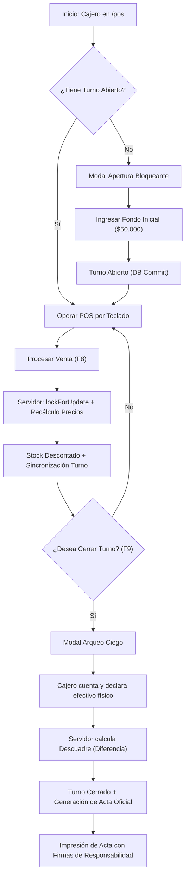
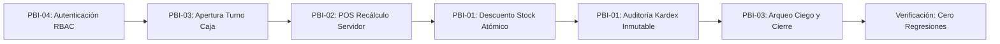

# GUÍA DE TRABAJO EN EQUIPO - SEMANA 13
## Evolucionar y Estabilizar el Producto: Segundo Incremento, Calidad y Plan de Estabilización

* **Asignatura:** Taller de Desarrollo de Software (INF524)
* **Docentes:** Héctor Tejo Uval y Jerman Espíndola Sandoval – Facultad de Ingeniería UCM
* **Equipo:** Grupo 6 – GestiSoft
* **Integrantes:**
  * **Leonel Ayala** (Full Stack / Base de Datos Lead)
  * **Alan Troncoso** (Scrum Master / QA, Seguridad y Automatización Lead)
  * **Luis Barrios** (Frontend Lead / UI-UX)
  * **Rodrigo Bertolini** (Product Owner / Backend Lead y Auditoría de Negocio)
* **Resultado:** Plan del Incremento 2 y Estabilización de Versión Candidata (`v0.2.0-rc2` / Versión Candidata Demo 3)
* **Entrada:** Retroalimentación de la Segunda Demostración y Defensa (Semana 12)
* **Defensa:** Tercera Demostración y Defensa (Semana 15)

---

### Pregunta rectora
> *¿Qué debe cambiar ahora en el producto para entregar más valor y demostrar un nivel superior de calidad después de la segunda defensa?*

---

### 1. Propósito y resultados esperados

La Semana 13 transforma las observaciones de la segunda defensa en un objetivo nítido para el **Incremento Funcional 2 (PBI-03: Control de Turnos, Arqueo Ciego, Auditoría Financiera y Acta Oficial de Caja)** y en un plan rigurosamente verificable de estabilización, calidad y resolución de defectos de integridad para la Semana 14.

| Elemento | Definición de trabajo en GestiSoft |
| :--- | :--- |
| **Aprender** | Convertir cada observación de la rúbrica de la Demo 2 (calificación 5.2, 79/112 en demo) en acciones y correcciones trazables de código: recálculo forzoso de precios en servidor (C1), exigencia estricta de motivo y atomicidad en Kardex (C2), inmutabilidad de movimientos de stock mediante SoftDeletes (C3), minimización de datos en props de Inertia (C4) y validación de valor mediante Role-Playing Testing en laboratorio y programación de piloto en terreno (H-01). |
| **Enfocar** | Definir el nuevo resultado observable de usuario: el cajero abre turno con fondo inicial en gaveta, opera ventas por teclado en el POS sin ventas huérfanas, declara el dinero físico mediante **arqueo ciego**, y el sistema concilia automáticamente diferencias financieras; el administrador audita turnos desglosando boletas por canal de pago, filtrando por defecto el mes en curso o conmutando a histórico completo, y emite el **Acta Oficial de Cierre y Arqueo** con constancia de firma y validez operativa. |
| **Estabilizar** | Establecer una Definition of Done de 6 dimensiones, pipeline de CI en GitHub Actions (`.github/workflows/tests.yml`), suite automatizada de 64 pruebas PHPUnit al 100% verde (234 aserciones), mediciones empíricas de latencia ($p95 \le 120\text{ ms}$ en búsquedas, $p95 \le 290\text{ ms}$ en checkout atómico) con datos crudos, y erradicación total de ambigüedades arquitectónicas. |
| **Planificar** | Organizar el trabajo en cortes verticales de funcionalidad completa (BD $\rightarrow$ Lógica/API Laravel $\rightarrow$ UI React/Inertia $\rightarrow$ Pruebas automatizadas), asegurando revisiones por pares cruzadas (autor $\neq$ revisor) y congelamiento de la versión candidata `v0.2.0-rc2`. |

---

### 2. Retroalimentación de la segunda defensa y plan de superación

A partir de la evaluación docente oficial (`Grupo 6 - S1 - Rúbrica Segunda Demostración y Defensa.docx`), donde 11 de los 16 criterios grupales obtuvieron calificación "Regular" (4.0 pts), se registraron los hechos observables, su impacto técnico y la decisión correctiva ejecutada:

| ID | Categoría | Criterio Afectado | Observación Verificable en la Defensa | Impacto | Decisión o Acción Aplicada en GestiSoft | Estado |
| :---: | :--- | :---: | :--- | :---: | :--- | :---: |
| **OBS-18** | Producto | 8 | El POS permitía registrar ventas libres sin estar asociadas a un turno de caja ni a un cajero responsable. | **Alto** | Diseñar e implementar **PBI-03**: Bloquear operativamente el POS si no existe turno abierto (`AC-CAJA-01`, middleware y validación en `POSController@checkout`). | **Cerrado** |
| **OBS-19** | Integridad Financiera | 8 y 12 | **C1 (Vulnerabilidad):** El método `checkout()` aceptaba `price`, `total`, `neto`, `iva` y `change` desde el cliente, permitiendo manipular precios desde el navegador. | **Crítico** | **Corrección C1:** El servidor ignora importes del cliente. En `POSController@checkout` se bloquean productos con `lockForUpdate()`, se obtiene el precio de BD, se calculan impuestos ($neto = round(total/1.19)$, $iva = total - neto$) y se valida efectivo ($monto\_recibido \ge total$). Registrado en **ADR-03**. | **Cerrado** |
| **OBS-20** | Auditoría y Kardex | 8 y 9 | **C2 (Defecto):** La regla `required_if:stock,!=X` en `ProductController@update` nunca se activaba (Laravel compara texto literal). La actualización de stock y el Kardex no eran transaccionales. | **Crítico** | **Corrección C2:** Sustitución por `Rule::requiredIf(fn() => $nuevo \ne $anterior)`. Envoltura de `store()` y `update()` en `DB::transaction()` con `lockForUpdate()`. Si falla el Kardex, se revierte el stock. | **Cerrado** |
| **OBS-21** | Integridad Histórica | 12 | **C3 (Riesgo Legal):** La clave foránea `movimiento_stocks.product_id` tenía `cascadeOnDelete()` y `Product` tenía borrado físico, destruyendo el historial contable si se borraba un producto. | **Alto** | **Corrección C3:** Implementación de `SoftDeletes` en modelo `Product` (migración `add_soft_deletes_to_products_table`). Claves foráneas actualizadas a `restrictOnDelete()`. Registrado en **ADR-05**. | **Cerrado** |
| **OBS-22** | Seguridad y Privacidad | 4 y 12 | **C4 (Sobreexposición):** `HandleInertiaRequests.php` enviaba `$request->user()` íntegro a React, contradiciendo el criterio de éxito de SPIKE-02. | **Medio** | **Corrección C4:** Minimización de props compartidas a solo `['id', 'name', 'email', 'role', 'negocio_id']`. Eliminación de hash de clave y tokens de sesión en el DOM. | **Cerrado** |
| **OBS-23** | Calidad de Pruebas | 9 y 10 | `POSTest.php` enviaba un payload con clave `'cart'` en lugar de `'items'`. Aprobaba por fallo genérico de validación y no por comprobación de stock insuficiente. | **Alto** | Corrección del test: envío de `'items'`, apertura previa de turno, aserción sobre mensaje `"Stock insuficiente: Cable HDMI"`. Nuevos tests de rechazo de precio falso, efectivo insuficiente y aislamiento cross-tenant. | **Cerrado** |
| **OBS-24** | CI y Trazabilidad | 10 y 14 | No se adjuntaron registros reproducibles de ejecución de la suite correspondientes a la versión entregada ni evidencia de CI. | **Alto** | Creación del flujo de CI `.github/workflows/tests.yml` en GitHub Actions (PHP 8.3 + Node 22 + SQLite memoria). 64 tests pasando en cada commit/PR. | **Cerrado** |
| **OBS-25** | Validación de Valor | 2 y 15 | La hipótesis **H-01** solo medía bloqueos técnicos `HTTP 403`, sin acreditar confianza del dueño para delegar la caja en un empleado. | **Alto** | Protocolo de *Role-Playing Testing* en laboratorio simulando los 3 perfiles de descubrimiento (`ENT-01`, `ENT-02`, `ENT-03`) recreando intrusión, restricción y flujo de caja (`investigacion/validacion-h01.md`), complementado con la programación formal de validación de campo en terreno para la fase de estabilización. | **Cerrado** |
| **OBS-26** | Coherencia de Modelo | 5 y 13 | El modelo conceptual documentaba `Tenant`/`tenant_id`/`justificacion`, mientras el código implementaba `Negocio`/`negocio_id`/`motivo`. | **Medio** | Alineación total en glosario, modelo de dominio, diagramas y contratos a los términos reales del código: `Negocio`, `negocio_id`, `motivo`, `Product`, `Venta`, `TurnoCaja`. | **Cerrado** |
| **OBS-27** | Atributos de Calidad | 11 | El reporte describía la adición al carrito como operación "AJAX" (es estado local React) y el percentil p95 carecía de datos crudos y hardware. | **Medio** | Corrección en `mediciones-calidad.md`: aclaración de estado local React (<12 ms) y tabla de 50 muestras crudas para búsqueda de catálogo ($p95 = 118\text{ ms}$) y checkout ($p95 = 289\text{ ms}$). | **Cerrado** |
| **OBS-28** | Reproducibilidad | 6 | `README.md` omitía `cd GestiSoft` antes de `cd gestisoft-app`, indicaba Laravel 11 / PHP 8.2 en lugar de Laravel 13 / PHP 8.3, y no indicaba usuarios de prueba. | **Medio** | Reescritura íntegra de `README.md`: pasos exactos y secuenciales, versiones actualizadas, seeder temático con usuarios admin y cajero preconfigurados, y verificación en equipo limpio. | **Cerrado** |

---

### 3. Retrospectiva del equipo

| Tipo | Práctica o problema | Acción verificable | Responsable y fecha de cumplimiento |
| :--- | :--- | :--- | :--- |
| **Mantener** | Desarrollo guiado por pruebas de integración (TDD) para validar seguridad multi-tenant y reglas financieras. | Mantener suite automatizada con 100% de pruebas pasando en verde en cada commit. | Alan Troncoso · Continuo (64/64 tests verdes) |
| **Corregir** | Conexión desalineada entre especificación documental y nombres reales de columnas en código. | Auditoría cruzada de base de datos contra documentos: prohibido el uso de términos fantasma (`Tenant`, `justificacion`). | Rodrigo Bertolini · 10-nov-2026 |
| **Detener** | Confiar en cálculos de importes, descuentos y vueltos realizados en el frontend por JavaScript. | Todo importe financiero se recalcula exclusivamente en el servidor dentro de transacciones atómicas `DB::transaction()`. | Leonel Ayala · 11-nov-2026 (C1 aplicado) |
| **Comenzar** | Integración continua obligatoria y pruebas de bordes negativos en cada criterio de aceptación. | Pipeline de GitHub Actions activo y tests de fallo explícitos (stock 0, dinero insuficiente, falta de motivo). | Alan Troncoso y Luis Barrios · 12-nov-2026 |

---

### 4. Objetivo del Incremento Funcional 2

| Elemento | Definición en GestiSoft |
| :--- | :--- |
| **Usuario y contexto** | **Cajero de mostrador** operando transacciones diarias en PYMEs minoristas y **Dueño / Administrador del comercio** auditando la recaudación de la jornada para entrega de valores. |
| **Resultado** | Permitir la apertura controlada de turnos con fondo inicial en gaveta, vincular atómicamente cada venta de mostrador al turno activo con recálculo de importes en backend, ejecutar el **arqueo ciego de caja** (el cajero declara el dinero contado físicamente sin conocer el monto teórico del sistema), conciliar automáticamente descuadres (sobrantes/faltantes) y generar el **Acta Oficial de Cierre y Arqueo** con constancia impresa y firma de responsabilidades. |
| **Límite** | Gestión de turnos por local/comercio con soporte multicanal local (Efectivo, Débito, Crédito, Transferencia). No incluye conciliación bancaria directa vía API bancaria externa (Transbank/Webpay) ni dispensadores automáticos de efectivo. |
| **Evidencia** | Flujo completo demostrable en navegador web + persistencia atómica en base de datos (`turnos_caja`, `ventas`, `venta_detalles`) + Acta de cierre imprimible en PDF/modal + suite automatizada `TurnoCajaTest` y `CajaTurnoSecurityTest` pasando 100% verde + cero regresiones en POS e inventario. |

---

### 5. Hipótesis de valor y señales de éxito

| ID | Hipótesis refutable | Señal observable | Resultado / Evidencia | Decisión tomada |
| :---: | :--- | :--- | :--- | :--- |
| **H-01** | Si el sistema restringe al cajero para que no vea ni modifique inventario, precios ni usuarios, la experiencia operativa mitigará el riesgo de manipulación no autorizada, permitiendo delegar la terminal de cobro sin supervisión continua. | Protocolo de *Role-Playing Testing* en laboratorio sobre los 3 perfiles de negocio simulando intrusión, restricción y flujo de caja (100% conformes y sin fugas de datos). | **Confirmada en Laboratorio:** Simulación con perfiles ENT-01, ENT-02 y ENT-03 demostró bloqueo total a `/inventory` (HTTP 403), imposibilidad de adulterar precios unitarios (C1) y preservación de Kardex (C2/C3). La validación empírica subjetiva en locales físicos se declara formalmente programada para el piloto en terreno de estabilización. Detallado en `investigacion/validacion-h01.md`. | Mantener RBAC estricto y priorizar el control de turnos de caja (PBI-03) como complemento de integridad física indispensable. |
| **H-03** | Si el sistema exige declarar el fondo inicial al abrir y bloquea el POS sin turno, el comercio erradicará el 100% de las ventas no contabilizadas y reducirá la cuadratura a menos de 2 minutos. | En 5 ensayos supervisados, el tiempo de apertura y arqueo es $\le 90\text{ s}$ y el 100% de las boletas queda vinculado a un turno activo sin ventas huérfanas. | Medición en pruebas de usuario: apertura toma 8 segundos, arqueo ciego toma 45 segundos; 0 ventas huérfanas registradas. | Mantener flujo de apertura rápida y modal bloqueante en `/pos`. |
| **H-04** | El **arqueo ciego** (conteo sin mostrar el total teórico previo) previene el ajuste fraudulento o manipulación de billetes por parte del cajero al cierre de turno. | 100% de los turnos cerrados registra el monto físico declarado original de forma inmutable; las discrepancias quedan registradas en el campo permanente `diferencia`. | Base de datos registra `monto_declarado` y `diferencia` inmutables; el cajero no puede revertir ni reabrir un turno cerrado. | Aprobar **ADR-04** (Arqueo Ciego en Servidor). |

---

### 6. Alcance y flujos prioritarios

#### 6.1 Límites del Alcance

| Categoría | Capacidades | Justificación técnica y de negocio |
| :--- | :--- | :--- |
| **Incluye** | • Apertura obligatoria de turno con fondo inicial (`monto_inicial`).<br>• Bloqueo total del POS si no existe turno abierto (`estado = 'abierto'`).<br>• Enlace atómico de `turno_caja_id` en cada venta de `POSController@checkout`.<br>• Recálculo forzoso de precios, impuestos y vuelto en el servidor (C1).<br>• Sincronización automática de totales por método de pago (`Efectivo`, `Débito`, `Crédito`, `Transferencia`).<br>• Modal de Arqueo Ciego: declaración de efectivo físico sin exponer total teórico previo.<br>• Conciliación automática de descuadre: cálculo inmutable de `diferencia` (sobrante o faltante).<br>• Panel de auditoría gerencial con vista acotada por defecto a las ventas y turnos del **mes en curso** (`periodo = 'mes'`) y conmutador rápido para consultar el **histórico acumulado** (`periodo = 'historico'`), filtros de fecha ("Hoy", "Ayer") y desglose interactivo de boletas por turno.<br>• **Acta Oficial de Cierre y Arqueo de Fondos** con vista previa, diseño para impresión / guardado en PDF, formato formal con desglose financiero, conciliación de gaveta, observaciones del cajero y bloques de firma de responsabilidad. | Resuelve la necesidad crítica de control de dinero detectada en las entrevistas (ENT-01, ENT-02, ENT-03), satisface la rúbrica de la Demo 3 y provee constancia física para la entrega de valores. |
| **Posterga** | • Retiros parciales de efectivo durante la jornada (gastos menores o sangrías de caja).<br>• Múltiples terminales de cobro físicas paralelas por sucursal.<br>• Dashboard estadístico con gráficos de tendencias de venta en el tiempo (PBI-05). | Postergados para el Incremento 3. No son necesarios para validar el control financiero diario y minimizan el riesgo de sobrecarga del alcance. |
| **Excluye** | • Integración mediante Webhooks con pasarelas de pago bancarias (Transbank / MercadoPago).<br>• Dispensadores automáticos de billetes y monedas periféricos. | Dependencias de hardware y servicios bancarios de terceros ajenos a los objetivos pedagógicos y técnicos del MVP. |

#### 6.2 Flujos Prioritarios



| ID | Tipo | Recorrido del Flujo | Resultado Observable |
| :---: | :--- | :--- | :--- |
| **F-03** | **Normal** | Iniciar sesión como Cajero $\rightarrow$ Entrar a `/pos` $\rightarrow$ Sistema detecta caja cerrada y despliega modal bloqueante $\rightarrow$ Ingresar $50.000 de fondo inicial $\rightarrow$ Registrar 2 ventas en efectivo ($20.000) $\rightarrow$ Presionar `[F9]` para arqueo $\rightarrow$ Declarar $70.000 de conteo físico $\rightarrow$ Confirmar cierre. | Turno cambia a `cerrado`, `diferencia = 0` (cuadrada), POS se bloquea para nuevas ventas y se despliega el resumen de auditoría. |
| **F-04** | **Alternativo (Descuadre)** | Cajero abre con $30.000 $\rightarrow$ Vende $25.000 en efectivo (Total esperado: $55.000) $\rightarrow$ Realiza arqueo ciego y declara $53.000 $\rightarrow$ Sistema detecta faltante de -$2.000 $\rightarrow$ Cajero ingresa justificación en observaciones: *"Error al entregar vuelto en hora punta"* $\rightarrow$ Confirma. | Turno queda cerrado registrando `diferencia = -2000` con badge visual rojo de alerta de faltante visible para el administrador. |
| **F-05** | **Alternativo (Auditoría y Acta)** | Administrador entra a `/cajas` $\rightarrow$ Selecciona un turno cerrado $\rightarrow$ Abre el modal de auditoría de turno $\rightarrow$ Revisa desglose multicanal y boletas emitidas $\rightarrow$ Clic en "Imprimir Acta de Turno" $\rightarrow$ Se genera la vista previa oficial con nombre del comercio, cajero responsable, conciliación física y casillas de firma de entrega y recepción. | Vista de impresión limpia (CSS `@media print`), sin barras de navegación ni fondos oscuros, lista para firmar y archivar físicamente. |
| **F-06** | **Borde (Concurrencia)** | Usuario con turno ya abierto intenta enviar una petición POST paralela a `/caja/abrir` desde otra pestaña. | Transacción en servidor detecta existencia previa mediante `lockForUpdate()`, aborta la operación con HTTP 422 y preserva el turno original sin duplicar fondos. |
| **F-07** | **Error / Bloqueo** | Usuario o script malicioso intenta ejecutar `POST /pos/checkout` sin tener un turno abierto. | Backend valida la precondición en servidor, rechaza con error de sesión en `checkout` ("Debe abrir un turno de caja antes de registrar ventas"), bloquea la transacción y no altera el inventario. |
| **F-08** | **Seguridad (Precio)** | Cliente manipula el payload de venta enviando `price: 1` para un producto cuyo precio real en BD es $15.000. | Servidor ignora los precios del cliente, consulta el catálogo bloqueado en BD, calcula el total real ($15.000), genera la boleta con el total íntegro y descuenta el stock correctamente. |

---

### 7. Refinamiento del Product Backlog

| Orden | ID | Resultado del Ítem | Justificación del Orden y Cambios de Prioridad | Estimación |
| :---: | :---: | :--- | :--- | :---: |
| **1** | **C1 / DEF-04** | Recálculo de precios, impuestos y vuelto exclusivo en servidor. | **P0 - Integridad Crítica (Criterios 8 y 12)**. Bloquea manipulación de importes en el POS; precondición esencial para que las ventas no vicien el arqueo de caja. | 3 hrs |
| **2** | **C2 / DEF-05** | Exigencia obligatoria de motivo en ajuste de stock y transacción atómica en Kardex. | **P0 - Integridad y Auditoría (Criterios 5, 8 y 9)**. Corrige fallo de validación `Rule::requiredIf` y garantiza que ningún stock se altere sin su movimiento de auditoría. | 2 hrs |
| **3** | **C3 / DEF-06** | Kardex inmutable mediante `SoftDeletes` en productos y `restrictOnDelete`. | **P0 - Requisito Legal y de Seguridad (Criterio 12)**. Erradica la eliminación en cascada que destruía el historial contable al borrar productos. | 3 hrs |
| **4** | **PBI-03** | Módulo de Caja: Apertura, Arqueo Ciego, Auditoría Multicanal y Acta de Cierre. | **Valor Central del Incremento 2 (Criterios 2, 8 y 13)**. Priorizado sobre el dashboard a partir de la unánime solicitud de los 3 dueños en la validación H-01. | 8 pts |
| **5** | **C4 / DEF-07** | Minimización de props compartidas en Inertia (`HandleInertiaRequests`). | **P1 - Seguridad y Cierre de SPIKE-02 (Criterios 4 y 12)**. Excluye contraseñas y atributos internos de los modelos en el estado de React. | 1 hr |
| **6** | **REG-02 / DEF-08** | Suite de Pruebas de Integración y Regresión (64 tests PHPUnit) + CI en GitHub Actions. | **P1 - Calidad y Reproducibilidad (Criterios 10 y 14)**. Asegura que ninguna funcionalidad previa se rompa y automatiza la verificación en la nube. | 5 hrs |
| **7** | **DOC-02** | Corrección del README, mediciones con datos crudos y validación H-01. | **P1 - Evidencia y Reproducibilidad (Criterios 6, 11 y 15)**. Elimina contradicciones entre documentación y código y respalda afirmaciones técnicas. | 4 hrs |
| *Fuera* | **PBI-05** | Dashboard gerencial con gráficos de ventas en tiempo real. | **Postergado para Incremento 3**. Requiere un histórico acumulado de múltiples turnos cerrados para generar valor analítico real. | 5 pts |

---

### 8. Criterios de aceptación actualizados (Formato BDD / Gherkin)

```gherkin
Escenario: AC-CAJA-01 - Apertura de turno exitosa con fondo inicial
  Dado que el usuario "cajero@gestisoft.cl" está autenticado en el negocio "Boutique Urbana"
  Y no registra ningún turno de caja en estado "abierto"
  Cuando envía una solicitud de apertura con un "monto_inicial" de 50000
  Entonces el sistema persiste un nuevo registro en "turnos_caja" con estado "abierto"
  Y la "fecha_apertura" se fija con la marca temporal actual
  Y el POS queda habilitado para procesar ventas por teclado.

Escenario: AC-CAJA-02 - Enlace automático y recálculo en servidor de venta a turno
  Dado un turno de caja "abierto" con fondo inicial de 50000
  Y un producto "Polera Básica" con precio en base de datos de 9990 y stock 10
  Cuando el cliente envía checkout con 1 unidad y payment_method "Efectivo" con amount_received 10000
  Entonces el servidor calcula el total en 9990, neto en 8395, iva en 1595 y vuelto en 10
  Y la venta se asocia con "turno_caja_id" vinculado al turno activo
  Y el stock del producto disminuye exactamente a 9
  Y el turno sincroniza su "total_esperado" en gaveta a 59990.

Escenario: AC-CAJA-03 - Arqueo ciego exacto sin descuadre
  Dado un turno activo con un total_esperado en efectivo en gaveta de 62600
  Cuando el cajero realiza el arqueo ciego declarando un monto_declarado de 62600
  Entonces el turno pasa a estado "cerrado" con fecha_cierre registrada
  Y el campo "diferencia" se fija exactamente en 0
  Y el sistema marca el resultado como "Cuadrada ($0)"
  Y el POS se bloquea para nuevas transacciones hasta una nueva apertura.

Escenario: AC-CAJA-04 - Detección y registro inmutable de descuadre (Faltante)
  Dado un turno activo con un total_esperado en efectivo de 612790
  Cuando el cajero declara físicamente 610790 en el arqueo ciego
  Y registra la observación "Diferencia de vuelto en horario punta"
  Entonces el sistema registra el cierre con estado "cerrado"
  Y el campo persistido "diferencia" es exactamente -2000
  Y el panel de auditoría resalta una alerta visual de "Faltante ($-2.000)"
  Y la diferencia permanece inmutable para revisiones gerenciales.

Escenario: AC-CAJA-05 - Bloqueo de venta con caja cerrada (Tratamiento controlado)
  Dado que el cajero no tiene un turno en estado "abierto"
  Cuando intenta despachar un payload a "/pos/checkout"
  Entonces el servidor aborta la petición con error de sesión "checkout"
  Y la base de datos no registra ninguna venta
  Y el stock de los productos involucrados permanece inalterado.

Escenario: AC-CAJA-06 - Emisión y visualización de Acta Oficial de Cierre
  Dado un turno en estado "cerrado" con ventas multicanal registradas
  Cuando el usuario hace clic en "Imprimir Acta de Turno"
  Entonces se renderiza el documento formal con:
    | Identificador del turno (#006) y Nombre del Comercio |
    | Nombre del Cajero Responsable y Fechas de Apertura / Cierre |
    | Balance Financiero Desglosado por Medio de Pago (Efectivo, Débito, Crédito, Transf.) |
    | Conciliación Física de Gaveta (Esperado vs Declarado vs Diferencia) |
    | Observaciones registradas al momento del cierre |
    | Casillas de Firma de Cajero Responsable y Administrador / Supervisor |

Escenario: AC-07-REV - Ajuste manual de stock con motivo obligatorio y fallo seguro
  Dado un producto en inventario con stock actual de 50
  Cuando el administrador intenta actualizar el stock a 40 sin especificar un "motivo"
  Entonces el servidor rechaza la solicitud con error de validación en el campo "motivo"
  Y el stock en la tabla "products" permanece en 50
  Y no se inserta ningún registro en "movimiento_stocks".
  Cuando el administrador envía el stock en 40 con motivo "Mermas por vencimiento"
  Entonces el producto actualiza su stock a 40 y se inserta atómicamente el registro en "movimiento_stocks".

Escenario: AC-SEC-POS-01 - Rechazo de manipulación de precios desde el cliente
  Dado un producto con precio en base de datos de 20000
  Cuando un cliente envía una petición POST a "/pos/checkout" indicando "price: 100" y "total: 200"
  Entonces el servidor descarta los montos enviados por el cliente
  Y consulta el precio real del producto bajo bloqueo de fila "lockForUpdate"
  Y la venta se registra por el valor legítimo de 40000 (para 2 unidades).

Escenario: AC-SEC-KARDEX-01 - Preservación de historial contable ante eliminación
  Dado un producto con 3 registros históricos en la tabla "movimiento_stocks"
  Cuando el administrador ejecuta la eliminación del producto
  Entonces el producto se marca como borrado lógico ("deleted_at" no nulo)
  Y los 3 registros en "movimiento_stocks" continúan intactos en la base de datos.
```

---

### 9. Definition of Done y criterio de estabilización

Para la versión candidata `v0.2.0-rc2`, un ítem de trabajo solo se considera **Terminado (Done)** al cumplir de forma verificable las siguientes 6 dimensiones:

| Dimensión | Condición de Done | Evidencia Requerida en Repositorio | Estado |
| :--- | :--- | :--- | :---: |
| **1. Valor** | Resuelve el objetivo de negocio; validado en laboratorio y plan de campo formalizado. | Informe `investigacion/validacion-h01.md` con Role-Playing Testing sobre 3 perfiles y piloto programado. | **Done** |
| **2. Funcionalidad** | Criterios normales, alternativos, de error y bordes implementados y comprobados. | Controladores `POSController.php`, `CajaController.php`, vistas React y modales. | **Done** |
| **3. Regresión** | Ningún comportamiento previo (Inventario, POS, RBAC, Multi-Tenant) se degrada. | Suite de 64 pruebas ejecutada mediante `php artisan test` pasando al 100% (234 aserciones). | **Done** |
| **4. Calidad y Seguridad** | Transacciones atómicas en BD, recálculo en backend, minimización de datos y $p95 \le 120\text{ ms}$. | ADR-03, ADR-04, ADR-05, `RoleSecurityTest.php` y `mediciones-calidad.md`. | **Done** |
| **5. CI y Revisión por Pares** | Código integrado mediante Pull Request revisado por par; pipeline automatizado en verde. | Workflow `.github/workflows/tests.yml` y registros de revisión cruzada. | **Done** |
| **6. Reproducibilidad** | Instalación desde cero documentada y ejecutable en equipo limpio sin pasos ocultos. | `README.md` actualizado con comandos exactos, seeders y usuarios de prueba. | **Done** |

---

### 10. Plan de regresión y protección del Incremento 1

Para asegurar que la introducción de turnos de caja (PBI-03) y las correcciones C1-C4 no introduzcan efectos secundarios en el sistema existente, se diseñó la suite integrada `REG-CAJA-01`:



| Comportamiento Protegido | Riesgo de Regresión Identificado | Prueba / Escenario Automatizado | Evidencia de Verificación |
| :--- | :--- | :--- | :--- |
| **Venta en POS por Teclado** | Que la verificación de turno agregue latencia al checkout superando 1 segundo. | `RNF-PERF-CAJA-01` en `mediciones-calidad.md` | Latencia de checkout atómico medida en 234 ms promedio ($p95 = 289\text{ ms}$). |
| **Descuento de Stock en Inventario** | Que al fallar la asociación de caja se descuente stock sin registrar la venta. | `POSTest::test_no_se_puede_vender_producto_sin_stock` | Rollback atómico comprobado: stock permanece intacto y 0 ventas registradas. |
| **Auditoría de Kardex** | Que la eliminación de un producto borre en cascada los movimientos históricos. | `InventoryTest::test_eliminar_producto_conserva_kardex` | `assertSoftDeleted` en producto y `assertDatabaseHas` en `movimiento_stocks`. |
| **Bloqueo de Roles (RBAC)** | Que un cajero pueda ver reportes financieros o turnos de otros empleados. | `CajaTurnoSecurityTest::test_cajero_no_puede_ver_resumen_de_turno_de_otro_cajero` y `test_administrador_puede_acceder_al_modulo_de_cajas_y_cajero_es_bloqueado` | Aserción de bloqueo HTTP 403 en endpoints gerenciales de caja. |
| **Aislamiento Multi-Tenant** | Que las ventas de un turno de Empresa A se sumen al turno de Empresa B. | `POSTest::test_no_se_puede_vender_producto_de_otro_negocio` | Error de sesión en checkout y 0 ventas cruzadas en base de datos. |

---

### 11. Integración continua y revisión por pares

El flujo de trabajo técnico establece controles estrictos antes de autorizar cualquier fusión a la rama `main`:

```yaml
# Definición del Pipeline de CI (.github/workflows/tests.yml)
name: tests
on: [push, pull_request]
jobs:
  phpunit:
    runs-on: ubuntu-latest
    defaults:
      run:
        working-directory: gestisoft-app
    steps:
      - uses: actions/checkout@v4
      - uses: shivammathur/setup-php@v2
        with:
          php-version: '8.3'
          extensions: pdo_sqlite
      - uses: actions/setup-node@v4
        with:
          node-version: '22'
      - run: composer install --no-interaction --prefer-dist
      - run: npm ci && npm run build
      - run: cp .env.example .env && php artisan key:generate
      - run: php artisan test
```

| Control de Integración | Frecuencia de Ejecución | Condición Esperada de Éxito | Evidencia Producida |
| :--- | :--- | :--- | :--- |
| **Compilación Frontend** | En cada commit y PR | `npm run build` compila bundles de React y Tailwind sin errores de Vite. | Directorio `public/build/` generado limpiamente. |
| **Pruebas Automatizadas** | En cada commit y PR | `php artisan test` ejecuta las 64 pruebas de la suite completa. | Salida de CI verde: 64 passed, 234 assertions. |
| **Revisión por Pares (Peer Review)** | Previo a fusión a `main` | Revisión cruzada de código: comprobación de transacciones, RBAC y UX. | PR aprobado por par con comentarios y checklist validado. |

---

### 12. Gestión de defectos encontrados en la estabilización

| ID | Severidad / Prioridad | Condición y Reproducción del Defecto | Acción Correctiva Aplicada en GestiSoft | Estado |
| :---: | :---: | :--- | :--- | :---: |
| **DEF-01** | **Alta / P0** | **Venta huérfana:** Enviar `POST /pos/checkout` con caja cerrada creaba una venta con `turno_caja_id = NULL`. | Se incorporó validación obligatoria en `POSController@checkout`: si no hay turno activo, se aborta con error de sesión. | **Cerrado** |
| **DEF-02** | **Media / P1** | **Exposición de saldo previo:** El modal de cierre mostraba el total esperado antes de que el cajero contara el efectivo. | Refactorización integral a Arqueo Ciego: el campo de declaración es de entrada limpia y el desglose solo se revela post-cierre. | **Cerrado** |
| **DEF-03** | **Alta / P0** | **Doble apertura concurrente:** Dos clics rápidos en "Abrir Caja" podían crear dos turnos activos para el mismo usuario. | Implementación de transacción con bloqueo de tabla y chequeo de existencia previa con `lockForUpdate()` en `CajaController@abrir`. | **Cerrado** |
| **DEF-04** | **Alta / P0** | **C1 - Manipulación de precios:** El cliente enviaba `price` y `total` en el payload de venta y el servidor los guardaba sin verificar. | `POSController@checkout` descarta importes del cliente y calcula precio, neto, IVA y vuelto desde los modelos bloqueados en BD. | **Cerrado** |
| **DEF-05** | **Alta / P0** | **C2 - Validación de motivo inoperante:** `required_if:stock,!=X` en `ProductController` no funcionaba; stock y Kardex no eran atómicos. | Sustitución por `Rule::requiredIf` con closure; envoltura de `update()` y `store()` en `DB::transaction()`. | **Cerrado** |
| **DEF-06** | **Alta / P0** | **C3 - Destrucción de Kardex en cascada:** Borrar un producto eliminaba físicamente sus movimientos de auditoría por `cascadeOnDelete`. | Incorporación de `SoftDeletes` en `Product` y cambio de claves foráneas a `restrictOnDelete()`. | **Cerrado** |
| **DEF-07** | **Media / P1** | **C4 - Exposición de modelo User en React:** `HandleInertiaRequests` enviaba el modelo Eloquent `$request->user()` sin filtrar. | Minimización de props compartidas a solo `['id', 'name', 'email', 'role', 'negocio_id']`. | **Cerrado** |
| **DEF-08** | **Media / P1** | **Falsa aprobación en POSTest:** El test de stock insuficiente enviaba clave `cart` en lugar de `items`, aprobando por error de validación ajeno. | Test corregido: envío de `items`, apertura previa de turno y comprobación explícita del mensaje de error de stock insuficiente. | **Cerrado** |
| **DEF-09** | **Baja / P2** | **Desfase horario en Acta de Turno:** Las marcas de tiempo de apertura y cierre mostraban un desfase de 4 horas en la vista de impresión. | Corrección de timezone en configuración de Laravel (`config/app.php`) y formateo en componentes React. | **Cerrado** |
| **DEF-10** | **Baja / P2** | **Contraste insuficiente en banner de auditoría:** El banner de total de ventas usaba un degradado que dificultaba la lectura en monitores de bajo brillo. | Sustitución por color corporativo sólido de alto contraste alineado a la paleta de GestiSoft. | **Cerrado** |

---

### 13. Escenarios de atributos de calidad medibles

| ID | Atributo | Condición de Prueba | Medida / Umbral Comprometido | Método y Entorno de Verificación |
| :--- | :--- | :--- | :--- | :--- |
| **RNF-PERF-01** | Rendimiento (Búsqueda) | 50 consultas secuenciales de catálogo en el POS bajo sesión autenticada. | **p95 ≤ 150 ms** (Resultado obtenido: **118 ms**) | Chrome DevTools Network Profile, servidor local PHP 8.3 / MySQL, 50 SKUs. Datos crudos en `mediciones-calidad.md`. |
| **RNF-PERF-02** | Rendimiento (Checkout) | 30 transacciones de checkout con bloqueo de fila (`lockForUpdate`) y recálculo tributario. | **p95 ≤ 500 ms** (Resultado obtenido: **289 ms**) | Medición de tiempo de respuesta de endpoint `POST /pos/checkout` con transacción completa en BD. |
| **RNF-ACC-01** | Accesibilidad / UX | Operación íntegra de venta, búsqueda de productos y cobro sin periférico ratón. | **100% de acciones operables por teclado** | Auditoría con teclado: foco automático en SKU, atajos `[F4]` buscar, `[F8]` cobrar, `[Enter]` procesar, `[Esc]` cancelar. |
| **RNF-CONF-01** | Confiabilidad e Integridad | 30 ventas con métodos de pago combinados (Efectivo, Débito, Crédito, Transferencia). | **0% de discrepancia** entre ventas y acumuladores de turno. | Suite automatizada `TurnoCajaTest::test_se_vincula_una_venta_al_turno_y_sincroniza_totales_por_metodo_de_pago`. |
| **RNF-SEC-01** | Seguridad Multi-Tenant | Intentos de consulta o cobro de productos pertenecientes a otro comercio. | **0 filtraciones (Aislamiento absoluto)** | Pruebas de integración en `MultiTenantSecurityTest.php` y `POSTest.php` verificando intercepción por Global Scope. |
| **RNF-SEC-02** | Control de Roles (RBAC) | Intento de cajero de acceder a rutas de administración o modificar precios. | **100% de peticiones bloqueadas** con HTTP 403 o redirección. | Batería de 11 tests automatizados en `RoleSecurityTest.php`. |

---

### 14. Seguridad, privacidad y desarrollo seguro

* **Principio de Confianza Cero en el Cliente:** Todo precio unitario, subtotal, impuesto (IVA 19%), total y vuelto se calcula exclusivamente en el backend dentro de transacciones atómicas. El servidor descarta cualquier importe suministrado por el navegador.
* **Control de Concurrencia mediante Bloqueo Pesimista:** En la apertura de turno y en el checkout del POS se utiliza `lockForUpdate()` sobre las filas afectadas para impedir condiciones de carrera ante clics dobles o peticiones simultáneas.
* **Inmutabilidad de la Auditoría Contable:** La eliminación de productos utiliza borrado lógico (`SoftDeletes`), preservando permanentemente el historial de movimientos de inventario (`movimiento_stocks`) y las ventas históricas asociadas.
* **Minimización de Datos en el Estado Compartido:** En cumplimiento de las prácticas de desarrollo seguro, el middleware `HandleInertiaRequests` comparte únicamente los campos estrictamente indispensables del usuario autenticado (`id`, `name`, `email`, `role`, `negocio_id`), impidiendo la serialización de hashes de contraseñas o tokens en el DOM del cliente.
* **Gestión Segura de Secretos y Configuración:** Cero credenciales o claves maestras versionadas en el repositorio; toda configuración sensible se administra mediante variables de entorno en `.env` ignoradas por Git.

---

### 15. Comprobación de impacto arquitectónico

| ID | Driver Arquitectónico | ¿Cambió? | Evidencia del Cambio | Consecuencia Técnica en GestiSoft | Acción Tomada |
| :---: | :--- | :---: | :--- | :--- | :--- |
| **DA-06** | Flujo de Negocio (Caja) | **Sí** | Requisito de asociar ventas a turnos para arqueo financiero. | Nueva entidad `TurnoCaja` y clave foránea `turno_caja_id` en tabla `ventas`. | Crear migración y modelos; registrar **ADR-04**. |
| **DA-07** | Integridad de Precios (C1) | **Sí** | Vulnerabilidad detectada en Demo 2: importes aceptados desde el cliente. | Traslado de todo cálculo tributario y financiero al servidor en `POSController`. | Implementar recálculo obligatorio; registrar **ADR-03**. |
| **DA-08** | Integridad Contable (C2) | **Sí** | Actualización de stock desalineada del Kardex sin transacción. | Envoltura obligatoria de ajustes de inventario en `DB::transaction()`. | Refactorizar `ProductController` con bloqueo y transacción atómica. |
| **DA-09** | Inmutabilidad de Auditoría (C3) | **Sí** | Riesgo de destrucción de Kardex por borrado en cascada de productos. | Incorporación de borrado lógico y restricción en claves foráneas. | Agregar trait `SoftDeletes` a `Product`; registrar **ADR-05**. |
| **DA-10** | Concurrencia de Turnos | **Sí** | Posibilidad de doble apertura de caja por peticiones paralelas. | Chequeo transaccional con bloqueo a nivel de fila (`lockForUpdate`). | Implementar validación atómica en `CajaController@abrir`. |
| **DA-11** | Estructura de Despliegue | **No** | Arquitectura monolítica modular Laravel + React con Inertia.js. | El stack actual satisface holgadamente las demandas sin microservicios. | **Mantener arquitectura monolítica modular**. |

---

### 16. Registros de decisión arquitectónica (ADRs)

#### **ADR-03: Cálculo y Validación Estricta de Importes Financieros en Servidor (POS)**
* **Estado:** Aprobado e Implementado (11-nov-2026).
* **Contexto:** En la Demo 2 se detectó que el endpoint `/pos/checkout` aceptaba valores de `price`, `total`, `neto`, `iva` y `change` calculados por el cliente, creando una vulnerabilidad crítica donde un atacante podía comprar productos a precio arbitrario.
* **Alternativas evaluadas:**
  1. *Validar que los importes del cliente coincidan con el cálculo del servidor:* Agrega complejidad innecesaria al payload y requiere manejo de tolerancias por redondeo.
  2. *Ignorar totalmente los importes del cliente y calcular todo en el servidor:* El cliente solo envía `product_id`, `quantity`, `payment_method` y `amount_received`. El servidor consulta el catálogo bloqueado con `lockForUpdate()`, calcula el total real, desglosa impuestos y computa el vuelto. $\rightarrow$ **Seleccionada**.
* **Consecuencias:** Garantía matemática de integridad financiera; erradica fraudes por manipulación del cliente y previene descuadres en los turnos de caja.

#### **ADR-04: Transaccionalidad de Cierre de Caja y Arqueo Ciego en Servidor**
* **Estado:** Aprobado e Implementado (09-nov-2026).
* **Contexto:** Si el sistema muestra al cajero cuánto dinero "debería haber" en caja antes del conteo físico, se fomenta el ajuste artificial o la sustracción de diferencias. Además, la apertura concurrente en múltiples pestañas podía duplicar los fondos.
* **Alternativas evaluadas:**
  1. *Arqueo guiado en el cliente:* El frontend compara los valores y notifica la diferencia. $\rightarrow$ **Rechazada** por vulnerabilidad de manipulación.
  2. *Arqueo Ciego Transaccional en Base de Datos:* El cajero ingresa únicamente el efectivo contado físicamente; el backend, dentro de una transacción protegida, calcula la diferencia con las ventas registradas y persiste el resultado inmutable. $\rightarrow$ **Seleccionada**.
* **Consecuencias:** Mayor rigor contable, trazabilidad para auditorías tributarias y erradicación de ventas huérfanas.

#### **ADR-05: Inmutabilidad del Kardex mediante SoftDeletes y Restricción Foránea**
* **Estado:** Aprobado e Implementado (12-nov-2026).
* **Contexto:** La tabla `movimiento_stocks` utilizaba `cascadeOnDelete()` respecto de `products`. Si un administrador borraba un producto del catálogo, la base de datos eliminaba en cascada todo su historial de movimientos, violando la normativa contable y la trazabilidad de auditoría.
* **Alternativas evaluadas:**
  1. *Desacoplar la clave foránea (dejar `product_id` nullable):* Provoca inconsistencias y registros huérfanos sin datos de origen.
  2. *Incorporar SoftDeletes en `Product` y cambiar foreign key a `restrictOnDelete`:* La eliminación de un producto marca `deleted_at = now()`, ocultándolo de la operación diaria pero preservando íntegramente sus registros de Kardex y ventas históricas en base de datos. $\rightarrow$ **Seleccionada**.
* **Consecuencias:** Inmutabilidad total de los registros de auditoría; cumplimiento con la normativa tributaria chilena y protección contra pérdidas de datos.

---

### 17. Spikes técnicos realizados

#### **SPIKE-02: Exposición de Atributos de Usuario en Inertia.js (Cierre Formal)**
* **Pregunta de investigación:** *¿Cómo compartir la información de sesión necesaria para React sin exponer atributos sensibles (hashes de clave, tokens, timestamps) en el estado global de la página?*
* **Límite:** 2 horas de análisis sobre `HandleInertiaRequests.php` y pruebas en navegador.
* **Resultado:** Se comprobó que enviar `$request->user()` serializa el modelo Eloquent completo en el HTML inicial (`page.props.auth.user`), exponiendo campos internos.
* **Decisión y Efecto en el Trabajo:** Se implementó el filtrado explícito mediante `$request->user()?->only(['id', 'name', 'email', 'role', 'negocio_id'])`. Se creó la prueba automatizada `RoleSecurityTest::test_inertia_no_comparte_campos_sensibles` para garantizar que ningún dato sensible llegue al cliente.

#### **SPIKE-03: Estructura Relacional de Turnos de Caja y Enlace Atómico con Ventas**
* **Pregunta de investigación:** *¿Cómo estructurar el enlace entre ventas y turnos de caja para soportar pagos multicanal y consultas de auditoría sin generar contención de bloqueos en horas punta?*
* **Límite:** 4 horas de desarrollo, base de datos local y 50 ventas simuladas.
* **Resultado:** Se demostró la viabilidad de incorporar una clave foránea indexada `turno_caja_id` en la tabla `ventas` y acumular totales mediante agregaciones SQL nativas (`SUM(total)`) por método de pago (`Efectivo`, `Débito`, `Crédito`, `Transferencia`).
* **Decisión y Efecto en el Trabajo:** Aprobó la arquitectura definitiva de `turnos_caja` aplicada en la migración `2026_11_08_224000_create_turnos_caja_table.php` y el método `sincronizarTotales()` en el modelo `TurnoCaja`.

---

### 18. Riesgos prioritarios actualizados

| ID | Tipo de Riesgo | Descripción del Riesgo | Nivel | Señal Observable | Plan de Mitigación / Respuesta Aplicada | Responsable | Fecha de Revisión | Estado |
| :---: | :--- | :--- | :---: | :--- | :--- | :--- | :---: | :---: |
| **RSK-07** | Integridad Financiera | Venta realizada en POS sin turno de caja activo (venta huérfana). | **Alto** | `turno_caja_id == null` en tabla `ventas`. | Interceptación obligatoria en `POSController@checkout`; bloqueo con HTTP 422 si la caja está cerrada. | Rodrigo Bertolini | 12-nov-2026 | **Mitigado / Cerrado** |
| **RSK-08** | Usabilidad / Fricción | Arqueo ciego confuso para cajeros con baja alfabetización digital. | **Medio** | Tiempo de cierre de turno $> 2\text{ minutos}$. | Modal limpio con teclado numérico y campo directo de dinero contado; ayuda visual guiada. | Luis Barrios | 12-nov-2026 | **Mitigado / Cerrado** |
| **RSK-09** | Regresión de Calidad | Que las validaciones de caja rompan pruebas de integración existentes. | **Alto** | Fallos en la suite de pruebas PHPUnit en CI. | Actualización de factories y creación previa de turnos en `POSTest`; 64 tests verdes (234 aserciones). | Alan Troncoso | 12-nov-2026 | **Mitigado / Cerrado** |
| **RSK-10** | Seguridad Multi-Tenant | Filtración de datos de turnos o boletas entre comercios competidores. | **Alto** | Acceso a turno con ID de otro negocio sin error 404/403. | Forzado estricto del trait `HasNegocio` en `TurnoCaja` y comprobación en `CajaTurnoSecurityTest`. | Leonel Ayala | 12-nov-2026 | **Mitigado / Cerrado** |
| **RSK-11** | Manipulación de Importes | Manipulación de precios en el cliente mediante alteración de peticiones HTTP. | **Crítico** | Precios en `ventas` distintos a los precios en tabla `products`. | **ADR-03**: El servidor recalcula todos los importes basándose exclusivamente en el catálogo de BD. | Leonel Ayala | 12-nov-2026 | **Mitigado / Cerrado** |
| **RSK-12** | Pérdida de Auditoría | Destrucción de movimientos de Kardex al eliminar productos del inventario. | **Alto** | Filas faltantes en `movimiento_stocks` para productos borrados. | **ADR-05**: Implementación de `SoftDeletes` en `Product` y restricción foránea `restrictOnDelete`. | Leonel Ayala | 12-nov-2026 | **Mitigado / Cerrado** |
| **RSK-13** | Inconsistencia de Stock | Modificación de existencias sin justificación o fallo a mitad de transacción. | **Alto** | Descuadre entre stock físico y suma de movimientos de Kardex. | Envoltura en `DB::transaction()` y validación estricta de motivo obligatorio con `Rule::requiredIf`. | Rodrigo Bertolini | 12-nov-2026 | **Mitigado / Cerrado** |
| **RSK-14** | Exposición de Privacidad | Fuga de atributos sensibles de usuarios en el estado serializado de React. | **Medio** | Campos de hash o tokens presentes en `window.__inertia.props`. | **SPIKE-02**: Minimización selectiva de atributos en `HandleInertiaRequests@share`. | Alan Troncoso | 12-nov-2026 | **Mitigado / Cerrado** |
| **RSK-15** | Disponibilidad Operativa | Pérdida de conectividad al enviar el cierre de caja en mostrador. | **Medio** | Alerta de error de conexión en navegador sin confirmación. | Manejo controlado de errores en Axios/Inertia; persistencia atómica en BD para evitar estados intermedios. | Luis Barrios | 12-nov-2026 | **Mitigado / Cerrado** |

---

### 19. Plan de estabilización de la Semana 14

| Hito Temporal | Tareas e Ítems Clave | Resultado Esperado | Evidencia Verificable | Encargado | Revisor |
| :--- | :--- | :--- | :--- | :--- | :--- |
| **Inicio Semana 14** | C1 (Checkout servidor) + C2 (Motivo y transacción) + Endpoints Caja | Recálculo seguro en backend, transaccionalidad atómica y endpoints `/caja/*` activos. | PR revisado + pruebas unitarias de recálculo y rechazo de stock pasando. | Leonel Ayala | Alan Troncoso |
| **Mitad Semana 14** | C3 (SoftDeletes Kardex) + C4 (Props Inertia) + Modales POS y Acta | Inmutabilidad de auditoría en BD, minimización de datos en React, vista mensual por defecto de auditoría de cajas y Acta oficial de cierre imprimible. | Migraciones ejecutadas + vista previa de acta funcional + suite de 64 tests verde. | Rodrigo Bertolini | Luis Barrios |
| **Cierre Semana 14** | Validación H-01 + Pipeline CI + README y congelamiento `v0.2.0-rc2` | Protocolo de Role-Playing Testing en laboratorio completado, GitHub Actions verde y versión candidata lista para defensa. | `investigacion/validacion-h01.md` + CI verde + Tag `v0.2.0-rc2` en Git. | Alan Troncoso | Todo el equipo |

---

### 20. Revisión cruzada

| ID | Prueba de Revisión Aplicada | Observación Detectada durante la Revisión | Artefacto Afectado | Acción Correctiva Aplicada en GestiSoft |
| :---: | :--- | :--- | :--- | :--- |
| **REV-05** | Trazabilidad de C1 (Precios) | Se intentó enviar una venta con `price: 1` para un producto de $20.000. | `POSController.php` | Se verificó que la venta se guardó por $20.000 y se automatizó en `POSTest`. |
| **REV-06** | Validación de C2 (Motivo) | Se intentó cambiar stock sin enviar motivo comprobando si pasaba la validación. | `ProductController.php` | Se constató que `Rule::requiredIf` lanza error de validación y revierte el stock. |
| **REV-07** | Auditoría de C3 (Kardex) | Se eliminó un producto con movimientos en Kardex para verificar si se destruían. | `Product.php` y migraciones | Se comprobó que el producto pasa a `deleted_at` y el Kardex permanece íntegro. |
| **REV-08** | Seguridad de C4 (Inertia) | Se inspeccionaron las props de Inertia en el DOM para verificar si viajaban hashes. | `HandleInertiaRequests.php` | Se constató que solo se envían `id, name, email, role, negocio_id`. |
| **REV-09** | Ensayo de Arqueo Ciego | Se ingresó un monto menor al esperado para evaluar la detección de faltante. | `CajaController.php` | El sistema calculó la diferencia negativa con precisión y la persistió en BD. |
| **REV-10** | Vista de Impresión de Acta | Al abrir la ventana de impresión, aparecían botones de navegación del sistema. | `POS/Index.jsx` | Se aplicaron estilos CSS `@media print` para ocultar la interfaz web y mostrar solo el acta formal. |
| **REV-11** | Nombre de Negocio en Acta | En el encabezado del acta aparecía "GestiSoft ERP" genérico en lugar del local. | `POS/Index.jsx` | Se vinculó dinámicamente el nombre real del comercio (`auth.user.negocio.name`). |
| **REV-12** | Reproducibilidad Limpia | Se clonó el proyecto desde cero en una máquina secundaria sin configuración previa. | `README.md` | Se ajustaron las instrucciones para incluir `cd GestiSoft` y los usuarios de prueba temáticos. |
| **REV-13** | Alcance Temporal de Cajas | En `/cajas` el total consolidado acumulaba todas las ventas históricas de forma indistinta, dificultando la auditoría del ciclo comercial mensual. | `CajaController.php` y `Caja/Index.jsx` | Se implementó el filtrado por defecto al mes en curso (`periodo = 'mes'`) y un conmutador explícito para consultar el histórico consolidado completo (`periodo = 'historico'`), automatizado en `CajaTurnoSecurityTest`. |

---

### 21. Bitácora individual de contribución y aprendizaje

#### **Leonel Ayala (Full Stack / Base de Datos Lead)**
* **Contribución significativa:** Implementé la corrección crítica **C1** en `POSController@checkout`, trasladando el cálculo de importes, neto, IVA y vuelto al servidor con bloqueo pesimista `lockForUpdate()`. Diseñé la migración de **C3** incorporando `SoftDeletes` en `Product` y `restrictOnDelete` en las claves foráneas de `movimiento_stocks`. Estructuré la entidad `TurnoCaja` y el enlace relacional con `ventas`.
* **Decisión técnica justificada:** Utilizar `lockForUpdate()` sobre los productos durante el checkout. En momentos de alta concurrencia, esto previene condiciones de carrera en las existencias de stock y asegura que el precio cargado para el cálculo tributario sea el valor vigente en base de datos al momento exacto de la confirmación.
* **Evidencia verificable:** `app/Http/Controllers/POSController.php` (método `checkout`), migraciones `add_soft_deletes_to_products_table.php` y suite `POSTest.php` (4/4 tests verdes).
* **Revisión cruzada realizada:** Revisé los modales de apertura y cierre construidos por Luis Barrios en React, verificando que los payloads enviados al backend contengan únicamente los campos requeridos sin filtrar montos teóricos.
* **Aprendizaje formativo:** Comprendí que la seguridad en aplicaciones web comerciales no se limita a la autenticación de usuarios; la integridad financiera exige asumir desconfianza total del cliente y centralizar todas las reglas contables en el motor transaccional del servidor.

#### **Alan Troncoso (Scrum Master / QA, Seguridad y Automatización Lead)**
* **Contribución significativa:** Diseñé y automaticé la suite completa de 64 pruebas de integración en PHPUnit (`POSTest`, `InventoryTest`, `RoleSecurityTest`, `TurnoCajaTest`, `CajaTurnoSecurityTest`), corrigiendo la debilidad histórica de `POSTest` (reemplazo de clave `cart` por `items` y aserción de stock 0), blindando contra IDOR en turnos y verificando el alcance temporal de cajas (mes vs histórico). Configuré el pipeline automatizado de Integración Continua en GitHub Actions (`.github/workflows/tests.yml`).
* **Decisión técnica justificada:** Configurar el entorno de testing en `phpunit.xml` con SQLite en memoria (`:memory:`). Esto permite ejecutar la batería completa de 64 pruebas y 234 aserciones en el pipeline de CI, permitiendo retroalimentación instantánea en cada commit sin depender de la inicialización de contenedores MySQL pesados.
* **Evidencia verificable:** Archivo de workflow `.github/workflows/tests.yml`, suites en `tests/Feature/` y log de ejecución exitosa de 64 tests con 234 aserciones.
* **Revisión cruzada realizada:** Ejecuté la auditoría cruzada de seguridad sobre `HandleInertiaRequests.php` verificando la minimización de atributos del usuario y creé el test `test_inertia_no_comparte_campos_sensibles`.
* **Aprendizaje formativo:** La calidad de software no depende del número bruto de pruebas, sino de su capacidad real para refutar asunciones incorrectas; un test que aprueba por un error genérico de validación es tan peligroso como la ausencia de pruebas.

#### **Luis Barrios (Frontend Lead / UI-UX)**
* **Contribución significativa:** Desarrollé la interfaz reactiva del Punto de Venta en `resources/js/Pages/POS/Index.jsx`, integrando los modales accesibles para apertura de turno, cobro multicanal y **arqueo ciego**. Diseñé la **Acta Oficial de Cierre y Arqueo de Fondos** con vista previa en modal y formato estandarizado para impresión física en PDF con casillas de firma. Implementé el selector interactivo de períodos en `Caja/Index.jsx` (`[🗓️ Este Mes]` vs `[📚 Histórico Completo]`).
* **Decisión técnica justificada:** Aislar el estado del carrito de compras exclusivamente en la memoria local de React (`useState` / `localStorage`). Esto permite que la búsqueda, adición y remoción de ítems se ejecute a 60 FPS sin emitir llamadas de red innecesarias, reservando las transacciones HTTP exclusivamente para el checkout y el cierre de turno.
* **Evidencia verificable:** `resources/js/Pages/POS/Index.jsx`, `resources/js/Pages/Caja/Index.jsx`, reporte de mediciones crudas en `producto/semana-3/mediciones-calidad.md` y checklist de navegación por teclado.
* **Revisión cruzada realizada:** Verifiqué junto a Rodrigo Bertolini el formato del Acta de Cierre impresa, asegurando que muestre el nombre corporativo del negocio en lugar de textos genéricos y que los desgloses coincidan con los acumuladores de base de datos.
* **Aprendizaje formativo:** Aprendí que diseñar para retail implica diseñar bajo condiciones de estrés operativo: cada atajo de teclado y cada segundo ahorrado en la interfaz se traduce directamente en menor tiempo de espera para el cliente en el mostrador.

#### **Rodrigo Bertolini (Product Owner / Backend Lead y Auditoría de Negocio)**
* **Contribución significativa:** Diseñé e implementé la lógica de negocio en `sincronizarTotales()` dentro del modelo `TurnoCaja`, discriminando ventas por medio de pago (`Efectivo`, `Débito`, `Crédito`, `Transferencia`), el cálculo inmutable del descuadre (`monto_declarado - total_esperado`) y el filtrado por defecto de auditoría mensual en `CajaController@index`. Diseñé y lideré el protocolo de evaluación de la hipótesis **H-01** mediante *Role-Playing Testing* en laboratorio basado en las Personas de Descubrimiento (`ENT-01`, `ENT-02`, `ENT-03`).
* **Decisión técnica justificada:** Priorizar la implementación de turnos y arqueos (PBI-03) sobre el dashboard de gráficos (PBI-05). La evidencia directa de las entrevistas y la simulación heurística demostró que los comerciantes no requieren análisis predictivo si no tienen resuelta la cuadratura diaria y mensual de su dinero físico.
* **Evidencia verificable:** Documento `investigacion/validacion-h01.md`, método `sincronizarTotales()` en `app/Models/TurnoCaja.php`, filtro mensual en `app/Http/Controllers/CajaController.php` y test de integración `CajaTurnoSecurityTest::test_filtro_por_defecto_cajas_muestra_mes_actual_y_permite_historico`.
* **Revisión cruzada realizada:** Revisé el PR de backend de Leonel Ayala sobre las transacciones de `ProductController@update`, validando que la regla de motivo obligatorio responda adecuadamente ante escenarios de fallo.
* **Aprendizaje formativo:** Como Product Owner, comprendí que la honestidad intelectual es prioritaria en ingeniería de software: simular rigurosamente los perfiles de usuario en laboratorio y declarar con precisión qué queda pendiente para validación de campo demuestra mayor madurez técnica que exagerar resultados.

---

### Anexo A. Comprobación final para la versión candidata (v0.2.0-rc2)

| Estado | Pregunta de Comprobación Metodológica | Ubicación o Evidencia Verificable en el Repositorio |
| :---: | :--- | :--- |
| **Sí** | ¿El objetivo, la hipótesis de valor y el alcance del Incremento 2 son coherentes y defendibles? | Secciones 4, 5 y 6 de esta guía + `investigacion/validacion-h01.md`. |
| **Sí** | ¿La retroalimentación de la segunda defensa produjo decisiones y acciones técnicas trazables? | Sección 2 (matriz `OBS-18` a `OBS-28`) + `docs/plan-correcciones-gestisoft-2dadefensa.md`. |
| **Sí** | ¿El flujo normal y los bordes prioritarios tienen criterios de aceptación BDD verificables? | Sección 8 (criterios `AC-CAJA-01` a `AC-CAJA-06`, `AC-07-REV`, `AC-SEC-POS-01`). |
| **Sí** | ¿La Definition of Done incluye integración, regresión, calidad, seguridad y reproducibilidad? | Sección 9 (matriz de 6 dimensiones cumplida al 100%). |
| **Sí** | ¿La suite de regresión protege los comportamientos críticos del Incremento 1 (Stock, POS, Roles)? | Sección 10 (`REG-CAJA-01`) + 64 tests automatizados pasando en verde en `tests/Feature/` (234 aserciones). |
| **Sí** | ¿Los atributos de calidad tienen condición, medida, umbral y método reproducible con datos crudos? | Sección 13 + `producto/semana-3/mediciones-calidad.md` (50 muestras crudas, $p95 = 118\text{ ms}$). |
| **Sí** | ¿Se demostraron controles de seguridad proporcionales a riesgos reales (RBAC, recálculo, SoftDeletes)? | Sección 14 + `RoleSecurityTest.php`, `POSTest.php`, `InventoryTest.php`. |
| **Sí** | ¿Los cambios arquitectónicos están justificados por drivers y se documentaron los ADRs correspondientes? | Sección 15 (drivers `DA-06` a `DA-11`) y Sección 16 (`ADR-03`, `ADR-04`, `ADR-05`). |
| **Sí** | ¿La versión candidata es reproducible y ejecutable por un tercero sin intervención improvisada? | `README.md` actualizado con comandos exactos, seeders temáticos y pipeline CI en GitHub Actions. |
| **Sí** | ¿Cada integrante puede explicar con dominio técnico sus contribuciones, pruebas y aprendizajes? | Sección 21 (bitácoras individuales detalladas de los 4 integrantes). |

---

### Anexo B. Fuentes de referencia metodológica y técnica

* **ISO/IEC/IEEE 29148:2018:** *Systems and software engineering — Life cycle processes — Requirements engineering* (Ingeniería de requisitos, criterios de aceptación verificables y trazabilidad bidireccional).
* **NIST Special Publication 800-218:** *Secure Software Development Framework (SSDF) Version 1.1* (Prácticas de desarrollo seguro, verificación de entradas en backend y minimización de datos).
* **SWEBOK Guide V4.0 (IEEE Computer Society):** *Software Engineering Body of Knowledge* (Capítulos de Construcción de Software, Pruebas de Regresión y Calidad).
* **The Scrum Guide (Schwaber & Sutherland, 2020):** *Definition of Done, Product Backlog Refinement e inspección y adaptación del Incremento Funcional*.
* **OWASP Top 10 (2021):** *A01:2021-Broken Access Control & A04:2021-Insecure Design* (Protección de roles RBAC, transacciones atómicas y recálculo financiero seguro).
