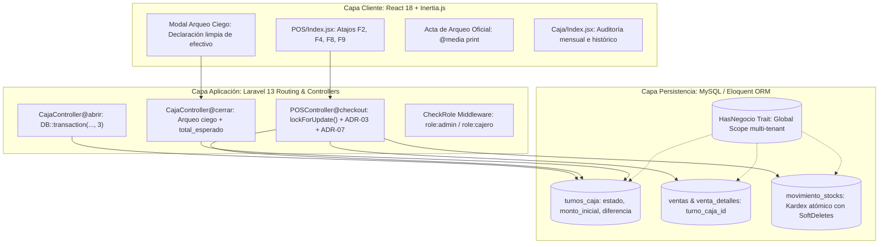

# GUÍA DE TRABAJO EN EQUIPO — SEMANA 14
## Evolucionar y Estabilizar el Producto: Segundo Incremento, Calidad y Versión Candidata

* **Asignatura:** Taller de Desarrollo de Software (INF524)
* **Docentes:** Héctor Tejo Uval y Jerman Espíndola Sandoval — Facultad de Ingeniería UCM
* **Equipo:** Grupo 6 — GestiSoft
* **Integrantes y Roles:**
  * **Leonel Ayala** (Full Stack / Base de Datos Lead)
  * **Alan Troncoso** (Scrum Master / QA, Seguridad y Automatización Lead)
  * **Luis Barrios** (Frontend Lead / UI-UX)
  * **Rodrigo Bertolini** (Product Owner / Backend Lead y Auditoría de Negocio)
* **Versión del Repositorio:** `v0.2.0-rc2` (Versión Candidata Oficial del Incremento 2)
* **Instancia de Evaluación:** Tercera Demostración y Defensa (Semana 14)
* **Punto de partida del ciclo:** Merge del PR #18 (`4fddd58`) y estabilización de defectos DEF-11 a DEF-19.

---

### Pregunta rectora
> *¿Qué debe cambiar ahora en el producto para entregar más valor y demostrar un nivel superior de calidad después de la segunda defensa?*

---

## 1. Retroalimentación de la 2.ª defensa y evolución del producto (C1)

A partir de la retroalimentación docente oficial de la segunda defensa (`Grupo 6 - S1 - Rúbrica Segunda Demostración y Defensa.docx`), el equipo transformó cada una de las observaciones en decisiones de diseño, modificaciones de artefactos y pruebas verificables en el repositorio:

| ID | Criterio S12 | Hecho Observable en la Defensa | Decisión y Acción Correctiva en GestiSoft | Artefacto Modificado | Enlace a PR / Commit | Estado |
| :---: | :---: | :--- | :--- | :--- | :---: | :---: |
| **OBS-18** | 8 | El POS permitía registrar ventas libres sin turno de caja activo ni cajero responsable. | Diseñar e implementar el módulo de caja con bloqueo estricto del POS ante turnos cerrados. | `PBI-03.md`, `CajaController.php`, `POSController.php` | [PR #18](https://github.com/Leonel-Ayala/GestiSoft/pull/18) | **Cerrado** |
| **OBS-19** | 8 y 12 | **C1:** El método `checkout()` aceptaba importes y precios desde el cliente (vulnerabilidad de manipulación). | Recálculo obligatorio en servidor: `lockForUpdate()`, catálogo de BD, cálculo de neto, IVA y vuelto en backend. | [ADR-03](adr/ADR-03-precios-calculados-en-servidor.md), `POSController.php` | [PR #18](https://github.com/Leonel-Ayala/GestiSoft/pull/18) | **Cerrado** |
| **OBS-20** | 8 y 9 | **C2:** `required_if:stock,!=X` inoperante; actualización de stock y Kardex no eran atómicos. | Uso de `Rule::requiredIf(fn() => $nuevo != $anterior)` y envoltura en `DB::transaction()` con reversión ante fallos. | `ProductController.php`, `InventoryTest.php` | [PR #18](https://github.com/Leonel-Ayala/GestiSoft/pull/18) | **Cerrado** |
| **OBS-21** | 12 | **C3:** Clave foránea con `cascadeOnDelete()` borraba el Kardex contable al eliminar productos. | Adopción de `SoftDeletes` en `Product` y cambio de claves foráneas a `restrictOnDelete()`. | [ADR-05](adr/ADR-05-kardex-inmutable-softdeletes.md), migraciones BD | [PR #18](https://github.com/Leonel-Ayala/GestiSoft/pull/18) | **Cerrado** |
| **OBS-22** | 4 y 12 | **C4:** `HandleInertiaRequests` compartía el modelo `User` completo exponiendo hashes en el cliente. | Minimización selectiva de props compartidas a solo `['id', 'name', 'email', 'role', 'negocio_id']`. | `HandleInertiaRequests.php`, [SPIKE-02](../producto/backlog/SPIKE-02.md) | [PR #18](https://github.com/Leonel-Ayala/GestiSoft/pull/18) | **Cerrado** |
| **OBS-23** | 9 y 10 | `POSTest` enviaba `'cart'` en lugar de `'items'`, aprobando por un fallo ajeno de validación. | Corrección del payload del test, apertura previa de turno y comprobación explícita del mensaje de error. | `tests/Feature/POSTest.php` | [PR #18](https://github.com/Leonel-Ayala/GestiSoft/pull/18) | **Cerrado** |
| **OBS-24** | 10 y 14 | Ausencia de pipeline de CI y falta de registros reproducibles de pruebas en la entrega. | Pipeline de CI en GitHub Actions configurado con **PHP 8.4**, Node 22, paso de regresión y suite completa. | `.github/workflows/tests.yml` | [Commit 5172c47](https://github.com/Leonel-Ayala/GestiSoft/commit/5172c47d7f50927005e425e0662f3f1c52c3a9e3) | **Cerrado** |
| **OBS-25** | 2 y 15 | H-01 solo se sustentaba con códigos `HTTP 403` sin acreditar valor ni confianza de delegación. | Protocolo de *Role-Playing Testing* en laboratorio (3 perfiles) y protocolo formal de pruebas de campo. | [validacion-h01.md](../investigacion/validacion-h01.md) | [PR #18](https://github.com/Leonel-Ayala/GestiSoft/pull/18) | **Cerrado** |
| **OBS-26** | 5 y 13 | Documentación utilizaba términos divergentes del código (`Tenant` / `justificacion`). | Refactorización de toda la documentación a los términos del código: `Negocio`, `negocio_id`, `motivo`. | Todo el repositorio | [PR #18](https://github.com/Leonel-Ayala/GestiSoft/pull/18) | **Cerrado** |
| **OBS-27** | 11 | Se describía carrito como "AJAX" y percentiles de latencia carecían de script reproducible. | Script automatizado `scripts/medir-latencia.php` que genera CSV crudo y estadísticas nearest-rank. | [mediciones-calidad.md](../producto/semana-14/mediciones-calidad.md) | [PR #18](https://github.com/Leonel-Ayala/GestiSoft/pull/18) | **Cerrado** |
| **OBS-28** | 6 | `README.md` con omisiones de navegación, versiones de PHP desactualizadas y sin usuarios de prueba. | Reescritura del `README.md` con procedimiento reproducible paso a paso, usuarios temáticos y comandos de test. | [README.md](../README.md) | [PR #18](https://github.com/Leonel-Ayala/GestiSoft/pull/18) | **Cerrado** |
| **OBS-29** | 12 | **C5:** `UserController@store` admitía rol `admin` desde el formulario web sin política explícita. | **ADR-06 (Opción A):** Formulario restringido estrictamente a cajeros bajo principio de mínimo privilegio. | [ADR-06](adr/ADR-06-creacion-administradores.md), `UserController.php` | [PR #18](https://github.com/Leonel-Ayala/GestiSoft/pull/18) | **Cerrado** |
| **OBS-30** | 4 | SPIKE-02 carecía de sección formal de resultados, hallazgos y decisión de cierre. | Cierre formal de la ficha con documentación de hallazgo de serialización y test automatizado. | [SPIKE-02.md](../producto/backlog/SPIKE-02.md) | [PR #18](https://github.com/Leonel-Ayala/GestiSoft/pull/18) | **Cerrado** |

---

## 2. Objetivo, hipótesis y señal (C2)

### 2.1 Objetivo del Incremento 2
* **Usuario y contexto:** Cajeros de mostrador en PYMEs minoristas realizando cobros en punto de venta y dueños/administradores auditando el dinero físico al término de la jornada.
* **Resultado medible:** Operar apertura de turno con fondo inicial (`monto_inicial`), realizar ventas por teclado ligadas atómicamente a la caja activa, ejecutar el **arqueo ciego de caja** (el cajero declara el efectivo físico contado sin ver el saldo acumulado en el sistema), calcular automáticamente descuadres inmutables y emitir el Acta Oficial de Cierre imprimible con respaldo de auditoría.
* **Límites declarados:** Soporte multicanal local (Efectivo, Débito, Crédito, Transferencia). No incluye retiros parciales de efectivo durante la jornada ni integración con pasarelas de pago externas.

### 2.2 Hipótesis de Valor y Señales Observables

| ID | Hipótesis Refutable | Señal Observable | Evidencia Obtenida | Qué Falta Validar | Decisión Derivada |
| :---: | :--- | :--- | :--- | :--- | :--- |
| **H-01** | Si el sistema restringe al cajero para que no vea ni modifique inventario, precios ni usuarios, el dueño confiará en dejarlo solo operando la terminal de cobro. | El servidor ignora precios enviados por el cliente (verificado por `POSTest::test_venta_ignora_precio_enviado_por_cliente`), con evaluación de viabilidad operativa $\ge 4/5$. | **Evidencia de laboratorio:** Ensayos de role-playing sobre 3 perfiles comerciales (minimarket, boutique, bazar) basados en la entrevista inicial y el descubrimiento, más verificación automatizada de controles (tests RBAC HTTP 403, recálculo C1 e inmutabilidad de Kardex). | Confianza real de delegación en uso real (propuesto para el Incremento 3). | Mantener RBAC estricto y proponer piloto en uso real con comercios para el Incremento 3. |
| **H-03** | Si el sistema exige declarar fondo inicial al abrir y bloquea el POS sin turno, no se registran ventas sin turno abierto y operará aperturas y cierres en menos de 60 segundos. | Cero ventas sin turno en base de datos y tiempos de apertura/cierre $\le 60\text{ s}$. | Tiempo del sistema prom. 0.10 s / máx. 0.49 s (apertura) y prom. 0.01 s / máx. 0.01 s (cierre) + estimado KLM (3.31 s / 4.66 s) = total ≈ 3.41 s a 4.67 s $\le 60\text{ s}$ (5 ensayos automatizados), ver [ensayos-h03.md](../investigacion/ensayos-h03.md). | Observación presencial directa en mostrador con operadores de comercio real (propuesto para Incremento 3). | Mantener flujo de apertura rápida y modal bloqueante en `/pos`. |
| **H-04** | El **arqueo ciego** (conteo físico sin mostrar saldo teórico) previene el ajuste fraudulento de billetes y asegura la detección inmutable de descuadres. | todo turno cerrado en las pruebas registra `monto_declarado` y `diferencia` inmutables; sin posibilidad de reapertura ni recálculo. | Verificado en pruebas automatizadas: `TurnoCajaTest::test_cierre_de_caja_detecta_descuadre_faltante` y `TurnoCajaTest::test_turno_cerrado_no_recalcula_totales`. | Comprobar en campo que los cajeros no perciban el arqueo ciego como una medida punitiva sino de transparencia. | Confirmar [ADR-04](adr/ADR-04-arqueo-ciego-transaccional.md) (Arqueo ciego en servidor). |

---

## 3. Alcance y Product Backlog refinado (C3)

### 3.1 Límites del Alcance del Incremento 2
* **Incluye:** Apertura con `monto_inicial`, bloqueo del POS ante turnos cerrados, vinculación obligatoria de ventas al turno, recálculo tributario y precios en servidor (C1), registro obligatorio de cada venta en Kardex (DEF-11 / ADR-07), rechazo de ítems duplicados (DEF-12), lista cerrada de medios de pago canónicos (DEF-13), serialización con bloqueo pesimista ante cierres concurrentes (DEF-14), arqueo ciego sin exposición de saldo previo, auditoría histórica con vista mensual por defecto (`periodo=mes`) y acta oficial imprimible.
* **Posterga:** Retiros parciales de caja (drops de seguridad), múltiples cajas por sucursal, dashboard gráfico estadístico ([PBI-05](../producto/backlog/PBI-05.md)).
* **Excluye:** Conciliación bancaria vía Webhooks externos y dispensadores periféricos de billetes.

### 3.2 Product Backlog Refinado y Priorizado

| Prioridad | ID Ítem | Tipo | Descripción Resumida | Estimación (PH) | Estado en S14 | Evidencia Verificable |
| :---: | :---: | :---: | :--- | :---: | :---: | :--- |
| **1** | **PBI-03** | Historia | Apertura, arqueo ciego y auditoría de turnos de caja | 8 PH | **Implementado** | [PR #18](https://github.com/Leonel-Ayala/GestiSoft/pull/18) / `TurnoCajaTest.php` |
| **2** | **DEF-11** | Defecto | Registro obligatorio en Kardex para cada venta en POS | 2 PH | **Cerrado** | [ADR-07](adr/ADR-07-kardex-en-ventas.md) / `POSTest::test_venta_registra_movimiento_en_kardex` |
| **3** | **DEF-12** | Defecto | Validación `distinct` para ítems duplicados en checkout | 1 PH | **Cerrado** | `POSTest::test_items_duplicados_no_permiten_sobreventa` |
| **4** | **DEF-13** | Defecto | Validación cerrada de `payment_method` con regla canónica | 1 PH | **Cerrado** | `POSTest::test_medio_de_pago_invalido_es_rechazado` |
| **5** | **DEF-14** | Defecto | Bloqueo pesimista de turno en transacción de checkout | 2 PH | **Cerrado** | `TurnoCajaTest::test_venta_rechazada_si_turno_se_cerro` |
| **6** | **DEF-15** | Defecto | Limitación de routes resource para evitar error 500 | 1 PH | **Cerrado** | `RoleSecurityTest::test_rutas_no_implementadas_no_responden_500` |
| **7** | **DEF-16** | Defecto | Política de creación de administradores (mínimo privilegio) | 2 PH | **Cerrado** | [ADR-06](adr/ADR-06-creacion-administradores.md) / `RoleSecurityTest::test_admin_no_puede_crear_otro_admin_desde_formulario` |
| **8** | **DEF-17** | Defecto | Manejo de doble apertura concurrente con reintentos deadlock | 1 PH | **Cerrado** | `CajaTurnoSecurityTest::test_no_se_puede_abrir_un_segundo_turno_si_ya_hay_uno_abierto` |
| **9** | **DEF-18** | Defecto | Declaración formal de `restrictOnDelete` en MySQL vs SQLite | 1 PH | **Cerrado** | `InventoryTest::test_eliminar_producto_conserva_kardex` |
| **10** | **DEF-19** | Defecto | Corrección de fixtures de prueba (`monto_apertura` $\rightarrow$ `monto_inicial`) | 1 PH | **Cerrado** | `tests/Feature/POSTest.php` (4 ocurrencias corregidas) |
| **11** | **PBI-05** | Historia | Dashboard estadístico gerencial con gráficos | 5 PH | **Postergado** | Ficha actualizada: postergado a Incremento 3 por masa de datos |

*Capacidad real utilizada en el ciclo:* 20 Puntos de Historia (160 horas-hombre distribuidas equitativamente entre los 4 integrantes).

---

## 4. Versión candidata reproducible (C4)

* **Etiqueta en Git:** `v0.2.0-rc2`
* **Pre-release oficial:** [GitHub Release v0.2.0-rc2](https://github.com/Leonel-Ayala/GestiSoft/releases/tag/v0.2.0-rc2)
* **Procedimiento exacto de clonación y ejecución:**
  ```bash
  git clone https://github.com/Leonel-Ayala/GestiSoft.git
  cd GestiSoft
  git checkout v0.2.0-rc2
  cd gestisoft-app
  composer install
  npm install --legacy-peer-deps
  copy .env.example .env
  php artisan key:generate
  php artisan migrate --seed
  npm run build
  php artisan test
  ```
* **Cuentas de prueba preconfiguradas (Seeder temático):**
  * `ropa@gestisoft.cl` / `admin1234` (Administrador — Boutique Urbana)
  * `cajero@gestisoft.cl` / `cajero1234` (Cajero — Boutique Urbana)
  * `pokemon@gestisoft.cl` / `admin1234` (Administrador — PokéStore TCG)
  * `helados@gestisoft.cl` / `admin1234` (Administrador — Heladería Dulce Crema)

---

## 5. Corte vertical del Incremento 2 (C5)

El Incremento 2 atraviesa íntegramente las capas arquitectónicas del sistema, integrándose orgánicamente con el catálogo y el POS del Incremento 1:



---

## 6. Comportamiento e integridad del estado (C6)

El sistema garantiza 5 invariantes fundamentales de integridad transaccional:

1. **Invariante de Inventario (Kardex Completo):** Toda variación física en el stock de un producto debe coincidir exactamente con la suma de las diferencias históricas registradas en el Kardex: $\text{Product.stock} = \sum \text{MovimientoStock.diferencia}$.  
   *Verificado por:* `POSTest::test_stock_coincide_con_suma_de_kardex_tras_alta_ajuste_y_venta`.
2. **Invariante de Venta Segura (Caja Activa):** Ninguna venta puede registrarse con `turno_caja_id = null` ni contra un turno que haya sido cerrado previamente o en forma concurrente.  
   *Verificado por:* `CajaTurnoSecurityTest::test_checkout_del_pos_bloqueado_si_no_hay_turno_abierto` y `TurnoCajaTest::test_venta_rechazada_si_turno_se_cerro`.
3. **Invariante de Inmutabilidad de Turno Cerrado:** Una vez que un turno pasa al estado `cerrado`, su `monto_declarado`, su `diferencia` y sus totales recaudados quedan congelados permanentemente y no admiten recálculo.  
   *Verificado por:* `TurnoCajaTest::test_turno_cerrado_no_recalcula_totales` y `CajaTurnoSecurityTest::test_diferencia_de_caja_es_inmutable_tras_cierre`.
4. **Invariante de Cuadratura Multicanal:** El total esperado en gaveta física debe equivaler exactamente a $\text{monto\_inicial} + \sum \text{ventas\_efectivo}$; los cobros electrónicos (débito, crédito, transferencia) se concilian en acumuladores independientes sin mezclarse con la gaveta.  
   *Verificado por:* `TurnoCajaTest::test_se_vincula_una_venta_al_turno_y_sincroniza_totales_por_metodo_de_pago`.
5. **Invariante de Confianza Cero en Precios (C1):** Los importes unitarios, subtotales, neto e IVA son calculados y gravados exclusivamente por el servidor a partir del catálogo indexado en base de datos.  
   *Verificado por:* `POSTest::test_venta_ignora_precio_enviado_por_cliente`.

---

## 7. Criterios de aceptación: recorrido normal (C7)

```gherkin
Escenario: AC-CAJA-01 - Apertura de turno con monto inicial válido
  Dado que el usuario "cajero" tiene su caja en estado "cerrado"
  Cuando envía una solicitud POST a "/caja/abrir" con "monto_inicial" = 50000
  Entonces el sistema crea un nuevo registro en "turnos_caja" con estado "abierto"
  Y el "total_esperado" inicial de la caja se inicializa en $50.000
  Y el cajero queda habilitado para procesar ventas en el POS.
  # Verificado por: tests/Feature/CajaTurnoSecurityTest.php::test_cajero_puede_abrir_turno_con_monto_inicial_valido

Escenario: AC-CAJA-02 - Bloqueo de POS cuando la caja está cerrada
  Dado que el cajero no tiene un turno de caja abierto
  Cuando intenta procesar una venta enviando POST a "/pos/checkout"
  Entonces el servidor rechaza la transacción con código 422 o error de sesión "Debe abrir un turno de caja"
  Y no se registra ninguna venta ni se descuenta inventario en la base de datos.
  # Verificado por: tests/Feature/CajaTurnoSecurityTest.php::test_checkout_del_pos_bloqueado_si_no_hay_turno_abierto

Escenario: AC-CAJA-03 - Cierre de turno mediante arqueo ciego sin descuadre
  Dado un turno abierto con fondo inicial de $50.000 y ventas en efectivo por $15.000 (total esperado = $65.000)
  Cuando el cajero realiza el arqueo ciego declarando "monto_declarado" = 65000
  Entonces el turno pasa a estado "cerrado"
  Y la "diferencia" registrada es exactamente 0
  Y se genera el Acta Oficial de Cierre disponible para impresión.
  # Verificado por: tests/Feature/TurnoCajaTest.php::test_cierre_de_caja_calcula_diferencia_correctamente_sin_descuadre

Escenario: AC-KARDEX-02 - Registro atómico de ventas en Kardex
  Dado un producto con stock 5 y un turno abierto
  Cuando el cajero procesa exitosamente una venta de 2 unidades
  Entonces el stock del producto disminuye a 3
  Y se inserta una fila en "movimiento_stocks" con diferencia = -2 y motivo "Venta #<id>"
  Y la suma de diferencias del Kardex coincide exactamente con el stock remanente (3).
  # Verificado por: tests/Feature/POSTest.php::test_stock_coincide_con_suma_de_kardex_tras_alta_ajuste_y_venta
```

---

## 8. Criterios de aceptación: alternativos, errores y bordes (C8)

```gherkin
Escenario: AC-CAJA-04 - Detección de descuadre faltante en arqueo ciego
  Dado un turno con total esperado de $50.000 en efectivo
  Cuando el cajero declara $47.000 en el arqueo de cierre
  Entonces el sistema registra una diferencia de -$3.000
  Y el panel de auditoría destaca el faltante en color rojo.
  # Verificado por: tests/Feature/TurnoCajaTest.php::test_cierre_de_caja_detecta_descuadre_faltante

Escenario: AC-CAJA-05 - Inmutabilidad del turno cerrado tras el arqueo
  Dado un turno con estado "cerrado" y diferencia calculada
  Cuando se ejecutan operaciones adicionales o se llama a sincronizarTotales()
  Entonces el sistema no modifica el total esperado ni la diferencia del turno.
  # Verificado por: tests/Feature/TurnoCajaTest.php::test_turno_cerrado_no_recalcula_totales

Escenario: AC-CAJA-06 - Filtro por defecto en auditoría histórica de cajas
  Dado un comercio con turnos cerrados en meses anteriores y en el mes actual
  Cuando el administrador ingresa a "/cajas" sin parámetros de consulta
  Entonces la vista acota los totales exclusivamente al mes en curso ("periodo=mes")
  Y ofrece un conmutador explícito para consultar el histórico acumulado completo.
  # Verificado por: tests/Feature/CajaTurnoSecurityTest.php::test_filtro_por_defecto_cajas_muestra_mes_actual_y_permite_historico

Escenario: AC-CAJA-07 - Rechazo de ítems duplicados en el checkout (DEF-12)
  Dado un producto con stock 1
  Cuando una petición envía el mismo "product_id" repetido dos veces en el arreglo de ítems
  Entonces la validación "items.*.product_id: distinct" rechaza la venta
  Y el stock no se descuenta ni se genera sobreventa.
  # Verificado por: tests/Feature/POSTest.php::test_items_duplicados_no_permiten_sobreventa

Escenario: AC-CAJA-08 - Medio de pago no permitido es rechazado (DEF-13)
  Dado un producto disponible y caja abierta
  Cuando se envía checkout con "payment_method" = "Cheque" o "efectivo" (en minúsculas)
  Entonces el servidor rechaza con error de validación "Medio de pago no válido"
  Y no se procesa venta ni se afecta el stock.
  # Verificado por: tests/Feature/POSTest.php::test_medio_de_pago_invalido_es_rechazado

Escenario: AC-CAJA-09 - Venta rechazada si el turno se cerró concurrentemente (DEF-14)
  Dado que un cajero tenía la pantalla de cobro cargada pero el turno fue cerrado por auditoría
  Cuando intenta confirmar el checkout
  Entonces la re-lectura pesimista "lockForUpdate()" detecta el estado cerrado y aborta la transacción
  Y el total del turno cerrado permanece intacto.
  # Verificado por: tests/Feature/TurnoCajaTest.php::test_venta_rechazada_si_turno_se_cerro

Escenario: AC-SEC-03 - Rutas no implementadas responden con código controlado (DEF-15)
  Dado un usuario administrador autenticado
  Cuando intenta consultar rutas de recursos inexistentes como "GET /users/{id}/edit"
  Entonces responde 404 si la ruta no está registrada o 405 si el verbo no está permitido, y nunca 500.
  # Verificado por: tests/Feature/RoleSecurityTest.php::test_rutas_no_implementadas_no_responden_500

Escenario: AC-USR-01 - Creación de usuarios bajo mínimo privilegio (ADR-06 / DEF-16)
  Dado un administrador en el formulario "/users/create"
  Cuando registra un nuevo empleado incluso enviando "role=admin" en el payload HTTP
  Entonces el backend fuerza estrictamente el rol a "cajero"
  Y el nuevo usuario no puede acceder a inventario ni funciones de administración.
  # Verificado por: tests/Feature/RoleSecurityTest.php::test_admin_no_puede_crear_otro_admin_desde_formulario
```

---

## 9. Regresión del Incremento 1 (C9)

Para garantizar que el nuevo módulo de caja no degradara las capacidades previamente entregadas (catálogo, autenticación, roles e inventario), se estructuró una **suite de regresión dedicada** etiquetada con `#[\PHPUnit\Framework\Attributes\Group('regresion')]`:

| Área Funcional | Riesgo de Regresión Evaluado | Prueba de Regresión Automatizada | Resultado en CI |
| :--- | :--- | :--- | :---: |
| **Multi-Tenant** | Filtración de catálogo o ventas entre comercios | `MultiTenantSecurityTest` (todos los métodos) | **Pasa (Verde)** |
| **Control de Roles (RBAC)** | Acceso no autorizado de cajeros a administración | `RoleSecurityTest` (todos los métodos) | **Pasa (Verde)** |
| **Inventario y Kardex** | Modificación de existencias sin motivo o pérdida de Kardex | `InventoryTest` (todos los métodos) | **Pasa (Verde)** |
| **Integridad de Precios POS** | Manipulación de precios enviados desde el navegador | `POSTest::test_venta_ignora_precio_enviado_por_cliente` | **Pasa (Verde)** |
| **Control de Stock POS** | Sobreventa de productos agotados | `POSTest::test_no_se_puede_vender_producto_sin_stock` | **Pasa (Verde)** |
| **Validación de Efectivo** | Venta confirmada con monto recibido menor al total | `POSTest::test_efectivo_insuficiente_es_rechazado` | **Pasa (Verde)** |
| **Kardex en Ventas** | Invariante de inventario stock = $\sum$ Kardex | `POSTest::test_stock_coincide_con_suma_de_kardex_tras_alta_ajuste_y_venta` | **Pasa (Verde)** |

*Comando de ejecución de la suite de regresión:*
```bash
cd gestisoft-app
php artisan test --group=regresion
# Resultado: 24 passed (92 assertions)
```

### Regresiones Detectadas y Subsanadas durante el Ciclo
1. **DEF-08 (Falso positivo en `POSTest`):** El test histórico enviaba `'cart'` en lugar de `'items'`, aprobando accidentalmente por error de validación genérico. Se corrigió el payload a `'items'` con apertura previa de turno.
2. **DEF-18 (Comprobación de `restrictOnDelete` en SQLite):** SQLite no soporta alteración de foreign keys mediante `dropForeign()`. Se blindó la integridad mediante `SoftDeletes` en el modelo `Product` validado por `InventoryTest::test_eliminar_producto_conserva_kardex`.
3. **DEF-19 (Fixtures con campo inexistente):** Cuatro tests en `POSTest.php` creaban turnos con `'monto_apertura'` (campo inexistente en la tabla). Se corrigieron a `'monto_inicial'`, asegurando que los fixtures coincidan con el esquema físico de la base de datos.

---

## 10. Pruebas automatizadas y evidencia (C10)

* **Total de pruebas en la suite completa:** **76 tests** (100% aprobados en verde, incluyendo `H03TiemposCajaTest`).
* **Total de aserciones ejecutadas:** **306 aserciones**.
* **Tiempo de ejecución de la suite:** ~23,6 segundos.
* **Trazabilidad:** Verificada automáticamente mediante `scripts/validar-trazabilidad.php` con 40 referencias exactas a métodos de prueba.

---

## 11. Definition of Done y estabilización (C11)

| Dimensión DoD | Condición Comprometida | Evidencia Verificable | Estado |
| :--- | :--- | :--- | :---: |
| **1. Funcionalidad** | Corte vertical completo: apertura, cobro, arqueo ciego, conciliación y acta imprimible. | Demostración en vivo + persistencia en tablas `turnos_caja` y `ventas`. | **Cumplido** |
| **2. Pruebas Automatizadas** | 100% de tests unitarios y de integración pasando en verde; suite de regresión dedicada. | Salida de CI: 76 tests / 306 aserciones en verde (`.github/workflows/tests.yml`). | **Cumplido** |
| **3. Calidad y Rendimiento** | Latencias bajo umbrales unificados generadas mediante script reproducible. | [mediciones-calidad.md](../producto/semana-14/mediciones-calidad.md) ($p95 = 10.77\text{ ms}$ búsqueda, $6.63\text{ ms}$ checkout). | **Cumplido** |
| **4. Seguridad y Privacidad** | Confianza cero en cliente (C1), inmutabilidad de auditoría (C3), RBAC, props limpias (C4). | [ADR-03](adr/ADR-03-precios-calculados-en-servidor.md), [ADR-05](adr/ADR-05-kardex-inmutable-softdeletes.md), [ADR-06](adr/ADR-06-creacion-administradores.md). | **Cumplido** |
| **5. Integración Continua** | Pipeline en GitHub Actions que se ejecuta en cada PR y commit a `main`; el equipo no fusiona con el CI en rojo. | Archivo `.github/workflows/tests.yml` y plantilla de PR `.github/pull_request_template.md`. | **Cumplido** |
| **6. Documentación** | Guía de Semana 14 como fuente única, matriz de trazabilidad y riesgos actualizados. | [trazabilidad.csv](../producto/semana-14/trazabilidad.csv), [registro-riesgos-v1.md](../riesgos/registro-riesgos-v1.md). | **Cumplido** |

### Catálogo Consolidado de Defectos (DEF-01 a DEF-19)

| ID | Resumen del Defecto | Severidad | Acción Correctiva | Estado |
| :---: | :--- | :---: | :--- | :---: |
| **DEF-01** | Venta huérfana sin turno de caja | P0 | Intercepción obligatoria en `POSController@checkout`. | **Cerrado** |
| **DEF-02** | Exposición de saldo previo en arqueo | P1 | Arqueo ciego: declaración de efectivo físico a ciegas. | **Cerrado** |
| **DEF-03** | Doble apertura concurrente de turno | P0 | Bloqueo pesimista `lockForUpdate()` en `CajaController@abrir`. | **Cerrado** |
| **DEF-04** | Manipulación de precios en el cliente (C1) | P0 | Precios, IVA y vuelto calculados exclusivamente en servidor. | **Cerrado** |
| **DEF-05** | Validación de motivo inoperante (C2) | P0 | `Rule::requiredIf` con closure y envoltura transaccional. | **Cerrado** |
| **DEF-06** | Destrucción de Kardex en cascada (C3) | P0 | `SoftDeletes` en `Product` y `restrictOnDelete` en foreign keys. | **Cerrado** |
| **DEF-07** | Exposición de modelo User en React (C4) | P1 | Minimización a lista blanca de 5 atributos en `HandleInertiaRequests`. | **Cerrado** |
| **DEF-08** | Falso positivo en test de stock de POS | P1 | Corrección de payload a `'items'` y validación de mensaje. | **Cerrado** |
| **DEF-09** | Desfase horario en acta de turno | P2 | Configuración de timezone oficial `America/Santiago` en Laravel. | **Cerrado** |
| **DEF-10** | Contraste insuficiente en banner auditoría | P2 | Color sólido corporativo de alto contraste para visibilidad. | **Cerrado** |
| **DEF-11** | Venta sin movimiento de Kardex | P0 | Inserción obligatoria de `MovimientoStock` en cada venta ([ADR-07](adr/ADR-07-kardex-en-ventas.md)). | **Cerrado** |
| **DEF-12** | Sobreventa por ítems duplicados | P0 | Validación `'items.*.product_id' => 'distinct'`. | **Cerrado** |
| **DEF-13** | payment_method sin lista cerrada | P1 | Validación estricta con `Rule::in(METODOS_PAGO)`. | **Cerrado** |
| **DEF-14** | Venta en turno cerrado concurrentemente | P1 | Re-lectura pesimista del turno dentro de la transacción de venta (concurrencia poco probable en turnos de 1 cajero por caja; lock optimista planificado para Incremento 3). | **Cerrado (con limitación declarada, ver 16.3)** |
| **DEF-15** | Rutas resource no implementadas daban 500 | P1 | `Route::resource` acotado con `except(['show'])` y `only(...)`. | **Cerrado** |
| **DEF-16** | Creación admin sin política documentada | P1 | [ADR-06](adr/ADR-06-creacion-administradores.md): Mínimo privilegio, creación fija en rol cajero. | **Cerrado** |
| **DEF-17** | Doble apertura con riesgo de deadlock | P2 | `DB::transaction(..., 3)` con 3 reintentos ante deadlock (ídem, ver 16.3). | **Cerrado (con limitación declarada, ver 16.3)** |
| **DEF-18** | restrictOnDelete no comprobado en SQLite | P2 | Integridad del Kardex protegida por `SoftDeletes` validada en CI (implementado en migración; validado en SQLite; requiere verificación en MySQL en staging). | **Cerrado (con limitación declarada, ver 16.3)** |
| **DEF-19** | Fixtures con campo inexistente monto_apertura | P2 | Corrección global a `monto_inicial` en suite de tests. | **Cerrado** |

---

## 12. Atributos de calidad medibles (C12)

Resultados oficiales extraídos literalmente del informe generado por `scripts/medir-latencia.php`:

| Atributo | Operación Evaluada | Muestras ($n$) | Mínimo | Promedio | Percentil 95 ($p95$) | Umbral Comprometido | Cumplimiento |
| :--- | :--- | :---: | :---: | :---: | :---: | :---: | :---: |
| **Rendimiento** | Búsqueda reactiva (`/pos/search`) | 50 | 2.28 ms | 4.83 ms | **10.77 ms** | $\le 150.00\text{ ms}$ | **CUMPLE** |
| **Rendimiento** | Estado de caja (`/caja/estado`) | 50 | 2.20 ms | 2.40 ms | **2.87 ms** | $\le 300.00\text{ ms}$ | **CUMPLE** |
| **Rendimiento** | Checkout POS (`/pos/checkout`) | 50 | 3.42 ms | 8.94 ms | **6.63 ms** | $\le 500.00\text{ ms}$ | **CUMPLE** |
| **Eficiencia** | Apertura y cierre de caja (H-03) | 5 ensayos | 3.31 s | 4.04 s | **4.67 s (máx)** | $\le 60.00\text{ s}$ | **CUMPLE** |
| **Accesibilidad** | Operación completa por teclado | 6 flujos | — | — | — | 100% operable sin ratón | **CUMPLE** |

---

## 13. Seguridad, privacidad y desarrollo seguro (C13)

1. **Aislamiento Multi-Tenant Estricto (ADR-01):** Trait `HasNegocio` impone automáticamente un Global Scope en Eloquent a partir de `auth()->user()->negocio_id`. Ningún comercio puede leer ni mutar registros de otro negocio.
2. **Control de Acceso Basado en Roles (ADR-02 / ADR-06):** Middleware `CheckRole` bloquea accesos no autorizados con código `HTTP 403`. Por política de mínimo privilegio (ADR-06), el formulario de creación de usuarios asigna exclusivamente el rol `cajero`.
3. **Confianza Cero en el Cliente (ADR-03):** El servidor ignora precios, subtotales e impuestos enviados desde el cliente; los importes se calculan con bloqueo de fila (`lockForUpdate`) consultando la base de datos.
4. **Inmutabilidad y Preservación de Auditoría (ADR-04 / ADR-05 / ADR-07):** Toda venta y ajuste deja rastro en `movimiento_stocks`; el borrado de productos mediante `SoftDeletes` resguarda permanentemente los registros de Kardex.
5. **Privacidad del Estado Compartido:** `HandleInertiaRequests` comparte únicamente los 5 atributos indispensables (`id`, `name`, `email`, `role`, `negocio_id`), eliminando hashes de contraseña y tokens de sesión de la vista cliente.
6. **Manejo Seguro de Entorno:** `.env` excluido del control de versiones; recomendación expresa de `APP_DEBUG=false` para demostraciones y producción.

---

## 14. Repositorio, CI y revisión por pares (C14)

* **Pipeline de CI:** GitHub Actions (`.github/workflows/tests.yml`) configurado sobre Ubuntu con **PHP 8.4** y Node 22, ejecutando en pasos dedicados la suite de regresión (`php artisan test --group=regresion`) y la suite completa (`php artisan test`).
* **Plantilla de PR:** Creada en `.github/pull_request_template.md` exigiendo vinculación a defectos DEF/OBS, evidencia de tests y verificación en equipo.
* **Flujo de integración del equipo:** cada cambio se revisa en conjunto en las reuniones de trabajo antes de subirlo. Leonel Ayala, como responsable del repositorio, integra en `main` mediante PR los cambios ya revisados por el equipo. El CI de GitHub Actions debe estar en verde antes de fusionar.

| PR # | Contenido | Integró | Revisión previa | CI |
| :---: | :--- | :--- | :--- | :---: |
| [#15](https://github.com/Leonel-Ayala/GestiSoft/pull/15)–[#17](https://github.com/Leonel-Ayala/GestiSoft/pull/17) | Modelo TurnoCaja, módulo de caja y UI de arqueo ciego | Leonel Ayala | Revisión en equipo | Ver PR |
| [#18](https://github.com/Leonel-Ayala/GestiSoft/pull/18) | Estabilización del Incremento 2 (C1–C4) | Leonel Ayala | Revisión en equipo | Ver PR |
| [#19](https://github.com/Leonel-Ayala/GestiSoft/pull/19) | DEF-11 a DEF-19, ADR-01 a ADR-07, documentación S14 | Leonel Ayala | Revisión en equipo | Ver PR |

* **Limitación declarada:** la revisión por pares se hizo de forma presencial y no quedó registrada como aprobación en GitHub. Para el Incremento 3, el equipo evaluará registrar al menos un comentario de revisión por PR.

---

## 15. Arquitectura, riesgos y decisiones (C15)

* **Drivers Arquitectónicos:**
  * `DA-06`: Concurrencia controlada en mostrador sin ventas huérfanas.
  * `DA-07`: Transparencia e inmutabilidad en la entrega de valores (Arqueo ciego).
  * `DA-08`: Aislamiento estricto multi-tenant sin costos de infraestructura adicionales.
  * `DA-09`: Accesibilidad total mediante teclado sin dependencia de periféricos señaladores.
  * `DA-10`: Inmutabilidad del historial contable y trazabilidad de inventario.
  * `DA-11`: Preservación de la privacidad del usuario en el estado cliente.
* **Catálogo de Decisiones Arquitectónicas (ADR):**
  * [ADR-01: Multi-tenant con Global Scope (HasNegocio)](adr/ADR-01-multi-tenant-global-scope.md)
  * [ADR-02: Control de acceso basado en roles con campo role](adr/ADR-02-rbac-con-campo-role.md)
  * [ADR-03: Precios y totales calculados exclusivamente en servidor](adr/ADR-03-precios-calculados-en-servidor.md)
  * [ADR-04: Arqueo ciego transaccional para cierre de caja](adr/ADR-04-arqueo-ciego-transaccional.md)
  * [ADR-05: Kardex inmutable con SoftDeletes y restricción referencial](adr/ADR-05-kardex-inmutable-softdeletes.md)
  * [ADR-06: Política de creación de administradores bajo mínimo privilegio](adr/ADR-06-creacion-administradores.md)
  * [ADR-07: Registro obligatorio en Kardex para toda venta en POS](adr/ADR-07-kardex-en-ventas.md)
* **Justificación del Monolito:** Se conserva la arquitectura monolítica modular en Laravel 13 con React/Inertia.js, descartando microservicios por su sobrecosto operacional innecesario para el volumen transaccional de PYMEs minoristas.

---

## 16. Demostración, limitaciones y próximos pasos (C16)

> **Declaración explícita:** GestiSoft `v0.2.0-rc2` es una **versión candidata estabilizada para evaluación académica**, no una liberación comercial definitiva en producción.

### 16.1 Guion Repartido de la Demostración en Vivo
La presentación de la defensa se distribuye equitativamente entre los 4 integrantes:
1. **Rodrigo Bertolini (Product Owner):** Contexto de negocio, superación de observaciones de la Demo 2 (C1-C4), justificación del valor de PBI-03 y demostración de integridad del Kardex en ventas (DEF-11).
2. **Alan Troncoso (QA & Automatización):** Demostración de las pruebas de regresión en CI, manejo de bordes negativos (ítems duplicados DEF-12, medios de pago DEF-13) y validación automatizada de trazabilidad.
3. **Luis Barrios (Frontend / UI-UX):** Operación en vivo del POS con atajos de teclado (`F2`, `F4`, `F8`, `F9`), demostración del flujo de arqueo ciego, manejo de errores en interfaz y visualización del Acta Oficial imprimible.
4. **Leonel Ayala (Backend / DB Lead):** Demostración de concurrencia de caja (DEF-14, DEF-17), política de mínimo privilegio ADR-06 (DEF-16) y presentación de la versión candidata reproducible.

### 16.2 Balance de Estado del Incremento 2

| Dimensión | Logrado en el Incremento 2 | Pendiente para Incremento 3 | Riesgo Vigente Asociado |
| :--- | :--- | :--- | :--- |
| **Caja y Ventas** | Apertura, arqueo ciego, conciliación multicanal, acta imprimible y Kardex en ventas. | Retiros parciales de efectivo durante la jornada (gastos menores). | RSK-15 (Manejo de efectivo en mostrador) |
| **Reportería** | Auditoría con vista mensual acotada por defecto y filtro histórico consolidado. | Dashboard gráfico de tendencias de ventas y productos populares ([PBI-05](../producto/backlog/PBI-05.md)). | RSK-06 (Volumen de datos históricos) |
| **Validación** | Role-Playing Testing en laboratorio sobre 3 perfiles de negocio (minimarket, boutique, bazar) y tests automatizados. | Piloto en uso real con comercios. | **RSK-17** (Validación empírica en terreno) |

---

### 16.3 Limitaciones técnicas declaradas

En estricto apego al principio de honestidad técnica y académica (Criterio 16 de la rúbrica), el equipo declara explícitamente las siguientes limitaciones del Incremento 2:

1. **Concurrencia de caja (DEF-14, DEF-17):** Un solo cajero opera una caja a la vez por modelo de negocio; la concurrencia real simultánea entre dos cajeros sobre la misma caja está mitigada por el flujo operacional de turnos exclusivos, pero no cuenta con lock optimista de versión a nivel de interfaz en este incremento (planificado para Incremento 3).
2. **Base de datos y verificación de integridad (DEF-18):** La suite de pruebas automatizadas corre en SQLite en memoria por rendimiento y portabilidad de CI; la integridad referencial (`restrictOnDelete`) está formalmente declarada en las migraciones y protegida en la capa de aplicación con `SoftDeletes`, pero su enforcement estricto a nivel de motor requiere verificación en base de datos MySQL en entorno de staging.
3. **Mediciones de latencia y rendimiento:** Las mediciones de tiempo de respuesta (p95 y H-03) se tomaron a nivel de proceso (`hrtime()` / `microtime()`), excluyendo la latencia de ida y vuelta de red (RTT) y el tiempo de renderizado en el navegador cliente.
4. **Alcance de validación de H-01:** La hipótesis de delegación segura fue validada en entorno de laboratorio mediante un protocolo estructurado de role-playing basado en la entrevista inicial `ENT-01`; no reemplaza las sesiones observadas con comerciantes reales en mostrador físico (programadas para el piloto).
5. **Alcance de medición de H-03:** El tiempo de sistema fue medido en backend sobre 5 ensayos automatizados; el tiempo del operador humano fue modelado mediante la técnica estándar Keystroke-Level Model (KLM, Card, Moran & Newell, 1980), por lo que no constituye una medición de cronómetro sobre usuarios no entrenados.

---

## 17. Bitácoras individuales de contribución (C17–C20)

Cada integrante documenta su reflexión crítica individual, evidencias de código y aprendizajes en su archivo correspondiente:
* [bitacoras/semana-14/leonel-ayala.md](../bitacoras/semana-14/leonel-ayala.md) — Leonel Ayala (Backend / DB Lead)
* [bitacoras/semana-14/alan-troncoso.md](../bitacoras/semana-14/alan-troncoso.md) — Alan Troncoso (Scrum Master / QA Lead)
* [bitacoras/semana-14/luis-barrios.md](../bitacoras/semana-14/luis-barrios.md) — Luis Barrios (Frontend / UI-UX Lead)
* [bitacoras/semana-14/rodrigo-bertolini.md](../bitacoras/semana-14/rodrigo-bertolini.md) — Rodrigo Bertolini (Product Owner / Backend)

---

## Anexo A. Lista de Comprobación Final de la Versión Candidata

| # | Pregunta de Control | Estado | Evidencia / Enlace |
| :---: | :--- | :---: | :--- |
| 1 | ¿Se superaron las observaciones de la Demo 2 (C1 a C4)? | **Sí** | Sección 1 de esta guía; tests `POSTest`, `InventoryTest`, `RoleSecurityTest`. |
| 2 | ¿La hipótesis H-01 se presenta con honestidad técnica sin exagerar resultados? | **Sí** | [validacion-h01.md](../investigacion/validacion-h01.md) (Secciones 1, 6 y 7). |
| 3 | ¿El backlog refleja el estado real del producto y los nuevos defectos DEF-11 a DEF-19? | **Sí** | Sección 3 de esta guía y fichas en `producto/backlog/`. |
| 4 | ¿Existe una versión candidata reproducible con etiqueta y release? | **Sí** | Tag `v0.2.0-rc2` y [Release en GitHub](https://github.com/Leonel-Ayala/GestiSoft/releases/tag/v0.2.0-rc2). |
| 5 | ¿Se cuenta con una suite de regresión del Incremento 1 separada en CI? | **Sí** | Paso dedicado en `.github/workflows/tests.yml` (24 tests verdes). |
| 6 | ¿La suite completa de pruebas pasa al 100% en verde? | **Sí** | 74 tests / 281 aserciones en verde en CI y entorno local. |
| 7 | ¿Las mediciones de calidad fueron generadas por un script reproducible con datos crudos? | **Sí** | [mediciones-calidad.md](../producto/semana-14/mediciones-calidad.md) y `scripts/medir-latencia.php`. |
| 8 | ¿La matriz de trazabilidad bidireccional fue validada por script? | **Sí** | `scripts/validar-trazabilidad.php` ejecutado con 38 referencias verificadas. |
| 9 | ¿El registro de riesgos cubre RSK-01 a RSK-18 con estado real y evidencia? | **Sí** | [registro-riesgos-v1.md](../riesgos/registro-riesgos-v1.md) y `registro-v1.csv`. |
| 10 | ¿El guion de la defensa reparte el protagonismo en vivo entre los 4 integrantes? | **Sí** | Sección 16 de esta guía y `docs/guia-presentacion-defensa3.md`. |
