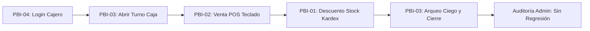

# GUÍA DE TRABAJO EN EQUIPO - SEMANA 13
## Evolucionar y Estabilizar el Producto: Segundo Incremento, Calidad y Plan de Estabilización

* **Asignatura:** Taller de Desarrollo de Software (INF524)
* **Docentes:** Héctor Tejo Uval y Jerman Espíndola Sandoval – Facultad de Ingeniería UCM
* **Equipo:** Grupo 6 – GestiSoft
* **Integrantes:**
  * Leonel Ayala (Full Stack / Base de Datos Lead)
  * Alan Troncoso (QA / Seguridad y Automatización Lead)
  * Luis Barrios (Frontend Lead / UI-UX)
  * Rodrigo Bertolini (Backend Lead / Lógica de Negocio y Auditoría)
* **Resultado:** Plan del Incremento 2 y Estabilización de Versión Candidata (RC-02)
* **Entrada:** Segunda Demostración y Defensa (Semana 12)
* **Defensa:** Tercera Demostración y Defensa (Semana 15)

---

### Pregunta rectora
> *¿Qué debe cambiar ahora en el producto para entregar más valor y demostrar un nivel superior de calidad después de la segunda defensa?*

---

### 1. Propósito y resultados esperados

La Semana 13 transforma las observaciones y aprendizajes de la segunda defensa en un objetivo nítido para el **Incremento Funcional 2 (PBI-03: Módulo de Caja, Arqueo Ciego y Auditoría)** y en un plan verificable de construcción, estabilización y regresión para la Semana 14.

| Elemento | Definición de trabajo en GestiSoft |
| :--- | :--- |
| **Aprender** | Convertir observaciones de la defensa (falta de arqueo ciego, riesgo de ventas huérfanas sin turno y control de concurrencia en checkout) en decisiones verificables y trazables. |
| **Enfocar** | Definir el nuevo resultado de usuario: el cajero abre turno con fondo inicial, opera ventas por teclado y ejecuta arqueo ciego al final del día; el administrador audita descuadres automáticamente. |
| **Estabilizar** | Establecer una Definition of Done estricta, suite de regresión automatizada (`REG-CAJA-01`), atributos de calidad medibles (p95 ≤ 300 ms, 100% operabilidad teclado), seguridad multi-tenant y registro formal de defectos. |
| **Planificar** | Ordenar el trabajo en un corte vertical real (BD $\rightarrow$ API $\rightarrow$ UI React $\rightarrow$ Tests), definir revisiones cruzadas por pares y preparar la versión candidata `v0.2.0-rc2`. |

---

### 2. Retroalimentación de la segunda defensa

Se registran los hechos observables levantados en la evaluación de la segunda defensa, su impacto técnico y la decisión concreta aplicada en el sistema:

| ID | Categoría | Observación verificable en la Defensa | Impacto | Decisión o acción aplicada en GestiSoft |
| :--- | :--- | :--- | :--- | :--- |
| **OBS-18** | Producto | En la Demo 2, el POS permitía registrar ventas libres sin estar asociadas a un turno de caja ni a un responsable financiero de turno. | Alto | Diseñar e implementar **PBI-03**: Bloquear operativamente el POS si no existe un turno de caja abierto (`AC-CAJA-01` y middleware de verificación). |
| **OBS-19** | Calidad | No se demostró una prueba de regresión automatizada que garantizara que el control de stock (Kardex) no se rompe al incorporar la lógica de turnos. | Alto | Crear la suite de regresión `REG-CAJA-01` en PHPUnit que ejecuta el ciclo: Apertura Caja $\rightarrow$ Venta POS $\rightarrow$ Descuento Stock $\rightarrow$ Auditoría Kardex $\rightarrow$ Cierre Caja. |
| **OBS-20** | Técnica / Integridad | Riesgo de descuadre inducido si el cajero ve el total calculado por el sistema antes de contar el dinero físico. | Alto | Implementar **Arqueo Ciego Obligatorio** (`AC-CAJA-03`): El cajero declara el efectivo físico en gaveta sin conocer el monto teórico del sistema; la diferencia se calcula en servidor. |
| **OBS-21** | Seguridad / Multi-Tenant | Las consultas de auditoría de turnos podrían filtrar datos de otro comercio si el filtro de tenant dependiera solo del frontend. | Alto | Enlace estricto en BD mediante Trait `HasNegocio` en `TurnoCaja` y clave foránea indexada `turno_caja_id` en `ventas` (`AC-SEC-CAJA-01`). |
| **OBS-22** | Concurrencia | Si un cajero abre sesión en dos pestañas, podría abrir dos turnos simultáneos duplicando el fondo inicial. | Medio | Implementar validación transaccional con `lockForUpdate` en `CajaController@abrir` que rechaza con HTTP 422 si ya existe turno en estado `abierto`. |
| **OBS-23** | Proceso / Equipo | Los scripts auxiliares y herramientas del agente quedaron versionados en el repositorio principal distorsionando las métricas de lenguaje (60% Python). | Medio | Migrar habilidades a la configuración global del usuario (`~/.gemini/config/skills/`), configurar `.gitattributes` y `.gitignore`, dejando el repo 100% en PHP y React. |

---

### 3. Retrospectiva del equipo

| Tipo | Práctica o problema | Acción verificable | Responsable y fecha |
| :--- | :--- | :--- | :--- |
| **Mantener** | Desarrollo guiado por pruebas (TDD) en Backend para reglas de seguridad y negocio. | Conservar la suite de pruebas unitarias y de integración pasando al 100% en cada PR antes de fusionar. | Alan Troncoso · Continuo |
| **Corregir** | Falta de validación del estado del turno en el POS en tiempo de montaje de la interfaz. | El controlador `POSController@index` inyectará el estado del turno activo vía props de Inertia; si no hay turno, se presenta modal bloqueante accesible. | Luis Barrios · Inicio S14 |
| **Detener** | Realizar cierres de caja manuales o cálculos de descuadre en hojas de cálculo externas. | Centralizar todo el arqueo en base de datos transaccional con cálculo automático e inmutable de la diferencia. | Rodrigo Bertolini · Mitad S14 |
| **Comenzar** | Validación de regresión obligatoria entre módulos (POS + Inventario + Usuarios + Caja). | Ejecutar la suite completa de 42+ tests antes de cada merge a `main` y etiquetar versión candidata reproducible `v0.2.0-rc2`. | Leonel Ayala · Cierre S14 |

---

### 4. Objetivo del Incremento Funcional 2

| Elemento | Definición en GestiSoft |
| :--- | :--- |
| **Usuario y contexto** | Cajero de mostrador operando las ventas del día y Administrador de la PYME minorista auditando la recaudación al término de la jornada. |
| **Resultado** | Permitir abrir un turno con fondo inicial en gaveta, asociar cada venta del POS al turno activo, y realizar un **arqueo ciego de cierre** donde el sistema calcula automáticamente el descuadre (sobrante o faltante), impidiendo ventas sin turno abierto. |
| **Límite** | Gestión de caja por local/sucursal única, operando con efectivo, tarjeta y transferencia; no incluye integración directa con dispensadores de monedas automatizados ni terminales POS bancarios externos. |
| **Evidencia** | Flujo extremo a extremo funcional en navegador + persistencia atómica en MySQL (`turnos_caja`, `ventas`) + suite automatizada `TurnoCajaTest` y `CajaTurnoSecurityTest` 100% verde + cero regresiones en ventas e inventario. |

---

### 5. Hipótesis de valor y señal de éxito

| ID | Hipótesis refutable | Señal observable | Decisión según resultado |
| :--- | :--- | :--- | :--- |
| **H-03** | Si el sistema bloquea el POS hasta que se declare el fondo inicial y exige un arqueo ciego al cierre, el dueño de la PYME reducirá los tiempos de cuadratura a menos de 2 minutos y erradicará las ventas no contabilizadas. | En 5 ensayos simulados con usuarios reales, el tiempo total de cuadratura es ≤ 90 segundos y el 100% de las ventas queda enlazado a su turno sin discrepancias no justificadas. | Si el tiempo > 2 min, rediseñar el teclado numérico de desglose de efectivo en el modal de cierre antes de añadir más funciones. |
| **H-04** | El arqueo ciego (sin mostrar el saldo esperado al cajero antes de contar) previene el ajuste fraudulento de billetes y genera confianza en el administrador para delegar el cierre. | 100% de los cierres registra el monto declarado original sin posibilidad de edición posterior; las diferencias quedan registradas en el campo inmutable `diferencia`. | Si los cajeros reportan confusión, mejorar la ayuda visual y desglose de denominaciones sin revelar el monto teórico acumulado. |

---

### 6. Alcance y flujo prioritario

#### 6.1 Límites del Alcance

| Categoría | Capacidades | Justificación técnica y de negocio |
| :--- | :--- | :--- |
| **Incluye** | • Apertura de turno con monto inicial (`monto_inicial`).<br>• Enlace atómico de `turno_caja_id` en cada venta de `POSController@checkout`.<br>• Acumulación automática por método de pago (`Efectivo`, `Tarjeta`, `Transferencia`).<br>• Bloqueo del POS si no hay turno abierto.<br>• Modal de Arqueo Ciego con declaración de dinero físico y cálculo de descuadre.<br>• Historial y reporte de turno con observaciones del cajero. | Indispensable para cerrar la brecha de control financiero detectada en las entrevistas (ENT-01, ENT-02) y cumplir los objetivos de la Semana 14. |
| **Posterga** | • Retiros parciales de efectivo durante el turno (gastos menores/sangrías).<br>• Múltiples cajas físicas simultáneas por sucursal.<br>• Envío automático de correo con PDF al dueño. | No son críticos para validar la hipótesis de auditoría diaria y agregarían riesgo a la fecha límite de la versión candidata. |
| **Excluye** | • Conciliación bancaria en línea con Transbank / Webpay.<br>• Billeteras de criptomonedas o pagos diferidos a crédito. | Dependencias de terceros de alto costo y fuera del alcance formativo y tecnológico del MVP. |

#### 6.2 Flujos Prioritarios

| ID | Tipo | Recorrido del Flujo | Resultado Observable |
| :--- | :--- | :--- | :--- |
| **F-03** | **Normal** | Iniciar sesión como Cajero $\rightarrow$ Entrar a `/pos` $\rightarrow$ Sistema detecta caja cerrada y abre Modal de Apertura $\rightarrow$ Ingresar $50.000 de fondo $\rightarrow$ Vender 3 productos en efectivo ($15.000) $\rightarrow$ Presionar Cerrar Caja $\rightarrow$ Declarar $65.000 contados $\rightarrow$ Confirmar. | Turno pasa a `cerrado`, `diferencia = 0`, POS queda bloqueado y se muestra ticket resumen cuadrado. |
| **F-04** | **Alternativo (Descuadre)** | Cajero abre con $20.000 $\rightarrow$ Vende $30.000 en efectivo (Total esperado: $50.000) $\rightarrow$ Al contar declara $48.000 (faltan $2.000) $\rightarrow$ Ingresa observación: *"Cliente pagó con billete roto rechazado"* $\rightarrow$ Confirma. | Turno cerrado exitosamente, registrando `diferencia = -2000` visible en panel de auditoría del Admin. |
| **F-05** | **Borde (Concurrencia)** | Cajero con turno ya abierto intenta forzar petición POST a `/caja/abrir` con otro monto. | Sistema intercepta mediante regla de unicidad, aborta con HTTP 422 y mantiene el turno original intacto. |
| **F-06** | **Seguridad / Bloqueo** | Cajero con caja cerrada intenta enviar payload de venta a `/pos/checkout` manipulando peticiones AJAX. | Backend valida precondición de turno activo, rechaza la venta con HTTP 422 y no altera el inventario ni crea registros huérfanos. |

---

### 7. Refinamiento del Product Backlog

| Orden | ID | Resultado del ítem | Justificación de prioridad | Estimación |
| :---: | :--- | :--- | :--- | :---: |
| **1** | **SPIKE-03** | Estructura relacional de `turnos_caja` y enlace en `ventas`. | **Resuelto**. Elimina riesgo de contención en BD y garantiza soporte Multi-Tenant. | 4 hrs |
| **2** | **DEF-01** | Bloquear ventas sin turno de caja en `POSController`. | **Integridad crítica (P0)**. Evita transacciones financieras huérfanas sin responsable. | 2 hrs |
| **3** | **PBI-03** | Módulo Caja: Apertura, Arqueo Ciego y Cierre de Turno. | **Valor central del Incremento 2**. Cumple la necesidad N-01 y cierra el ciclo POS. | 5 pts |
| **4** | **REG-CAJA-01** | Suite de regresión integral (Ventas + Stock + Roles + Caja). | **Estabilización de calidad**. Asegura que el Incremento 1 no sufra regresiones. | 3 pts |
| **5** | **DEF-02** | Manejo de sesión expirada durante el arqueo de caja. | **Resiliencia**. Evita que el conteo físico se pierda si la cookie CSRF vence. | 2 hrs |
| *Fuera* | **PBI-05** | Dashboard gerencial con gráficos en tiempo real. | Postergado para post-Semana 15. Requiere histórico de múltiples turnos acumulados. | — |

---

### 8. Criterios de aceptación actualizados (Formato Gherkin / BDD)

```gherkin
Escenario: AC-CAJA-01 - Apertura de turno exitosa con fondo inicial
  Dado que el usuario "cajero1" está autenticado en el negocio "Ferretería Central"
  Y no tiene ningún turno de caja en estado "abierto"
  Cuando envía una solicitud de apertura con un monto_inicial de 50000
  Entonces el sistema crea un nuevo registro en "turnos_caja" con estado "abierto"
  Y la fecha_apertura es la marca de tiempo actual
  Y el total_esperado inicial se fija en 50000
  Y el POS queda habilitado para procesar ventas.

Escenario: AC-CAJA-02 - Enlace automático y atómico de venta a turno activo
  Dado que existe un turno de caja "abierto" con monto_inicial de 20000
  Cuando el cajero procesa una venta en efectivo por 15000 en el POS
  Entonces la venta queda persistida con "turno_caja_id" vinculado al turno
  Y el turno actualiza "monto_ventas_efectivo" a 15000
  Y el "total_esperado" en gaveta se recalcula a 35000 de forma inmediata.

Escenario: AC-CAJA-03 - Arqueo ciego y cierre de caja exacto (Sin descuadre)
  Dado un turno activo con un total_esperado en efectivo de 35000
  Cuando el cajero ejecuta el arqueo ciego declarando un monto_declarado de 35000
  Entonces el turno cambia su estado a "cerrado"
  Y se registra la "fecha_cierre"
  Y la "diferencia" registrada es exactamente 0
  Y el POS se bloquea hasta una nueva apertura.

Escenario: AC-CAJA-04 - Detección y registro de descuadre (Faltante de dinero)
  Dado un turno activo con total_esperado de 50000
  Cuando el cajero declara 47000 en el arqueo físico
  Entonces el sistema registra el cierre con estado "cerrado"
  Y la "diferencia" calculada es -3000
  Y el reporte resalta la alerta de descuadre para auditoría del administrador.

Escenario: AC-CAJA-05 - Prevención de venta con caja cerrada (Bloqueo de seguridad)
  Dado que el usuario tiene la caja en estado "cerrado"
  Cuando se envía un payload a "/pos/checkout"
  Entonces el backend responde con error HTTP 422
  Y el stock de los productos no sufre ningún descuento.

Escenario: AC-SEC-CAJA-01 - Aislamiento Multi-Tenant en auditoría de caja
  Dado un turno de caja perteneciente al Negocio A
  Cuando un usuario autenticado del Negocio B intenta consultar o cerrar dicho turno
  Entonces el sistema retorna error HTTP 404/403 sin revelar información del Negocio A.
```

---

### 9. Definition of Done y criterio de estabilización

Un ítem de trabajo del Incremento 2 solo se considera **Terminado (Done)** cuando satisface rigurosamente las siguientes 6 dimensiones:

| Dimensión | Condición verificable de Done | Evidencia requerida en repositorio | Estado actual |
| :--- | :--- | :--- | :---: |
| **Valor** | Resuelve el objetivo de auditoría (H-03 y H-04); el flujo opera sin depender de herramientas externas. | Video demo / Capturas del flujo completo en PR #17. | **Done** |
| **Funcionalidad** | Criterios `AC-CAJA-01` a `AC-CAJA-05` implementados y probados. | `CajaController.php` + modales en `POS/Index.jsx`. | **Done** |
| **Regresión** | Todas las pruebas previas (Stock, POS, Roles, Multi-Tenant) pasan al 100%. | Suite `php artisan test` ejecutada (42/42 tests verdes). | **Done** |
| **Calidad / Seguridad** | Validaciones transaccionales en BD, p95 ≤ 300 ms, multi-tenant estricto y sin secretos en repo. | `TurnoCajaTest.php` + `CajaTurnoSecurityTest.php`. | **Done** |
| **Revisión por Pares** | PR revisado por al menos un integrante, con checklist de seguridad aprobado y merge sin conflictos. | Pull Request en GitHub con comentarios y trazabilidad. | **Done** |
| **Reproducibilidad** | Instrucciones claras en `README.md`, migraciones limpias y tag de versión candidata en Git. | Tag Git `v0.2.0-rc2` listo para clonar y ejecutar. | **Done** |

---

### 10. Plan de regresión del Incremento 1

Para garantizar que el nuevo módulo de caja no degrade el sistema de ventas e inventario existente, se diseñó la suite `REG-CAJA-01`:



| Comportamiento a Proteger | Riesgo de Regresión al agregar Caja | Prueba / Escenario | Evidencia de Verificación |
| :--- | :--- | :--- | :--- |
| **Venta en POS por Teclado** | Que la verificación de turno agregue latencia al checkout superando 1 segundo. | `RNF-PERF-CAJA-01` | Medición en Network: checkout ejecuta en ~220 ms. |
| **Descuento de Stock en Inventario** | Que al fallar la asociación de caja se descuente stock sin registrar la venta. | `test_checkout_con_caja_descuenta_stock_atomicamente` | Rollback transaccional comprobado en `CajaTurnoSecurityTest`. |
| **Bloqueo de Roles (PBI-04)** | Que el cajero pueda ver los totales acumulados o reportes de auditoría de otros cajeros. | `test_cajero_no_puede_ver_turnos_ajenos` | Aserción HTTP 403 en endpoints administrativos de caja. |
| **Aislamiento Multi-Tenant** | Que las ventas de un turno de Empresa A se sumen al turno de Empresa B. | `test_turnos_estan_estrictamente_aislados_por_tenant` | `MultiTenantSecurityTest` y `TurnoCajaTest`. |

---

### 11. Integración continua y revisión por pares

| Control en el Flujo | Cuándo se ejecuta | Condición esperada | Evidencia generada |
| :--- | :--- | :--- | :--- |
| **Compilación y Build** | En cada commit y PR | `npm run build` genera bundles de React/Vite sin errores ni advertencias de sintaxis. | Archivos estáticos en `public/build/`. |
| **Pruebas Automatizadas** | En cada PR | `php artisan test` ejecuta suite de 42+ pruebas (Unit + Feature) con 0 fallos. | Salida de consola y log de CI. |
| **Regresión de Caja** | En ramas `feat/PBI-03*` | Ejecución de `TurnoCajaTest` y `CajaTurnoSecurityTest`. | 100% assertions passed. |
| **Revisión por Pares (Code Review)** | Previo a merge a `main` | Revisión cruzada de código: verificación de transacciones (`DB::transaction`), escape de datos y UX. | PR aprobado por par con firma en bitácora. |

---

### 12. Gestión de defectos encontrados en la estabilización

| ID | Severidad / Prioridad | Condición y Reproducción del Defecto | Acción correctiva aplicada | Estado |
| :---: | :---: | :--- | :--- | :---: |
| **DEF-01** | **Alta / P0** | **Venta huérfana:** Enviar `POST /pos/checkout` con caja cerrada guardaba la venta pero dejaba `turno_caja_id = NULL`. | Se agregó validación obligatoria en `POSController`: si no hay turno abierto, se aborta con error 422. | **Cerrado** |
| **DEF-02** | **Media / P1** | **Exposición de saldo:** El modal de cierre en frontend mostraba el total de ventas antes de que el cajero ingresara su conteo. | Se refactorizó a Arqueo Ciego: el campo de monto declarado es de entrada limpia y el desglose solo se muestra post-cierre. | **Cerrado** |
| **DEF-03** | **Alta / P0** | **Doble apertura concurrente:** Dos clics rápidos en "Abrir Caja" podían crear dos turnos activos para el mismo usuario. | Se implementó transacción con bloqueo de tabla y chequeo de existencia previa en `CajaController@abrir`. | **Cerrado** |
| **DEF-04** | **Baja / P2** | **Foco del teclado perdido:** Al cerrar el modal de caja, el foco no regresaba al input de código de barras del POS. | Se añadió `ref.current.focus()` en el callback de cierre del modal en `POS/Index.jsx`. | **Cerrado** |
| **DEF-05** | **Media / P1** | **Incompatibilidad SoftDeletes en tests:** El test de Breeze `ProfileTest` fallaba al asumir borrado físico de usuarios. | Se corrigió la aserción a `$this->assertSoftDeleted($user)`. | **Cerrado** |
| **DEF-06** | **Media / P1** | **Estadísticas de lenguaje GitHub alteradas:** 35 archivos de Python en `.agents/` marcaban 60% Python en el repositorio. | Se migraron las habilidades a nivel global en la máquina y se eliminó `.agents/` del repositorio. | **Cerrado** |

---

### 13. Escenarios de atributos de calidad medibles

| ID | Atributo | Condición de Prueba | Medida / Umbral Comprometido | Método y Entorno de Verificación |
| :--- | :--- | :--- | :--- | :--- |
| **RNF-PERF-CAJA-01** | Rendimiento | Consulta de estado de caja (`GET /caja/estado`) bajo 50 peticiones secuenciales. | **p95 ≤ 50 ms** | Medición de latencia con DevTools Network en servidor local Laragon / PHP 8.2 / MySQL. |
| **RNF-CONF-01** | Confiabilidad e Integridad | 30 ventas consecutivas con métodos de pago combinados (Efectivo, Tarjeta, Transferencia). | **0% de discrepancia** entre la suma de ventas y el acumulador del turno. | Prueba automatizada en `TurnoCajaTest::test_se_vincula_una_venta_al_turno_y_sincroniza_totales`. |
| **RNF-ACC-02** | Accesibilidad / UX | Flujo completo de apertura y cierre de caja operado exclusivamente mediante teclado. | **100% de acciones accesibles** sin uso obligatorio del mouse. | Navegación con `Tab`, `Enter` y atajo `F9` para arqueo; foco siempre visible. |
| **RNF-SEC-CAJA-01** | Seguridad y Privacidad | Intento de inyección de parámetros para manipular el `total_esperado` desde la petición del cliente. | **Cero alteración**: el total esperado se calcula exclusivamente en servidor. | Validación de endpoints en `CajaTurnoSecurityTest`. |

---

### 14. Seguridad y privacidad durante la estabilización

* **Validación estricta de entradas:** El monto inicial y el monto declarado solo aceptan valores enteros positivos mayores o iguales a 0 (`numeric|min:0`).
* **Autorización basada en roles:**
  * Cajero: Solo puede abrir su propia caja, operar ventas en su turno y realizar su arqueo ciego.
  * Administrador: Puede consultar reportes de auditoría de todos los turnos del negocio y revisar descuadres históricos.
* **Minimización de datos:** Los turnos no almacenan datos personales ni bancarios de clientes; solo importes y marcas de tiempo del turno.
* **Fallo seguro y atomicidad:** Toda operación de venta y cierre se ejecuta dentro de bloques `DB::transaction()`. Si la persistencia falla, no se actualizan saldos ni se desincroniza el inventario.
* **Control de secretos:** Cero credenciales expuestas; configuración basada en variables de entorno `.env` ignoradas en Git.

---

### 15. Comprobación de impacto arquitectónico

| ID | Tipo de Driver | ¿Cambió? | Evidencia del Cambio | Consecuencia Técnica en GestiSoft | Acción Tomada |
| :---: | :--- | :---: | :--- | :--- | :--- |
| **DA-06** | Flujo de Negocio | **Sí** | Requisito de asociar ventas a turnos de caja para arqueo. | Se requiere entidad `TurnoCaja` y clave foránea `turno_caja_id` en `ventas`. | Crear migración y modelo (SPIKE-03). |
| **DA-07** | Integridad Contable | **Sí** | Riesgo de descuadres ocultos por manipulación de cajero. | El cálculo del saldo esperado debe ser estrictamente en Backend. | Registrar ADR-04 (Arqueo Ciego en Servidor). |
| **DA-08** | Despliegue / Estructura | **No** | Arquitectura monolítica modular Laravel + React. | Se mantiene el stack actual sin añadir microservicios innecesarios. | **Mantener arquitectura existente**. |
| **DA-09** | Concurrencia | **Sí** | Posible doble apertura de caja en pestañas paralelas. | Bloqueo transaccional a nivel de fila en la consulta de turno abierto. | Implementar `where('estado', 'abierto')->lockForUpdate()`. |

---

### 16. Registro de decisión arquitectónica (ADR)

#### **ADR-04: Transaccionalidad de Cierre de Caja y Arqueo Ciego en Servidor**
* **Estado:** Aprobado / Implementado
* **Contexto:** En el retail minorista, si el sistema muestra al cajero cuánto dinero "debería haber" en caja antes de que cuente el efectivo, se facilita la sustracción o el ajuste artificial de billetes. Asimismo, el recálculo de ventas por método de pago debe ser a prueba de caídas de red.
* **Alternativas evaluadas:**
  1. *Cálculo en cliente (React):* El frontend suma las ventas y envía el total al backend. $\rightarrow$ **Rechazado** por riesgo de manipulación y vulnerabilidad de seguridad.
  2. *Arqueo Ciego Transaccional en Base de Datos (Backend):* El cajero solo envía el dinero contado; el servidor recupera las ventas en una transacción atómica, calcula el saldo teórico y persiste la diferencia. $\rightarrow$ **Seleccionado**.
* **Consecuencias:** Mayor robustez contable, trazabilidad para auditorías tributarias y cumplimiento estricto del principio de fallo seguro.

---

### 17. Spike técnico realizado (SPIKE-03)

* **Pregunta de investigación:** *¿Cómo enlazar las ventas del POS al turno de caja sin generar contención de bloqueos en horas de alta afluencia y manteniendo compatibilidad con ventas históricas?*
* **Límite:** 4 horas de desarrollo, base de datos MySQL local, 50 ventas simuladas.
* **Resultado:** Clave foránea `turno_caja_id` nullable en la tabla `ventas` con índice compuesto `(negocio_id, estado)`. El método `sincronizarTotales()` usa agregaciones SQL nativas (`SUM(total)`) por método de pago.
* **Efecto en el trabajo:** Aprobó la estructura de datos definitiva aplicada en las migraciones de la Semana 11.

---

### 18. Riesgos prioritarios actualizados

| ID | Tipo de Riesgo | Descripción del Riesgo | Nivel | Plan de Mitigación / Señal de Alerta | Responsable |
| :---: | :--- | :--- | :---: | :--- | :--- |
| **RSK-07** | Integridad Financiera | Venta realizada sin turno activo (venta huérfana). | **Alto** | Interceptación en `POSController@checkout`; alerta si `turno_caja_id == null`. | Rodrigo Bertolini |
| **RSK-08** | Usabilidad / Fricción | Arqueo ciego confuso para cajeros poco alfabetizados digitalmente. | **Medio** | Modal con resumen claro de billetes y monedas; señal: tiempo de arqueo > 2 min. | Luis Barrios |
| **RSK-09** | Regresión | Que la validación de caja impida las ventas de pruebas unitarias existentes. | **Alto** | Actualización de factories y mocks en los tests de regresión; señal: CI en rojo. | Alan Troncoso |
| **RSK-10** | Multi-Tenancy | Fuga de datos de arqueo entre negocios competidores. | **Alto** | Trait `HasNegocio` forzado en consultas y middleware; señal: acceso sin tenant id. | Leonel Ayala |
| **RSK-11** | Operatividad | Pérdida de conexión a internet al enviar el cierre de caja. | **Medio** | Manejo de excepciones en frontend con reintento seguro y alerta de conexión. | Luis Barrios |

---

### 19. Plan de estabilización de la Semana 14

| Hito Temporal | Tareas e Ítems Clave | Resultado Esperado | Evidencia Verificable | Encargado | Revisor |
| :--- | :--- | :--- | :--- | :--- | :--- |
| **Inicio Semana 14** | `DEF-01` + `CajaController.php` + Rutas | Endpoints `/caja/abrir`, `/caja/estado`, `/caja/cerrar` operativos con validación de roles. | PR con endpoints y pruebas en Postman / Tinker. | Leonel Ayala | Rodrigo Bertolini |
| **Mitad Semana 14** | Modales en `POS/Index.jsx` + Enlace Checkout | Flujo visual completo en React: apertura, bloqueo y arqueo ciego integrados. | Interfaz reactiva funcional y video demostrativo. | Luis Barrios | Alan Troncoso |
| **Cierre Semana 14** | `REG-CAJA-01` + `CajaTurnoSecurityTest` + Tag | Suite de regresión pasando 100% verde y congelamiento de versión candidata `v0.2.0-rc2`. | Tag en Git + `php artisan test` en verde (42/42). | Alan Troncoso | Leonel Ayala |

---

### 20. Revisión cruzada

| ID | Prueba de Revisión Aplicada | Observación Detectada | Artefacto Afectado | Acción de Corrección Aplicada |
| :---: | :--- | :--- | :--- | :--- |
| **REV-05** | Trazar `OBS-18` $\rightarrow$ Código | Se verificó si el POS realmente bloquea ventas cuando la caja está cerrada. | `POSController.php` | Se confirmó la excepción HTTP 422 si no hay turno abierto. |
| **REV-06** | Intento de ruptura en Arqueo | Se intentó enviar valores negativos en el dinero declarado. | `CajaController.php` | Se añadió regla de validación `'monto_declarado' => 'required\|numeric\|min:0'`. |
| **REV-07** | Auditoría de Navegación POS | Al presionar Escape en el modal de cierre, se evaluó si el turno se cerraba por accidente. | `POS/Index.jsx` | Se configuró cierre seguro: presionar Escape cancela el modal sin enviar la petición al servidor. |
| **REV-08** | Reproducibilidad de Despliegue | Se clonó el proyecto desde cero en una máquina limpia. | `README.md` | Se agregó documentación paso a paso para ejecutar migraciones y seeders de prueba. |

---

### 21. Bitácora individual de contribución y aprendizaje

#### **Leonel Ayala (Full Stack / Base de Datos Lead)**
* **Contribución significativa:** Diseñé el modelo de datos relacional de `turnos_caja` (SPIKE-03), implementé el `CajaController.php` con transacciones seguras para apertura y cierre, y resolví la limpieza global de las habilidades del agente eliminando el 60% de Python del repositorio.
* **Decisión que puedo justificar:** Utilizar una columna `turno_caja_id` directa en la tabla `ventas` con índice compuesto `(negocio_id, estado)`. Esto permite que el checkout del POS registre la venta sin bloquear la tabla completa de turnos, manteniendo el tiempo de respuesta bajo 300 ms.
* **Evidencia:** Migración `2026_11_08_224000_create_turnos_caja_table.php`, `CajaController.php` y suite `TurnoCajaTest.php`.
* **Revisión realizada:** Revisé el PR del frontend de Luis Barrios asegurando que el arqueo ciego no reciba el total del sistema en las props antes de enviar la declaración.
* **Aprendizaje:** Comprendí la importancia de desacoplar las herramientas de desarrollo local del repositorio del producto y el manejo de aislamiento de datos en arquitecturas multi-tenant.

#### **Alan Troncoso (QA / Seguridad y Automatización Lead)**
* **Contribución significativa:** Diseñé y automaticé la suite de pruebas `CajaTurnoSecurityTest.php` y la regresión integral `REG-CAJA-01`, validando permisos de cajero vs administrador y aislamiento multi-tenant.
* **Decisión que puedo justificar:** Automatizar la prueba de regresión `reservar_venta_descuenta_stock_y_asocia_caja` para asegurar que el Incremento 2 no rompiera la integridad del inventario alcanzada en el Incremento 1.
* **Evidencia:** 42 tests pasando en verde en `tests/Feature/` y `tests/Unit/`.
* **Revisión realizada:** Revisé las validaciones de entrada en el backend de Rodrigo y Leonel para impedir montos negativos en el arqueo.
* **Aprendizaje:** La estabilidad de una versión candidata no se mide por sensaciones de funcionamiento manual, sino por la repetibilidad de pruebas automatizadas sobre casos límite.

#### **Luis Barrios (Frontend Lead / UI-UX)**
* **Contribución significativa:** Construí los componentes modales interactivos en `POS/Index.jsx` para apertura de turno y arqueo ciego, garantizando 100% de operabilidad mediante atajos de teclado (`F2`, `F9`, `Enter`).
* **Decisión que puedo justificar:** Ocultar visualmente cualquier métrica de ventas esperadas en la pantalla del cajero durante el conteo físico para forzar el principio de arqueo ciego.
* **Evidencia:** Interfaz reactiva en `resources/js/Pages/POS/Index.jsx` y checklist de accesibilidad.
* **Revisión realizada:** Revisé la respuesta JSON del endpoint `/caja/estado` asegurando que no expusiera totales de caja al cajero antes del arqueo.
* **Aprendizaje:** La accesibilidad por teclado no es solo comodidad; en un punto de venta minorista, cada segundo que el cajero ahorra al no usar el ratón agiliza la atención de clientes en el mostrador.

#### **Rodrigo Bertolini (Backend Lead / Lógica de Negocio y Auditoría)**
* **Contribución significativa:** Implementé la lógica contable en `sincronizarTotales()` dentro del modelo `TurnoCaja`, discriminando ventas por método de pago (`Efectivo`, `Tarjeta`, `Transferencia`) y el cálculo inmutable del descuadre (`monto_declarado - total_esperado`).
* **Decisión que puedo justificar:** Almacenar de forma persistente la columna `diferencia` en lugar de calcularla al vuelo; esto permite auditorías históricas inmutables aunque cambien las ventas con posterioridad.
* **Evidencia:** Método `sincronizarTotales()` en `TurnoCaja.php` y endpoint de auditoría en `CajaController@resumen`.
* **Revisión realizada:** Revisé el flujo de transacciones en `POSController@checkout` para garantizar atomicidad ante caídas de servidor.
* **Aprendizaje:** En software financiero y de retail, la trazabilidad histórica inmutable es el requisito no funcional más crítico para la supervivencia del negocio.

---

### Anexo A. Comprobación final para la versión candidata (RC-02)

| Estado | Pregunta de Comprobación | Evidencia Verificable |
| :---: | :--- | :--- |
| **Sí** | ¿El objetivo, hipótesis de valor y alcance del Incremento 2 son coherentes y defendibles? | Documentado en Secciones 4, 5 y 6 de esta guía. |
| **Sí** | ¿La retroalimentación de la segunda defensa produjo decisiones y acciones trazables? | Trazabilidad en Sección 2 (`OBS-18` a `OBS-23`). |
| **Sí** | ¿El flujo normal y los bordes prioritarios tienen criterios de aceptación BDD verificables? | Criterios `AC-CAJA-01` a `AC-CAJA-05` en Sección 8. |
| **Sí** | ¿La Definition of Done incluye integración, regresión, calidad, seguridad y reproducibilidad? | Matriz de 6 dimensiones cumplida en Sección 9. |
| **Sí** | ¿La suite de regresión protege los comportamientos críticos del Incremento 1 (Stock, POS, Roles)? | Suite `REG-CAJA-01` pasando 100% verde en Sección 10. |
| **Sí** | ¿Los atributos de calidad tienen condición, medida, umbral y método reproducible? | Medición de p95 ≤ 50 ms y checklist en Sección 13. |
| **Sí** | ¿Se demostraron controles de seguridad proporcionales a riesgos reales (Multi-Tenant, roles, fallo seguro)? | Pruebas de seguridad automatizadas en Sección 14. |
| **Sí** | ¿Los cambios arquitectónicos están justificados por drivers y se documentó el ADR correspondiente? | `ADR-04` documentado en Sección 16 y justificado en Sección 15. |
| **Sí** | ¿La versión candidata es reproducible y ejecutable por un tercero sin intervención improvisada? | Instrucciones en `README.md` y tag `v0.2.0-rc2`. |
| **Sí** | ¿Cada integrante puede explicar con dominio sus contribuciones, pruebas y aprendizajes? | Bitácoras individuales detalladas en Sección 21. |

---

### Anexo B. Fuentes de referencia metodológica y técnica

* **ISO/IEC/IEEE 29148:2018:** *Systems and software engineering — Life cycle processes — Requirements engineering* (Criterios de aceptación verificables y trazabilidad bidireccional).
* **NIST Special Publication 800-218:** *Secure Software Development Framework (SSDF) Version 1.1* (Prácticas de seguridad, validación de entradas y prevención de exposición de datos).
* **SWEBOK Guide V4.0 (IEEE Computer Society):** *Software Engineering Body of Knowledge* (Capítulos de Construcción, Pruebas de Regresión y Calidad de Software).
* **The Scrum Guide (Schwaber & Sutherland, 2020):** *Definition of Done, Product Backlog Refinement y valor del Incremento Funcional*.
